# Sumário executivo

Este estudo consolida, a partir exclusivamente de bases públicas (DATASUS/TABNET: SIH, SIA, CNES, SIM e SINASC; SIOPS/MS; IBGE/SIDRA; edital do concurso SESA 001/2026; legislação orçamentária divulgada pela Alap e pela imprensa), o retrato da produção assistencial, da rede física, da força de trabalho, do financiamento e dos indicadores vitais da saúde no Amapá na série histórica **2022–2026**: 2022 é o ano-base (último exercício da gestão anterior), 2023 a 2025 são os anos completos da gestão que se encerra e 2026 é o ano parcial (competências de janeiro a agosto no SIH/SIA, setembro no CNES e 4º bimestre no SIOPS). Há comparativos entre as unidades da federação para 2024–2025. Todas as tabelas de apoio estão na planilha `Tabelas_Saude_Amapa_Transicao_2026.xlsx` (129 abas), e os dados brutos e scripts de extração acompanham este documento para auditoria e reprocessamento.

**Dez achados centrais**

1. **A produção SUS cresceu fortemente, mas o valor médio por internação é o menor do país.** As internações passaram de 41.312 AIH (2022) para 57.873 (2025), alta de 40,1%, e o valor hospitalar de R$ 35,9 milhões para R$ 54,5 milhões (+51,7%). Mesmo assim, o valor médio da AIH no Amapá (R$ 942) é o mais baixo das 27 UFs (Brasil: R$ 1.760), e o gasto hospitalar SUS por habitante (R$ 67,6) é o 26º. Apenas 2,3% das internações são de alta complexidade: o estado interna muito, mas interna procedimentos de baixa densidade tecnológica, e a alta complexidade continua sendo buscada fora do estado.
2. **A produção ambulatorial quase dobrou em valor em três anos.** O SIA/SUS saltou de R$ 77,0 milhões (2022) para R$ 148,7 milhões (2025), +93,3%, e de 7,5 milhões para 16,5 milhões de procedimentos (+119,8%). Em 2026 (jan–ago) já soma R$ 115,5 milhões, ritmo anualizado de cerca de R$ 173 milhões. O gasto ambulatorial SUS por habitante (R$ 154 em 2024) está acima da média nacional (R$ 149) e é o 7º do país.
3. **Há uma anomalia de faturamento em procedimentos vasculares que exige auditoria imediata.** O subgrupo "terapias especializadas" (praticamente todo em "tratamento esclerosante não estético de varizes") saiu de R$ 15 mil em 2022 para R$ 10,9 milhões em 2023, R$ 21,8 milhões em 2024 e R$ 25,6 milhões em 2025 (84.885 procedimentos), com R$ 18,6 milhões em jan–ago/2026. No mesmo movimento, as internações por doenças do aparelho circulatório passaram de 1.899 (2022) para 15.455 (2023) e 11.024 (2025), quase todas no Hospital de Clínicas Dr. Alberto Lima (HCAL), com 7.375 AIH de "trombectomia do sistema venoso" em 2025 (R$ 5,7 milhões) e permanência média de zero dias. O CBO "médico em cirurgia vascular" responde sozinho por R$ 29,9 milhões (20,1%) de todo o valor ambulatorial de 2025. Trata-se do principal ponto de atenção para controle interno, auditoria do SUS (DENASUS) e Tribunal de Contas.
4. **O Estado gasta muito em saúde por habitante e cumpre com folga o mínimo constitucional, mas a composição do gasto mudou.** Pelo SIOPS, o Amapá aplicou 16,80% da receita própria em ações e serviços públicos de saúde em 2025 (5º do país; 17,58% em 2024, 3º; 15,39% em 2022), e tem a maior despesa estadual com saúde por habitante do Brasil (R$ 2.889 em 2025, contra R$ 1.566 em 2022, alta de 84,5%; a mediana das UFs é R$ 1.009). A participação de pessoal caiu de 49,8% (2022) para 44,3% (2025), serviços de terceiros (pessoa jurídica) oscilam entre 21% e 27%, e a dependência de transferências subiu de 15,5% para 36,0% da despesa (41,8% no 4º bimestre de 2026). O Fundo Estadual de Saúde está em R$ 1,72 bilhão na LOA 2026 (13,8% do orçamento estadual) e em R$ 1,98 bilhão no PLOA 2027.
5. **A rede de leitos cresceu 15% desde 2022, mas é concentrada e tem inconsistências cadastrais relevantes.** São 1.663 leitos de internação (1.469 SUS) em set/2026 contra 1.412 (1.280 SUS) em dez/2022. Macapá concentra 1.013 leitos SUS (69%) e Santana 194; os outros 14 municípios somam 262. As UTIs adulto dobraram (68 leitos em dez/2022 para 139 em set/2026), mas apenas 19 estão cadastradas como SUS no CNES; em UTI pediátrica 31/20 e neonatal 53/40. A divergência entre "existente" e "SUS" sugere erro de cadastro ou leitos não habilitados, com impacto direto em financiamento federal e regulação.
6. **A força de trabalho cresceu mais de 50%, mas segue abaixo da média nacional e concentrada na capital.** Médicos cadastrados no CNES: 1.065 (dez/2022) para 1.636 (set/2026), +53,6%, ou 2,02 por mil habitantes (Brasil: 2,91; 22º lugar); 81% atuam em Macapá. Enfermeiros: 1.380 para 2.223 (+61%). O concurso SESA 001/2026 (4.210 vagas de cadastro de reserva, prova em 20/12/2026) chegará à nova gestão em fase de homologação, com decisão pendente sobre nomeações e substituição de vínculos temporários.
7. **Indicadores materno-infantis melhoraram em processo, mas a mortalidade infantil segue entre as três piores do país.** O pré-natal com 7 ou mais consultas passou de 49,6% (2022) para 60,3% (2025) dos nascidos vivos e a gravidez na adolescência caiu de 18,6% para 17,7%. Porém a taxa de mortalidade infantil foi de 17,8 por mil em 2024 (Brasil: 12,6; 3ª maior entre as UFs), após o pico de 20,9 em 2023, e 17,3 em 2025 (preliminar); 65% dos óbitos infantis de 2024 são por causas evitáveis, sobretudo ligadas à atenção à gestante e ao recém-nascido. A cesariana subiu de 38,8% para 46,9% dos partos.
8. **O Amapá é exportador de alta complexidade e importador de baixa complexidade.** Em 2025, os hospitais do Amapá realizaram 57.873 internações, enquanto os residentes do estado consumiram 55.555 (onde quer que tenham sido internados). O saldo é positivo em quantidade (atendimento a pacientes do Pará, em especial do arquipélago do Marajó), mas negativo em valor (R$ 56,1 milhões consumidos pelos residentes contra R$ 54,5 milhões produzidos no estado). O Tratamento Fora de Domicílio custou R$ 10,0 milhões em 2025 só em deslocamento e ajuda de custo registrados no SIA (R$ 9,3 milhões em 2022).
9. **A transição epidemiológica pressiona a rede.** As doenças do aparelho circulatório já são a primeira causa de morte (944 óbitos em 2024), seguidas de causas externas (701, com 257 agressões e 106 "intervenções legais") e neoplasias (594). As internações por doenças respiratórias (5.576 em 2025, 343 óbitos; 4.041 AIH de pneumonia/influenza com 232 óbitos) levaram ao decreto de emergência em saúde pública de junho de 2026. A oncologia ganhou radioterapia própria em dezembro de 2025; a nefrologia faz cerca de 54 mil sessões de hemodiálise/ano (equivalente a ~350 pacientes em programa).
10. **Dependência do prestador filantrópico e do HU.** O Hospital São Camilo e São Luís respondeu por 4.411 AIH e R$ 11,9 milhões em 2025 (21,8% do valor hospitalar, com o maior valor médio por AIH do estado e 74% das AIH de alta complexidade), e protagonizou em 2025 uma tentativa de rescisão unilateral dos contratos, suspensa judicialmente. O HU-UNIFAP (Ebserh) saiu de 23 AIH em 2022 para 2.371 em 2025, com 90 dos 212 leitos planejados abertos. A continuidade contratual com esses dois prestadores é item crítico dos primeiros 100 dias.

# 1. Escopo, fontes e método

**Objeto.** Produção hospitalar (SIH/SUS), produção ambulatorial (SIA/SUS), morbidade hospitalar, rede física e equipamentos (CNES), força de trabalho (CNES), mortalidade (SIM), nascimentos (SINASC), financiamento (SIOPS, LOA) e demografia (IBGE) do Estado do Amapá, com recortes por ano, mês, estabelecimento, município, região de saúde, procedimento, complexidade, gestão e esfera do prestador.

**Período.** Série histórica de 2022 a 2026: 2022 como ano-base, 2023–2025 como anos completos e 2026 parcial (competências de janeiro a agosto no SIH/SIA; setembro no CNES; 4º bimestre no SIOPS). Comparativos entre UFs para 2024 e 2025.

**Fontes e extração.** Todas as tabelas foram extraídas em 6/11/2026 diretamente do TABNET/DATASUS (arquivos `.def` por UF e nacionais), do SIOPS (consulta de indicadores de estados, despesa empenhada, 6º bimestre) e da API SIDRA do IBGE (tabela 6579). O edital do concurso foi lido do PDF oficial. Os scripts e os CSV brutos estão em `dados/` e `scripts/`.

**Limitações.** (a) O SIA estadual não permite tabulação por estabelecimento; (b) os repasses do Fundo Nacional de Saúde (ConsultaFNS), os portais estaduais (transparência, SESA) e os painéis de atenção primária (e-Gestor/SISAB) e vacinação (SI-PNI) não estavam acessíveis a partir do ambiente de extração, e seus dados devem ser requisitados à SESA na transição; (c) valores em reais correntes, sem deflação; (d) dados de 2025 do SIM/SINASC são preliminares; (e) a série populacional do IBGE tem quebra entre o Censo 2022 e as estimativas pós-Censo (2024: 802.837; 2025: 806.517; 2026: 809.953), por isso taxas per capita são calculadas apenas para 2024–2026; (f) o CNES conta indivíduos, que podem ter mais de um vínculo.

# 2. Demografia e perfil epidemiológico

## 2.1 População

O Amapá tem 806.517 habitantes (IBGE 2025), dos quais 489.676 (60,7%) em Macapá e 118.803 (14,7%) em Santana. Os dois municípios concentram três quartos da população, o que explica, mas não justifica integralmente, a concentração de leitos, médicos e produção na capital. Os 14 demais municípios têm entre 4 mil (Pracuúba, Cutias) e 38 mil (Laranjal do Jari) habitantes, com populações ribeirinhas, indígenas e de fronteira (Oiapoque) que elevam o custo logístico do cuidado.

| Município | Pop. 2025 | % |
|---|---:|---:|
| Macapá | 489.676 | 60,7 |
| Santana | 118.803 | 14,7 |
| Laranjal do Jari | 37.872 | 4,7 |
| Oiapoque | 30.786 | 3,8 |
| Mazagão | 23.773 | 2,9 |
| Porto Grande | 19.048 | 2,4 |
| Pedra Branca do Amapari | 13.888 | 1,7 |
| Tartarugalzinho | 13.816 | 1,7 |
| Vitória do Jari | 11.899 | 1,5 |
| Calçoene | 11.461 | 1,4 |
| Amapá | 8.440 | 1,0 |
| Ferreira Gomes | 7.184 | 0,9 |
| Itaubal | 6.097 | 0,8 |
| Serra do Navio | 5.003 | 0,6 |
| Cutias | 4.723 | 0,6 |
| Pracuúba | 4.048 | 0,5 |
| **Amapá** | **806.517** | **100** |

Fonte: IBGE/SIDRA, tabela 6579 (aba `POP_Municipios`).

## 2.2 Nascimentos e saúde materno-infantil

Os nascidos vivos de mães residentes caíram de 13.615 (2022) para 12.612 (2025), queda de 7,4%, consistente com a transição demográfica. A qualidade do pré-natal avançou: 60,3% dos nascidos vivos de 2025 tiveram 7 ou mais consultas (49,6% em 2022), e a proporção de mães de 10 a 19 anos caiu de 18,6% para 17,7%. Em contrapartida, a cesariana passou de 38,8% para 46,9% dos partos; pela classificação de Robson (2024), o grupo 5 (cesárea anterior) já responde por 2.217 nascimentos, 1.737 deles por nova cesárea, e o grupo 2 (nulíparas com indução ou cesárea antes do trabalho de parto) tem 77% de cesáreas.

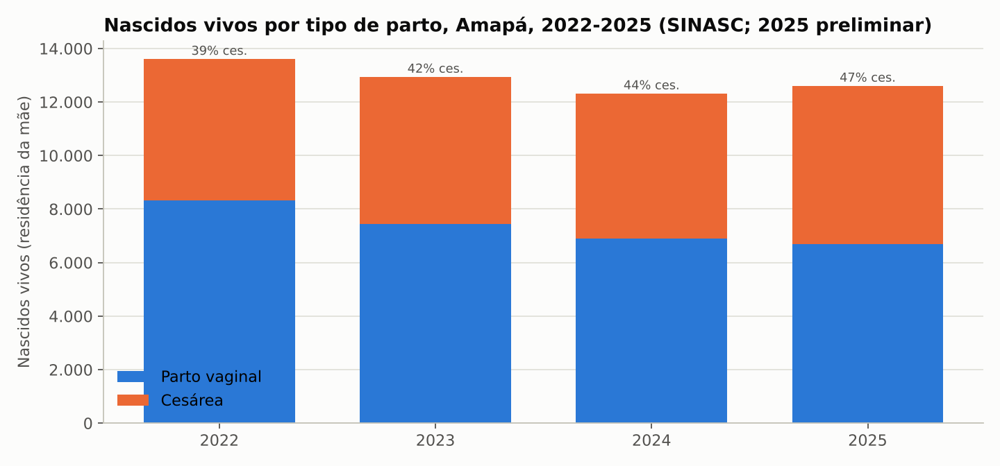

A mortalidade infantil é o indicador mais sensível e mais preocupante: 17,8 óbitos por mil nascidos vivos em 2024 (220 óbitos), 3ª maior taxa entre as UFs (Brasil: 12,6), depois do pico de 20,9 em 2023 (271 óbitos), e 17,3 em 2025 (218 óbitos, dado preliminar). Do total de 2024, 144 óbitos (65%) foram classificados como evitáveis, dos quais 63 reduzíveis por adequada atenção à mulher na gestação, 18 por atenção ao parto e 26 por atenção ao recém-nascido. O componente neonatal precoce (0 a 6 dias) concentra cerca de metade dos óbitos infantis.

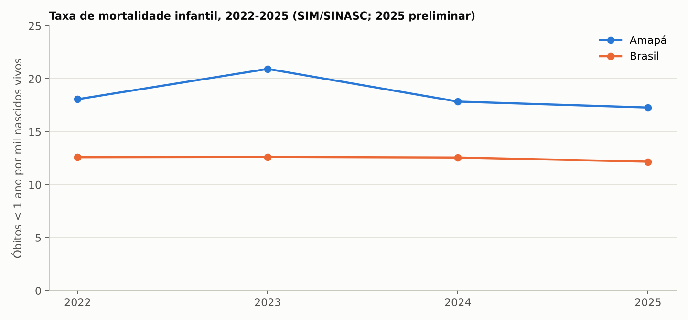

| Ano | Nascidos vivos | Óbitos < 1 ano | TMI (por mil) | % cesáreas | % 7+ consultas pré-natal | % mães 10–19 anos |
|---|---:|---:|---:|---:|---:|---:|
| 2022 | 13.615 | 246 | 18,1 | 38,8 | 49,6 | 18,6 |
| 2023 | 12.948 | 271 | 20,9 | 42,5 | 51,2 | 18,5 |
| 2024 | 12.327 | 220 | 17,8 | 43,9 | 55,5 | 17,5 |
| 2025* | 12.612 | 218 | 17,3 | 46,9 | 60,3 | 17,7 |

\* preliminar. Fonte: SINASC/SIM (aba `VITAL_00_Indicadores`).

## 2.3 Mortalidade geral e causas

Foram 3.846 óbitos de residentes em 2022, 3.926 em 2023, 3.903 em 2024 e 3.988 em 2025 (preliminar). O perfil de causas (2024) é o de um estado em transição epidemiológica acelerada: doenças do aparelho circulatório 944 (infarto 276, AVC 281), causas externas 701 (agressões 257, contra 385 em 2023; intervenções legais 106; acidentes de transporte 99), neoplasias 594, doenças respiratórias 468 (pneumonia 266), infecciosas 226 e diabetes 177. As causas mal definidas representam 5,4% dos óbitos (Brasil: 5,1%), aceitável, mas com margem de melhoria na investigação. Em 2025 os óbitos por doenças respiratórias (521) e circulatórias (953) seguem em alta.

# 3. Produção hospitalar (SIH/SUS)

## 3.1 Série histórica

| Ano | AIH aprovadas | Valor total (R$) | Valor médio AIH (R$) | Média perm. (dias) | Óbitos | Tx. mortalidade (%) |
|---|---:|---:|---:|---:|---:|---:|
| 2022 | 41.312 | 35.931.724 | 870 | 5,2 | 1.308 | 3,17 |
| 2023 | 56.851 | 47.548.618 | 836 | 4,4 | 1.529 | 2,69 |
| 2024 | 57.245 | 49.734.245 | 869 | 4,9 | 1.434 | 2,51 |
| 2025 | 57.873 | 54.508.025 | 942 | 4,7 | 1.443 | 2,49 |
| 2026 (jan–ago) | 44.065 | 54.393.607 | 1.234 | 4,8 | 1.184 | 2,69 |
| Var. 2022–2025 | +40,1% | +51,7% | +8,3% | — | +10,3% | — |

Fonte: SIH/SUS, AIH por ano de processamento, local de internação (aba `SIH_01_Ano`).

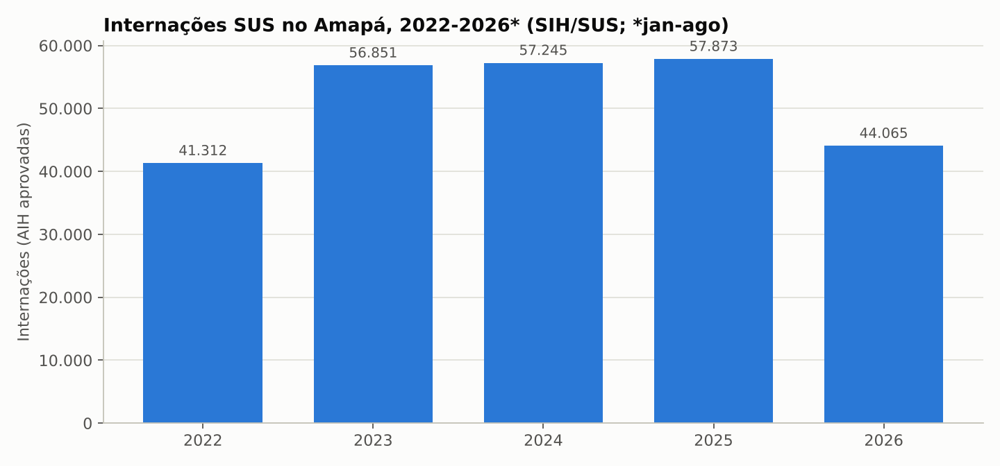

Três movimentos marcam a série: (i) o degrau de 2023, quando as internações sobem 38% em um ano (de 41,3 mil para 56,9 mil), explicado quase integralmente pelo HCAL (de 3.737 para 15.446 AIH) e por procedimentos eletivos (de 8.743 para 20.205), e não por urgências; (ii) a estabilidade de 2024–2025 em torno de 57 mil internações, com o valor crescendo pela mudança de perfil (mais cirurgias, mais FAEC); (iii) a aceleração do valor em 2026: nos oito primeiros meses o faturamento (R$ 54,4 milhões) já iguala o ano inteiro de 2025, com valor médio da AIH subindo para R$ 1.234, puxado pelo HCAL (R$ 17,5 milhões em oito meses, contra R$ 9,5 milhões em todo o 2025) e por FAEC (R$ 21,7 milhões em jan–ago/2026 contra R$ 13,0 milhões em 2025 e R$ 0,9 milhão em 2022), o que indica a entrada dos programas federais de cirurgias eletivas.

Os eletivos passaram de 21,2% das AIH em 2022 (8.743) para 32,8% em 2025 (18.982). As urgências somam 38.889 AIH (67,2%).

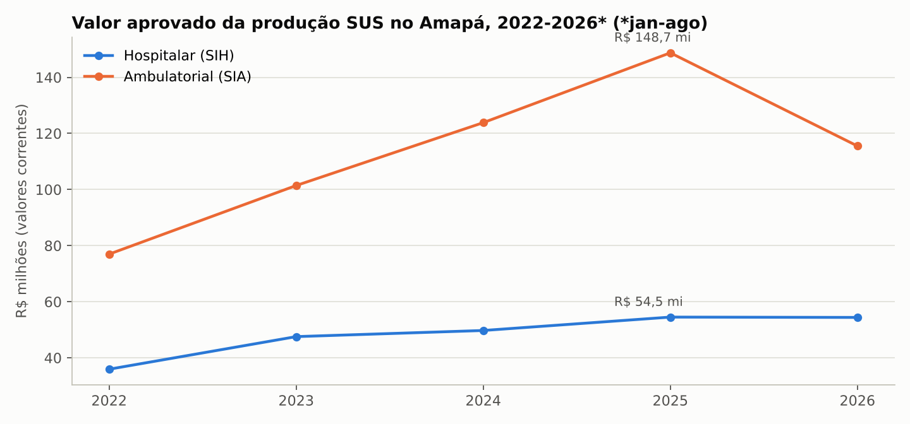

## 3.2 Produção por estabelecimento

| Estabelecimento | AIH 2022 | AIH 2025 | Var. 22–25 | Valor 2025 (R$) | Média perm. 2025 | Óbitos 2025 | Tx. mort. 2025 (%) | AIH jan–ago/2026 |
|---|---:|---:|---:|---:|---:|---:|---:|---:|
| Hospital de Clínicas Dr. Alberto Lima (HCAL) | 3.737 | 10.469 | +180% | 9.518.556 | 2,8 | 263 | 2,51 | 9.559 |
| Hospital da Mulher Mãe Luzia | 12.848 | 9.259 | −28% | 10.500.831 | 4,9 | 75 | 0,81 | 6.929 |
| Hospital de Emergência (HE) | 3.245 | 7.182 | +121% | 6.321.203 | 7,2 | 276 | 3,84 | 6.096 |
| Hospital Estadual de Santana | 4.872 | 5.889 | +21% | 2.999.034 | 5,4 | 195 | 3,31 | 4.203 |
| Hospital São Camilo e São Luís (filantrópico) | 4.967 | 4.411 | −11% | 11.899.992 | 3,4 | 40 | 0,91 | 2.532 |
| Hospital Estadual de Laranjal do Jari | 4.203 | 4.403 | +5% | 2.119.920 | 2,1 | 79 | 1,79 | 2.828 |
| Hospital Maria Lúcia G. da Silva (Porto Grande) | 293 | 2.876 | +882% | 1.504.336 | 1,8 | 4 | 0,14 | 1.834 |
| Hospital da Criança e do Adolescente (HCA) | 1.833 | 2.820 | +54% | 3.681.675 | 8,4 | 56 | 1,99 | 2.399 |
| Maternidade Zona Norte Dra. Euclélia Américo | 716 | 2.775 | +288% | 1.367.493 | 2,1 | 0 | 0,00 | 2.038 |
| HU-UNIFAP (Ebserh) | 23 | 2.371 | — | 2.102.931 | 8,3 | 115 | 4,85 | 1.909 |
| Hospital Estadual de Oiapoque | 1.711 | 1.737 | +2% | 735.197 | 3,0 | 21 | 1,21 | 1.180 |
| Unidade Estadual de Internação (desde 2025) | — | 1.666 | — | 955.949 | 10,5 | 241 | 14,47 | 1.524 |
| Hospital Vila Amazonas (Santana) | 15 | 690 | — | 287.764 | 6,8 | 12 | 1,74 | 28 |
| Unidades mistas e UPAs (9 unidades em 2022, 8 em 2025) | 2.659 | 1.117 | −58% | 408.671 | — | 7 | — | 635 |
| Hospital Marco Zero (desde 2025) | — | 208 | — | 104.472 | 8,4 | 59 | 28,37 | 371 |
| Hospitais de campanha COVID (encerrados) | 190 | — | — | — | — | — | — | — |
| **Total** | **41.312** | **57.873** | **+40%** | **54.508.025** | **4,7** | **1.443** | **2,49** | **44.065** |

Fonte: SIH/SUS (abas `SIH_estab_2025`, `SIH_estab_2026`, `SIH_estab_ano_aih`, `SIH_estab_ano_valor`).

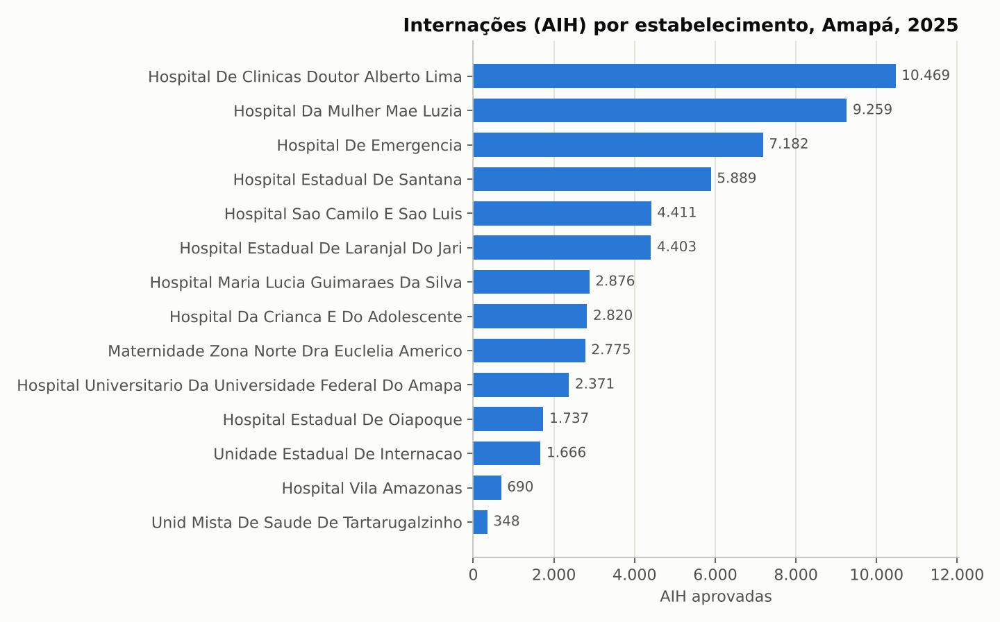

Leituras relevantes para a transição:

- **HCAL** virou o maior produtor de AIH do estado (10.469 em 2025; 9.559 em jan–ago/2026) com 100% de internações eletivas e permanência de 2,8 dias; 7.624 das suas AIH de 2025 são do capítulo de doenças circulatórias (ver seção 8.1). É também o hospital com maior crescimento de faturamento em 2026 (anualizado em R$ 26 milhões, contra R$ 4,4 milhões em 2022).
- **HE** mais que dobrou as internações desde 2022 e tem a maior permanência média entre os grandes (7,2 dias) e 276 óbitos/ano; é o principal nó da rede de urgência, com o novo HE em obras (anexo de 30 leitos entregue em junho/2026).
- **Mãe Luzia** perdeu 28% das internações desde 2022 (consolidação da Maternidade Zona Norte, que quase quadruplicou, e queda dos nascimentos), mas ainda é o maior faturamento público (R$ 10,5 milhões), com 1.327 internações de afecções perinatais.
- **São Camilo** concentra alta complexidade (992 das 1.341 AIH de alta complexidade do estado, 74%) e tem valor médio de R$ 2.698 por AIH, quase o triplo da média estadual: é o prestador que mais pesa por internação. A relação contratual sofreu ruptura em 2025 (notificação de rescisão unilateral, suspensa por decisão judicial), as AIH caíram 11% desde 2022 e em jan–ago/2026 somam apenas 2.532 (ritmo anual de 3,8 mil).
- **HU-UNIFAP** passou de produção residual em 2022 para 2.371 AIH em 2025, com perfil clínico-cirúrgico de maior permanência (8,3 dias) e mortalidade (4,85%).
- **Unidade Estadual de Internação** (criada em 2025) e **Hospital Marco Zero** apresentam mortalidade de 14,5% e 28,4%, compatíveis com perfis de cuidados prolongados/paliativos ou de retaguarda clínica de pacientes graves. Vale revisar o perfil assistencial, a habilitação e o registro.
- **UPAs e unidades mistas** reduziram as internações registradas de 2.657 (2022) para 1.117 (2025): a UPA Zona Sul deixou de registrar AIH (1.463 em 2022, 1.682 em 2023, 35 em 2025, zero em 2026) e as unidades mistas do interior internam pouco (61 a 348 AIH/ano cada), o que mostra uma rede do interior de baixa resolutividade e que drena pacientes para Macapá: 71,2% das internações e 87,8% do valor ambulatorial do estado ocorrem na capital.

## 3.3 Perfil de morbidade

| Capítulo CID-10 | Intern. 2022 | Intern. 2025 | Valor 2025 (R$) | Média perm. 2025 | Óbitos 2025 | Tx. mort. 2025 (%) |
|---|---:|---:|---:|---:|---:|---:|
| XV. Gravidez, parto e puerpério | 16.643 | 15.591 | 8.233.813 | 2,9 | 6 | 0,04 |
| IX. Aparelho circulatório | 1.899 | 11.024 | 15.514.668 | 2,3 | 279 | 2,53 |
| X. Aparelho respiratório | 4.775 | 5.576 | 5.779.172 | 7,9 | 343 | 6,15 |
| XI. Aparelho digestivo | 3.725 | 5.356 | 4.364.505 | 4,8 | 133 | 2,48 |
| XIX. Lesões e causas externas | 2.442 | 4.503 | 3.402.927 | 5,2 | 59 | 1,31 |
| XIV. Aparelho geniturinário | 2.279 | 3.635 | 2.176.373 | 5,9 | 79 | 2,17 |
| I. Infecciosas e parasitárias | 2.644 | 3.184 | 2.836.877 | 7,3 | 203 | 6,38 |
| XVI. Afecções perinatais | 2.395 | 1.980 | 6.159.656 | 8,7 | 70 | 3,54 |
| II. Neoplasias | 1.422 | 1.823 | 1.809.399 | 6,0 | 130 | 7,13 |
| XII. Pele e subcutâneo | 811 | 1.294 | 519.561 | 5,8 | 14 | 1,08 |
| Demais | 2.277 | 3.907 | 3.711.074 | — | 127 | — |
| **Total** | **41.312** | **57.873** | **54.508.025** | **4,7** | **1.443** | **2,49** |

Fonte: SIH/SUS, morbidade hospitalar (abas `MORB_cap_ano`, `MORB_cap_2025`).

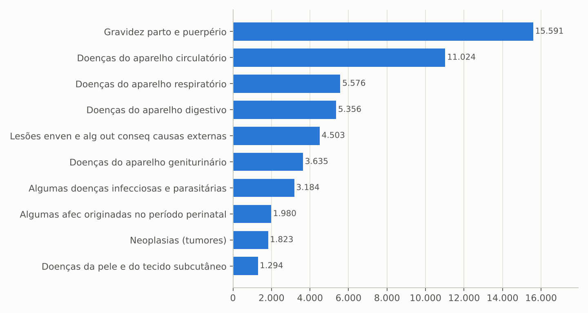

A obstetrícia responde por 27% das internações (parto normal 6.835; cesariana 5.374), o que explica a baixa mortalidade hospitalar agregada do Amapá (2,49%, a menor do país; Brasil 4,34%). Descontado o capítulo XV, a taxa sobe para 3,4%. As doenças respiratórias têm a maior carga de óbitos (343; 232 só em pneumonia/influenza) e permanência longa (7,9 dias); em jan–ago/2026 já são 4.319 internações e 296 óbitos, ritmo acima de 2025, coerente com o decreto estadual de emergência por síndromes respiratórias de junho de 2026. As internações de menores de 1 ano (3.725) e de 1 a 4 anos (2.429) somam 10,6% do total, com forte predomínio respiratório (1.040 e 1.282 AIH, respectivamente): a pediatria é o gargalo sazonal da rede (HCA com 192 leitos após ampliação em 2026). As internações por causas externas quase dobraram (2.442 para 4.503) e as do aparelho digestivo cresceram 44%, refletindo a expansão de cirurgia geral (colecistectomia, hernioplastia, apendicectomia).

## 3.4 Fluxo de pacientes: residência versus local de internação

| Ano | AIH de residentes do AP (qualquer UF) | AIH realizadas no AP | Saldo (AIH) | Valor residentes (R$) | Valor realizado no AP (R$) | Saldo (R$) |
|---|---:|---:|---:|---:|---:|---:|
| 2022 | 39.793 | 41.312 | +1.519 | 36.457.453 | 35.931.724 | −525.729 |
| 2023 | 55.036 | 56.851 | +1.815 | 49.556.840 | 47.548.618 | −2.008.222 |
| 2024 | 55.111 | 57.245 | +2.134 | 51.450.674 | 49.734.245 | −1.716.429 |
| 2025 | 55.555 | 57.873 | +2.318 | 56.067.200 | 54.508.025 | −1.559.176 |

Fonte: SIH/SUS por UF de residência e por UF de internação (aba `SIH_Residencia_x_Local`).

O Amapá recebe mais internações do que seus residentes consomem (saldo de +2.318 AIH em 2025, essencialmente pacientes paraenses do Marajó e do baixo Amazonas atendidos em Macapá e Santana), mas o saldo financeiro é negativo em R$ 1,6 milhão: as internações de amapaenses fora do estado são de alta complexidade e custo (cardiologia intervencionista, neurocirurgia, oncologia cirúrgica, transplantes). Esse fluxo, somado ao TFD (R$ 10,0 milhões/ano em passagens aéreas e ajuda de custo, seção 4.3), é a medida objetiva do vazio assistencial de alta complexidade. A gestão estadual plena concentra 100% das AIH desde 2024 (o Pacto de Gestão municipal de Porto Grande deixou de registrar AIH).

## 3.5 Comparativo entre UFs

| Indicador (2025) | Amapá | Brasil | Posição do AP (27 UFs) |
|---|---:|---:|---:|
| Internações SUS por 100 hab. | 7,18 | 6,86 | 10º |
| Valor SIH por habitante (R$) | 67,6 | 120,8 | 26º |
| Valor médio da AIH (R$) | 942 | 1.760 | 27º (menor) |
| Média de permanência (dias) | 4,7 | 5,0 | — |
| Taxa de mortalidade hospitalar (%) | 2,49 | 4,34 | 27º (menor) |
| % AIH de alta complexidade | 2,3 | — | — |
| Valor SIA por habitante, 2024 (R$) | 154 | 149 | 7º |

Fonte: SIH/SIA por UF e IBGE (aba `BENCH_UF`).

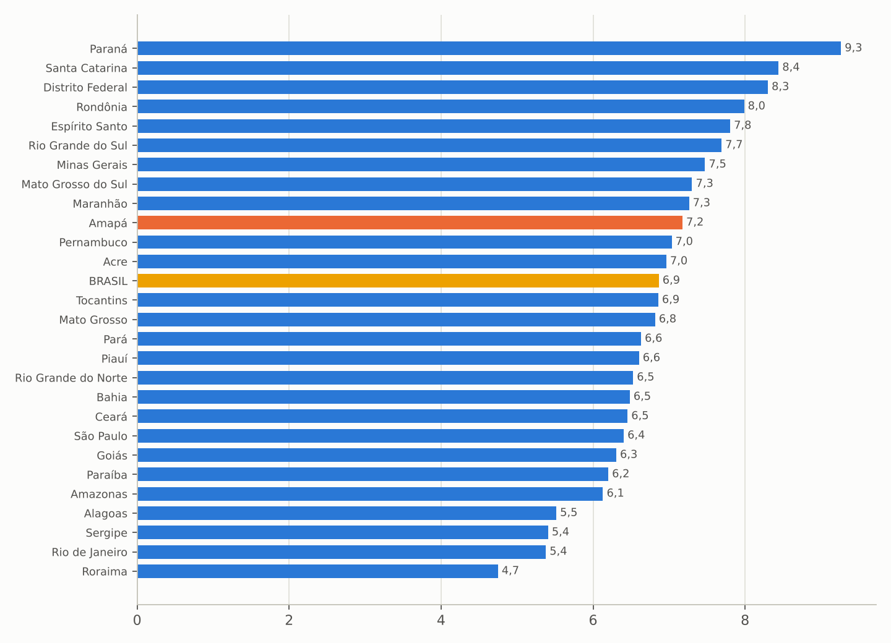

A combinação "muitas internações, valor médio mínimo, pouca alta complexidade" é a assinatura de uma rede que resolve o básico e o obstétrico, mas depende de Belém, Brasília e São Paulo para o restante. Entre os estados da Região Norte, o Amapá tem valor médio de AIH abaixo de Acre (R$ 1.038), Rondônia (R$ 1.152), Amazonas (R$ 1.215), Pará (R$ 1.279), Tocantins (R$ 1.291) e Roraima (R$ 1.311).

# 4. Produção ambulatorial (SIA/SUS)

## 4.1 Série histórica

| Ano | Procedimentos aprovados | Valor aprovado (R$) | Valor apresentado (R$) |
|---|---:|---:|---:|
| 2022 | 7.490.015 | 76.958.762 | 85.238.415 |
| 2023 | 10.178.221 | 101.419.804 | 101.758.460 |
| 2024 | 13.424.826 | 123.836.722 | 124.370.832 |
| 2025 | 16.460.498 | 148.724.442 | 148.994.309 |
| 2026 (jan–ago) | 10.959.853 | 115.512.295 | 114.289.628 |
| Var. 2022–2025 | +119,8% | +93,3% | +74,8% |

Fonte: SIA/SUS por ano de processamento, local de atendimento (aba `SIA_01_Ano`).

O valor ambulatorial quase dobrou entre 2022 e 2025 e a quantidade mais que dobrou, com crescimento em todos os anos da série. A gestão estadual plena responde por R$ 120,9 milhões (81%) em 2025, contra R$ 68,5 milhões em 2022, e o Pacto de Gestão municipal (Macapá, Santana e demais) por R$ 27,9 milhões (R$ 8,4 milhões em 2022). Por fonte: MAC R$ 102,5 milhões, FAEC R$ 43,5 milhões (R$ 18,2 milhões em 2022) e assistência farmacêutica (componente especializado) R$ 2,7 milhões. Por instrumento de registro: BPA-C R$ 53,8 milhões, BPA-I R$ 64,2 milhões e APAC R$ 30,7 milhões.

## 4.2 Composição por subgrupo e procedimento

| Subgrupo | Valor 2022 (R$) | Valor 2025 (R$) | Var. 22–25 | % do valor 2025 | Quantidade 2025 |
|---|---:|---:|---:|---:|---:|
| 0301 Consultas / atendimentos / acompanhamentos | 15.989.257 | 31.867.081 | +99% | 21,4 | 8.510.597 |
| 0309 Terapias especializadas (angiologia) | 15.280 | 25.557.699 | ×1.673 | 17,2 | 113.164 |
| 0202 Diagnóstico em laboratório clínico | 8.059.051 | 15.849.791 | +97% | 10,7 | 3.928.199 |
| 0305 Tratamento em nefrologia | 10.376.160 | 13.371.816 | +29% | 9,0 | 54.700 |
| 0803 Autorização / regulação (TFD: deslocamento e ajuda de custo) | 9.313.297 | 10.038.443 | +8% | 6,7 | 109.715 |
| 0206 Diagnóstico por tomografia | 1.932.923 | 10.013.538 | +418% | 6,7 | 86.329 |
| 0211 Métodos diagnósticos em especialidades | 6.917.096 | 6.674.788 | −4% | 4,5 | 356.147 |
| 0304 Tratamento em oncologia | 1.832.317 | 5.007.235 | +173% | 3,4 | 5.349 |
| 0401 Pequenas cirurgias / pele | 111.225 | 4.955.318 | ×45 | 3,3 | 163.283 |
| 0405 Cirurgia do aparelho da visão | 11.104.027 | 4.881.070 | −56% | 3,3 | 12.378 |
| 0207 Ressonância magnética | 2.122.319 | 3.161.223 | +49% | 2,1 | 11.762 |
| 0604 Componente especializado da assistência farmacêutica | 933.729 | 2.652.940 | +184% | 1,8 | 1.352.259 |
| 0205 Ultrassonografia | 682.829 | 2.609.081 | +282% | 1,8 | 72.622 |
| 0204 Radiologia | 1.902.507 | 2.594.329 | +36% | 1,7 | 264.638 |
| 0212 Hemoterapia (diagnóstico) | 2.074.748 | 2.340.940 | +13% | 1,6 | 104.342 |
| Demais | 3.591.997 | 7.149.150 | +99% | 4,8 | 1.315.014 |
| **Total** | **76.958.762** | **148.724.442** | **+93%** | **100** | **16.460.498** |

Fonte: SIA/SUS (abas `SIA_subgrupo_ano_valor`, `SIA_subgrupo_2025`).

Os dez procedimentos de maior valor em 2025 mostram onde está o dinheiro ambulatorial: tratamento esclerosante de varizes (84.885 procedimentos, R$ 25,5 milhões), hemodiálise (51.777 sessões, R$ 12,5 milhões), atendimento de urgência em atenção especializada (885.863, R$ 9,7 milhões), consulta de nível superior não médico (1.477.497, R$ 9,3 milhões), curativo grau II (148.471, R$ 4,8 milhões), deslocamento aéreo de paciente e de acompanhante no TFD (R$ 4,5 e R$ 4,0 milhões), facoemulsificação com lente intraocular (5.081, R$ 3,9 milhões), observação de urgência até 24 h (308.514, R$ 3,8 milhões) e consulta médica especializada (335.097, R$ 3,3 milhões).

Por CBO do executante, "médico em cirurgia vascular" lidera com R$ 29,9 milhões (20,1% de todo o SIA), seguido por médico clínico (R$ 27,3 milhões), radiologista (R$ 16,9 milhões), biomédico (R$ 16,5 milhões), nefrologista (R$ 13,6 milhões) e oftalmologista (R$ 12,1 milhões).

## 4.3 Linhas de cuidado de alto custo

- **Nefrologia.** R$ 13,4 milhões e cerca de 54 mil sessões de hemodiálise em 2025 (51.777 convencionais e 2.247 em sorologia positiva), o equivalente a aproximadamente 350 pacientes em programa regular. A linha cresceu 29% desde 2022 (R$ 10,4 milhões), com 115 a 132 equipamentos de diálise cadastrados no CNES a partir de 2025.
- **Oncologia.** R$ 5,0 milhões em quimioterapia (SIA) em 2025, contra R$ 1,8 milhão em 2022 (+173%), mais R$ 0,3 milhão em internações clínicas oncológicas (493 AIH com 24% de mortalidade) e cirurgia oncológica (77 AIH). O Centro de Radioterapia do Amapá iniciou em dezembro de 2025 e, até agosto de 2026, registrava 305 primeiras consultas e 235 simulações, com braquiterapia a partir de junho de 2026; sua produção ainda aparece pouco no SIA (subgrupo "atenção em oncologia", R$ 309 mil em jan–ago/2026) e deve ser acompanhada.
- **Oftalmologia.** R$ 11,1 milhões em 2022 (mutirões de catarata), queda para R$ 1,8 milhão em 2024, retomada para R$ 4,9 milhões em 2025 mais R$ 1,2 milhão nas novas "ofertas de cuidado integrado" (OCI) oftalmológicas, e R$ 6,6 milhões mais R$ 4,0 milhões de OCI em jan–ago/2026, indicando nova rodada de mutirão em 2026 (programa "Zera Fila").
- **Tratamento Fora de Domicílio.** R$ 10,0 milhões em 2025 em deslocamento aéreo de paciente (R$ 4,5 milhões) e acompanhante (R$ 4,0 milhões) e ajudas de custo (R$ 1,4 milhão), contra R$ 9,3 milhões em 2022. O TFD é, junto com o saldo negativo de internações fora do estado, o custo visível da ausência de alta complexidade.
- **Imagem.** Tomografia R$ 10,0 milhões (86 mil exames), cinco vezes o valor de 2022, e ressonância R$ 3,2 milhões (11,8 mil exames); o estado possui 27 tomógrafos e 15 ressonâncias em uso, mas apenas 4 tomógrafos e 1 ressonância na esfera estadual (seção 5.3), o que explica a dependência de prestadores privados contratados.

## 4.4 Distribuição territorial

Macapá concentra 87,8% do valor ambulatorial (R$ 130,5 milhões em 2025, contra R$ 66,4 milhões em 2022) e Santana 5,3% (R$ 7,8 milhões). A Região de Saúde Norte (Oiapoque, Calçoene, Amapá, Pracuúba, Tartarugalzinho) produz apenas R$ 2,9 milhões (1,9%) e a Sudoeste R$ 11,7 milhões (7,9%). Porto Grande saltou de R$ 250 mil (2024) para R$ 2,7 milhões (2025), e o Hospital Maria Lúcia Guimarães da Silva passou de 85 para 2.876 AIH no mesmo período, indicando a implantação de um polo regional; vale verificar se o salto é produção real ou mudança de registro.

# 5. Rede física e equipamentos (CNES)

## 5.1 Estabelecimentos

Em setembro de 2026 o CNES registra 1.196 estabelecimentos no Amapá (867 em dezembro de 2022): 20 hospitais gerais (15 da administração estadual, 1 empresa pública federal — HU-UNIFAP/Ebserh —, 3 empresariais e 1 filantrópico), 3 hospitais especializados (todos estaduais), 5 pronto-atendimentos (3 estaduais), 153 centros de saúde/UBS e 65 postos de saúde (municipais), 34 policlínicas, 156 clínicas de especialidade, 84 SADT isolados, 12 CAPS (2 estaduais), 1 hemocentro, 2 centrais de regulação do acesso estaduais, 20 unidades de saúde indígena (federais) e 432 consultórios isolados privados. Sob gestão estadual estão 68 estabelecimentos; os demais 1.128 estão sob gestão municipal. O crescimento do cadastro entre 2022 e 2026 vem sobretudo de consultórios isolados (306 para 432), clínicas de especialidade (93 para 156), policlínicas (11 para 34) e farmácias (21 para 81).

## 5.2 Leitos

| Especialidade | Leitos SUS dez/2022 | dez/2023 | dez/2024 | dez/2025 | set/2026 | Existentes set/2026 |
|---|---:|---:|---:|---:|---:|---:|
| Clínicos | 598 | 561 | 688 | 590 | 642 | 748 |
| Cirúrgicos | 227 | 254 | 294 | 300 | 310 | 350 |
| Obstétricos | 230 | 224 | 217 | 248 | 240 | 249 |
| Pediátricos | 194 | 218 | 252 | 217 | 237 | 276 |
| Outras especialidades (psiquiatria, crônicos) | 31 | 32 | 34 | 32 | 40 | 40 |
| **Total** | **1.280** | **1.289** | **1.485** | **1.387** | **1.469** | **1.663** |

Fonte: CNES (abas `CNES_leitos_esp_ano`, `CNES_leitos_esp_ano_sus`).

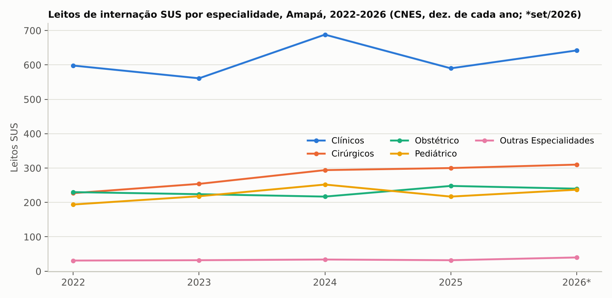

Os leitos SUS cresceram 14,8% entre dezembro de 2022 e setembro de 2026 (1,81 leitos SUS por mil habitantes), com expansão concentrada em leitos cirúrgicos (+37%) e pediátricos (+22%), oscilação dos clínicos (pico de 688 em 2024, queda em 2025, recuperação em 2026) e estabilidade dos obstétricos. A capital tem 1.013 leitos SUS (69%), Santana 194 (13%), Laranjal do Jari 74, Oiapoque 51 e os demais municípios entre 10 e 21 cada. Pela esfera jurídica, 1.163 leitos SUS estão em unidades da administração estadual, 90 no HU, 161 em prestadores empresariais e 55 no filantrópico (que tem 207 leitos existentes, apenas 55 SUS).

| Leitos complementares | Existentes dez/2022 | Existentes set/2026 | SUS set/2026 |
|---|---:|---:|---:|
| UTI adulto (tipos I, II e III) | 68 | 139 | 19 |
| UTI pediátrica (tipo II) | 20 | 31 | 20 |
| UTI neonatal (tipo II) | 50 | 53 | 40 |
| UCI neonatal convencional / canguru | 45 / 15 | 49 / 18 | 44 / 13 |
| Unidade de isolamento | 19 | 26 | 25 |
| UCI adulto | 8 | 6 | 5 |
| **Total** | **231** | **322** | **166** |

Fonte: CNES (abas `CNES_uti_tipo_ano`, `CNES_uti_tipo_ano_sus`). Em dez/2022 ainda havia 6 leitos de unidade intermediária neonatal, extintos depois.

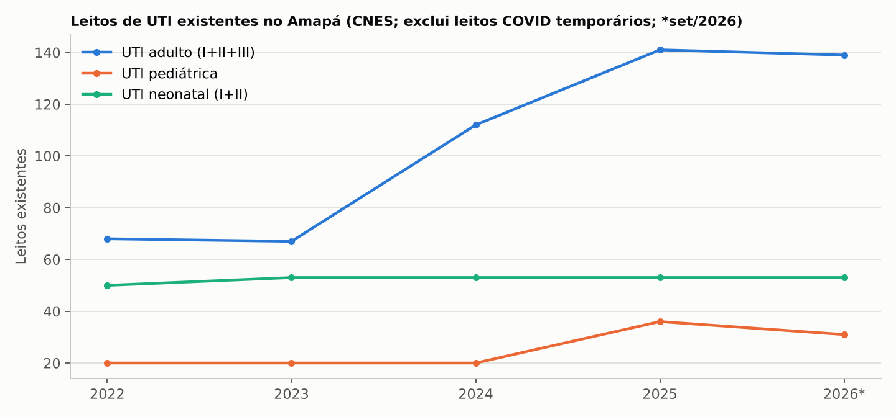

As UTIs adulto dobraram (68 leitos em dez/2022 para 139 em set/2026, com salto em 2024–2025), e as pediátricas passaram de 20 para 31. Porém o CNES mostra apenas 19 leitos de UTI adulto cadastrados como SUS (53 existentes em hospitais estaduais, 10 no HU, 50 em empresariais e 20 no filantrópico). Essa divergência, de 120 leitos, tende a ser um problema de cadastro (campo "leitos SUS" não preenchido) ou de habilitação: em ambos os casos compromete o custeio federal de UTI (diárias habilitadas), a regulação e a transparência. Em leitos complementares SUS por 100 mil habitantes o Amapá (20,5) iguala a média nacional (20,7), mas a composição interna está distorcida pela subnotificação da UTI adulto; a recomendação é um censo de leitos e conciliação CNES x habilitações nos primeiros 60 dias.

## 5.3 Equipamentos

| Equipamento (set/2026) | Existentes | Em uso | Estabelecimentos com equipamento SUS | Em uso na esfera estadual |
|---|---:|---:|---:|---:|
| Tomógrafo computadorizado | 27 | 27 | 17 | 4 |
| Ressonância magnética | 15 | 15 | 11 | 1 |
| Mamógrafo | 27 | 26 | 11 | 1 |
| Raio X | 293 | 283 | 93 | 28 |
| Ultrassom | 250 | 244 | 85 | 25 |
| Equipo odontológico completo | 580 | 561 | 161 | 21 |

Fonte: CNES (abas `CNES_equip_sel_latest`, `CNES_equip_sel_esfjur_latest`).

O parque de imagem de alta densidade está majoritariamente no setor privado (18 dos 27 tomógrafos, 11 das 15 ressonâncias, 15 dos 26 mamógrafos), o que torna o Estado comprador de exames e sustenta os R$ 13,2 milhões anuais de tomografia e ressonância no SIA. O total de equipamentos em uso cadastrados subiu de 6.226 (dez/2022) para 10.382 (set/2026), com destaque para equipamentos de manutenção da vida (1.323 para 2.650) e o novo grupo de diálise (132).

# 6. Força de trabalho

| Profissionais (indivíduos, CNES) | dez/2022 | dez/2023 | dez/2024 | dez/2025 | set/2026 | Var. 22–26 |
|---|---:|---:|---:|---:|---:|---:|
| Médicos | 1.065 | 1.193 | 1.363 | 1.519 | 1.636 | +54% |
| Enfermeiros | 1.380 | 1.685 | 1.811 | 1.871 | 2.223 | +61% |
| Fisioterapeutas | 521 | 549 | 579 | 638 | 731 | +40% |
| Farmacêuticos | 231 | 269 | 300 | 322 | 350 | +52% |
| Cirurgiões-dentistas (total) | 563 | 574 | 595 | 639 | 692 | +23% |
| Nível superior (total) | 5.126 | 5.836 | 6.487 | 7.186 | 8.019 | +56% |
| Técnicos de enfermagem (set/2026) | — | — | — | — | 5.091 | — |
| Todas as ocupações | 15.622 | 17.732 | 18.931 | 20.431 | 22.155 | +42% |

Fonte: CNES (abas `CNES_prof_medicos_ano`, `CNES_prof_sup_ano`, `CNES_prof_geral_ano`, `CNES_prof_tec_latest`).

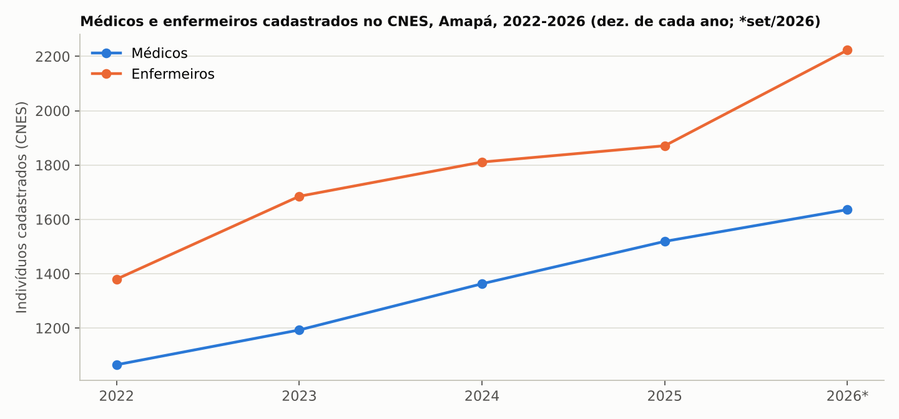

O número de médicos cresceu 54% desde 2022, mas a densidade (2,02 por mil habitantes) segue abaixo da média nacional (2,91) e é a 22ª entre as UFs; 1.332 médicos (81%) atuam em Macapá, 82 em Santana, 60 em Laranjal do Jari, 39 em Porto Grande, 37 em Oiapoque e entre 3 e 15 nos demais municípios. Entre as especialidades, destacam-se 560 clínicos, 205 médicos de família, 114 pediatras, 71 obstetras, 53 radiologistas, 51 cirurgiões gerais, 45 cardiologistas, 44 anestesistas, 22 cirurgiões vasculares e 13 psiquiatras. Dos 8.019 profissionais de nível superior, 3.560 (44%) estão vinculados à administração estadual, 2.812 à municipal, 279 ao HU e cerca de 1.300 ao setor privado/filantrópico.

**Concurso público SESA 001/2026.** Publicado em 11/9/2026 (Instituto AOCP), com 4.210 vagas de cadastro de reserva para o Grupo Saúde sob regime estatutário (Lei 0066/1993, PCCS Lei 1.059/2006 reestruturado pelas Leis 3.512/2026 e 3.527/2026), distribuídas por Região de Saúde: Central 2.552, Norte 637 e Sudoeste 1.021, com lotação mínima de três anos no município. Os maiores quantitativos são técnico em enfermagem (904 só na Região Central) e enfermeiro (786), além de cerca de 150 vagas médicas em 46 especialidades na Região Central. Vencimentos básicos: R$ 11.116,42 (médicos), R$ 5.520,64 (demais nível superior) e R$ 3.363,43 (nível médio/técnico). Inscrições encerradas em 13/10/2026; prova objetiva em 20/12/2026. A nova gestão herdará a homologação, o dimensionamento de nomeações (o edital é só cadastro de reserva) e a estratégia de substituição de contratos temporários, com impacto direto no indicador de despesa com pessoal (44,3% em 2025).

# 7. Financiamento

## 7.1 SIOPS: indicadores do Estado

| Indicador SIOPS (Estado do Amapá) | 2022 | 2023 | 2024 | 2025 | 2026 (4º bim.) |
|---|---:|---:|---:|---:|---:|
| 3.2 % da receita própria aplicada em ASPS (mín. 12%) | 15,39 | 19,38 | 17,58 | 16,80 | 15,34 |
| 2.1 Despesa com saúde por habitante (R$) | 1.566 | 2.034 | 2.666 | 2.889 | 1.940 |
| 2.2 % pessoal na despesa com saúde | 49,8 | 55,3 | 47,8 | 44,3 | 44,3 |
| 2.4 % serviços de terceiros, pessoa jurídica | 27,1 | 24,4 | 25,1 | 20,9 | 22,6 |
| 2.5 % investimentos | 4,1 | 3,0 | 8,5 | 4,8 | 2,0 |
| 2.3 % medicamentos | 0,2 | 0,0 | 0,0 | 0,0 | 0,0 |
| 3.1 % transferências na despesa com saúde | 15,5 | 22,9 | 26,0 | 36,0 | 41,8 |
| 1.3 % transferências SUS no total transferido ao Estado | 3,7 | 6,6 | 7,8 | 11,1 | 11,1 |

Fonte: SIOPS/MS, despesa empenhada (abas `SIOPS_AP_Serie`, `SIOPS_UF_2024`, `SIOPS_UF_2025`).

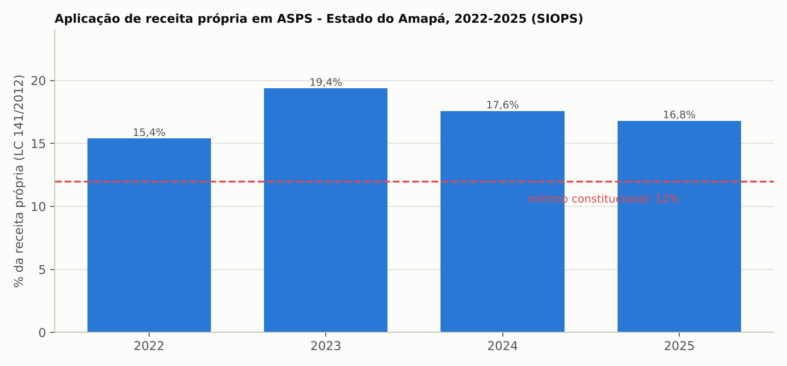

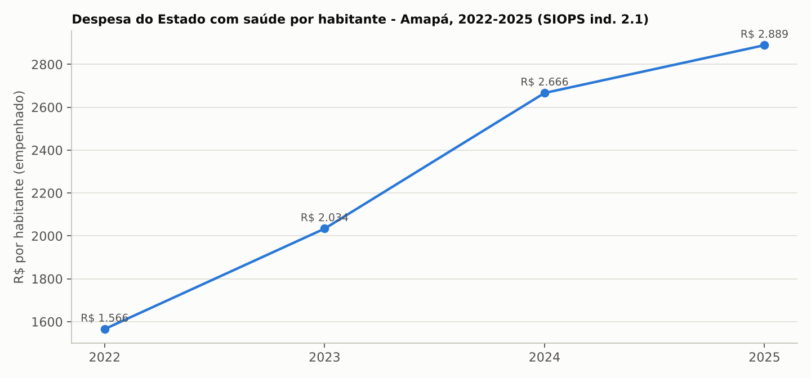

Quatro pontos: (i) o Estado cumpre o mínimo constitucional com folga em toda a série e está entre os cinco que mais aplicam receita própria (3º em 2024, 5º em 2025; a mediana das UFs é 15,4%); (ii) a despesa por habitante cresceu 84,5% em três anos e é a maior do país em 2024 e 2025 (a segunda, Acre, gasta R$ 2.760; a mediana é R$ 1.009), o que combina pequena população, custo amazônico e rede estadualizada (o Estado gere todos os hospitais, enquanto em outras UFs há forte presença municipal e filantrópica); (iii) a queda da participação de pessoal de 49,8% para 44,3%, simultânea ao salto das transferências federais na despesa (de 15,5% para 36% em 2025 e 41,8% em 2026) e à alta do peso do SUS no total transferido ao Estado (de 3,7% para 11,1%), mostra que o crescimento recente do gasto foi financiado sobretudo por recursos federais (emendas, FAEC, programas de eletivas e de UTI) e por contratos de serviços, e não por expansão do quadro próprio; (iv) o indicador de medicamentos zerado desde 2023 é incompatível com a operação de uma rede hospitalar e indica classificação contábil inadequada da despesa com medicamentos (possivelmente dentro de "material de consumo" ou de contratos), ponto a corrigir na prestação de contas.

## 7.2 Orçamento estadual e recursos federais

- **LOA 2026:** R$ 12,425 bilhões para o Estado; Fundo Estadual de Saúde com R$ 1,72 bilhão (13,8% da LOA). **PLOA 2027** (em tramitação na Alap): R$ 13,47 bilhões, com FES em R$ 1,98 bilhão (+15,3%). Valores de fonte secundária (Alap e imprensa), a confirmar na lei publicada.
- **Produção remunerada pelo SUS (MAC/FAEC):** o valor aprovado da produção hospitalar e ambulatorial somou R$ 203,2 milhões em 2025 (R$ 54,5 milhões SIH e R$ 148,7 milhões SIA), contra R$ 112,9 milhões em 2022 (+80%). O FAEC passou de R$ 19,2 milhões (2022) para R$ 56,5 milhões (2025: R$ 13,0 milhões SIH e R$ 43,5 milhões SIA) e já soma R$ 65,4 milhões em jan–ago/2026. Como o teto MAC é transferido fundo a fundo independentemente da produção, esse valor é uma referência do "faturamento" e não do repasse; a diferença entre teto e produção deve ser obtida na SESA/FNS.
- **Lacuna de informação:** os repasses do FNS por bloco (manutenção e estruturação) e por esfera, os restos a pagar, as despesas por unidade hospitalar e os contratos de gestão e de prestação de serviços não estão em bases públicas acessíveis e devem compor a lista de documentos da transição (seção 9).

# 8. Pontos de atenção para a transição

## 8.1 Procedimentos vasculares: crescimento atípico de faturamento (prioridade máxima)

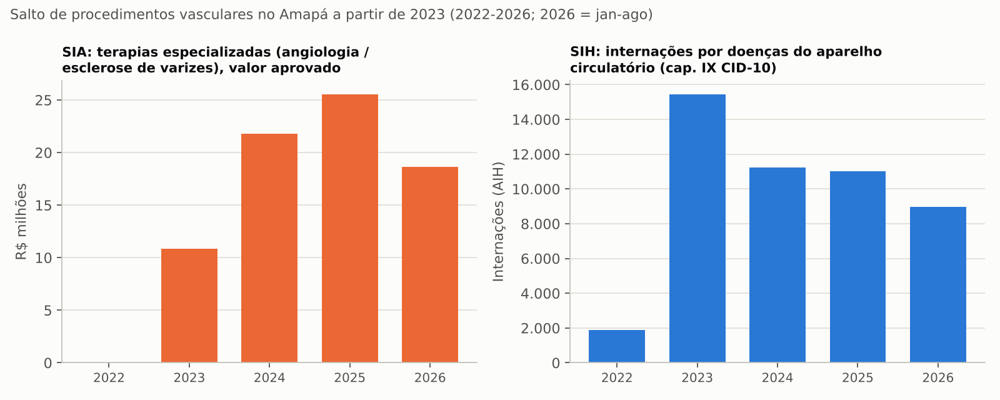

Resumo da evidência: (a) SIA, subgrupo 0309 "terapias especializadas": R$ 15 mil (2022), R$ 10,9 milhões (2023), R$ 21,8 milhões (2024), R$ 25,6 milhões (2025), R$ 18,6 milhões (jan–ago/2026), quase integralmente no procedimento 03.09.07.001-5 (esclerose não estética de varizes, 84.885 registros em 2025); (b) SIH, capítulo IX: 1.899 internações (2022) para 15.455 (2023), 11.226 (2024), 11.024 (2025) e 8.973 (jan–ago/2026), das quais 7.624 no HCAL em 2025 e 7.375 AIH de "trombectomia do sistema venoso" com permanência média 0,0 dia; (c) CBO cirurgia vascular com R$ 29,9 milhões (20,1% do SIA) executados por 22 cirurgiões vasculares cadastrados; (d) o HCAL, com 100% de internações eletivas, tornou-se o maior produtor de AIH do estado e dobrou o faturamento em 2026. Cada um desses elementos pode ter explicação assistencial (programa estadual de varizes com demanda represada), mas a magnitude (R$ 39 milhões em 2025 somando SIA e SIH, mais do que toda a produção hospitalar de 2022) e as características de registro (AIH de permanência zero, volumes diários implausíveis para 22 profissionais) justificam auditoria técnica e operativa imediata, com verificação de prontuários, agendas, listas de regulação, contratos e vínculos dos executantes, e comunicação ao DENASUS e ao TCE-AP. Enquanto a auditoria não concluir, recomenda-se não usar esse faturamento como base para contratualização ou metas.

## 8.2 Cadastro de leitos e habilitações

A diferença entre leitos existentes e leitos SUS em UTI (139 contra 19 em adulto) e a presença de 207 leitos existentes com apenas 55 SUS no prestador filantrópico exigem conciliação entre CNES, portarias de habilitação e contratos. Leitos de UTI habilitados geram custeio federal por diária; leitos não habilitados ou mal cadastrados são receita perdida e regulação cega.

## 8.3 Relações com prestadores estratégicos

São Camilo e São Luís (filantrópico; 74% da alta complexidade hospitalar do estado; conflito contratual judicializado em 2025; produção em queda em 2026) e HU-UNIFAP/Ebserh (90 de 212 leitos abertos; 2.371 AIH em 2025; contratualização com a SESA a verificar) são os dois prestadores cujas condições contratuais, débitos e metas precisam ser mapeados antes da posse. O mesmo vale para os contratos de imagem (tomografia e ressonância) e de nefrologia, majoritariamente privados.

## 8.4 Rede de urgência, sazonalidade respiratória e pediatria

A emergência em saúde pública por síndromes respiratórias (decreto de junho de 2026, 180 dias, com contratações diretas) vence no início da nova gestão e deve ser avaliada quanto à continuidade dos contratos emergenciais. O HE é o principal ponto de pressão (7.182 internações, 7,2 dias de permanência, 276 óbitos) e tem obra em curso (novo HE). A pediatria (HCA, 192 leitos) e as UTIs pediátricas (31 existentes, 20 SUS) são o gargalo sazonal. As UPAs deixaram de registrar internações e as unidades mistas do interior têm produção residual: a regionalização prevista no edital do concurso (lotação por Região de Saúde) é uma oportunidade de fixar equipes fora de Macapá.

## 8.5 Mortalidade infantil e atenção materna

Com TMI de 17,8 por mil (2024) e 65% dos óbitos infantis evitáveis, o estado precisa de um plano de redução com metas por maternidade (Mãe Luzia, Maternidade Zona Norte, Santana, Laranjal do Jari, Oiapoque), investigação de 100% dos óbitos infantis e fetais, vigilância da cesariana (46,9%) e integração com a atenção primária municipal (pré-natal e puericultura).

## 8.6 Alta complexidade e TFD

O menor valor médio de AIH do país, 2,3% de alta complexidade, saldo negativo de R$ 1,6 milhão em internações fora do estado e R$ 10 milhões anuais de TFD mostram o custo de não ter cardiologia intervencionista plena, neurocirurgia e oncologia cirúrgica suficientes. A radioterapia (dez/2025) é o primeiro passo; a agenda inclui habilitação de serviços de alta complexidade (cardiovascular, neurocirurgia, oncologia cirúrgica, transplante renal) com o Ministério da Saúde e avaliação de consórcio ou contrato interestadual com Belém.

## 8.7 Pessoal

Decidir o volume de nomeações do concurso 001/2026, a substituição de temporários, o impacto na folha (indicador 2.2 em 44%) e a fixação regional. O crescimento do quadro desde 2022 (médicos +54%, enfermeiros +61%) não reduziu a concentração em Macapá.

# 9. Recomendações e agenda dos primeiros 100 dias

**Documentos a requisitar imediatamente à SESA (equipe de transição):**

1. Execução orçamentária e financeira do FES 2025 e 2026 por ação e por unidade; restos a pagar processados e não processados; passivos com fornecedores e prestadores (inclusive São Camilo, HU e serviços de imagem e diálise).
2. Teto MAC, portarias FAEC e repasses fundo a fundo 2022–2026 (ConsultaFNS), com a comparação entre produção aprovada (SIH/SIA) e valor transferido.
3. Contratos de gestão, de prestação de serviços e credenciamentos vigentes, com metas, vigência, aditivos e situação de pagamento; contratos emergenciais do decreto de junho/2026.
4. Relatório da regulação: filas por especialidade e por procedimento (SISREG e sistema estadual), tempo médio de espera, TFD interestadual (pacientes, destinos, custo), leitos regulados e taxa de ocupação por hospital.
5. Censo de leitos (existentes, operacionais, habilitados, bloqueados) e conciliação com CNES e habilitações do MS.
6. Relatórios de auditoria interna, do DENASUS e do TCE-AP sobre produção ambulatorial e hospitalar de 2023–2026, com destaque para procedimentos vasculares.
7. Quadro de pessoal por vínculo (efetivo, temporário, terceirizado, cedido), por unidade e por categoria; folha mensal; cronograma do concurso 001/2026.
8. Situação das obras (novo HE, HCA, unidades do interior), com percentuais físicos e financeiros, e dos equipamentos em implantação (radioterapia, imagem, diálise).
9. Estoque e consumo de medicamentos e insumos estratégicos (inclusive oncologia, componente especializado e emergência respiratória), e a conciliação contábil que explica a despesa com medicamentos zerada no SIOPS.
10. Plano Estadual de Saúde 2024–2027, Programação Anual de Saúde 2026 e Relatórios Detalhados do Quadrimestre, para medir a execução de metas.

**Prioridades de gestão sugeridas (ordem de urgência):**

1. Instaurar auditoria especial sobre os procedimentos vasculares (SIA 0309 e SIH 0406) e sobre o HCAL, com suspensão cautelar de novas autorizações acima da média histórica até conclusão.
2. Pactuar com São Camilo e HU-UNIFAP a continuidade dos serviços de alta complexidade enquanto se renegociam contratos e metas; mapear riscos de descontinuidade de diálise e imagem.
3. Realizar o censo de leitos e corrigir o CNES (UTI SUS), buscando habilitações federais pendentes.
4. Lançar um plano de redução da mortalidade infantil e da cesariana com metas por maternidade e comitês de investigação.
5. Preparar o plano de inverno respiratório 2027 (leitos pediátricos, oxigênio, vacinação, contratos) antes de março.
6. Definir a política de pessoal pós-concurso, com lotação regional e metas de fixação no interior; revisar terceirizações em face da queda de participação de pessoal no gasto.
7. Estruturar a agenda de alta complexidade (cardiologia intervencionista, neurocirurgia, oncologia cirúrgica, transplante renal) e revisar o TFD com critérios e auditoria.
8. Recompor a resolutividade do interior (unidades mistas, UPAs) com protocolos, telessaúde e transporte sanitário, usando a regionalização do concurso.
9. Instituir painel mensal de produção, fila, leitos e gasto por unidade, publicado no portal da transparência, como instrumento de governança da nova gestão.

# Anexos

## A. Conteúdo da planilha `Tabelas_Saude_Amapa_Transicao_2026.xlsx`

A aba `Indice` lista as 129 abas com hiperlinks; todas as séries estão recortadas para 2022–2026. Grupos: `00_Indicadores_Chave` (painel-resumo); `POP_*` (IBGE); `SIH_*` (33 abas: séries, estabelecimentos, municípios, regiões, caráter, complexidade, gestão, esfera, procedimentos, financiamento, residência x local); `MORB_*` (morbidade por CID, faixa etária, sexo, estabelecimento); `SIA_*` (23 abas: séries, subgrupos, procedimentos, CBO, municípios, regiões, gestão, financiamento, instrumento de registro); `CNES_*` (27 abas: leitos, UTI, estabelecimentos, equipamentos, profissionais); `VITAL_*` (SIM e SINASC, 20 abas, com indicadores sintéticos); `BENCH_*` (comparativos entre UFs); `SIOPS_*` (série do Estado e ranking das UFs em 2024 e 2025); `RH_Concurso_2026`; `Fontes_Notas`.

## B. Fontes

- DATASUS/TABNET: SIH/SUS (qiap, qrap, niap, qiuf, qruf), SIA/SUS (qaap, qauf), CNES (leiintap, leiutiap, estabap, equipoap, prid02ap, leiutibr, prid02br), SIM (obt10ap, inf10ap, obt10uf, inf10uf), SINASC (nvap, nvuf). Extração em 6/11/2026.
- SIOPS/Ministério da Saúde: consulta de indicadores de estados, 6º bimestre de 2022 a 2025 e 4º bimestre de 2026.
- IBGE/SIDRA: tabela 6579 (estimativas de população) para UFs e municípios.
- SEAD/SESA-AP: Edital de Concurso Público nº 001/2026 (Instituto AOCP).
- Alap e imprensa local (Diário do Amapá, De Bubuia, Agência Amapá, Correio da Manhã): LOA 2026, PLOA 2027, emergência em saúde pública (jun/2026), obra do novo HE, HCA, Centro de Radioterapia, conflito contratual com o Hospital São Camilo; HU-UNIFAP: Carta de Serviços abril/2026 (Ebserh).
- TSE: resultado da eleição para governador de 2026 (posse em 6/1/2027).
