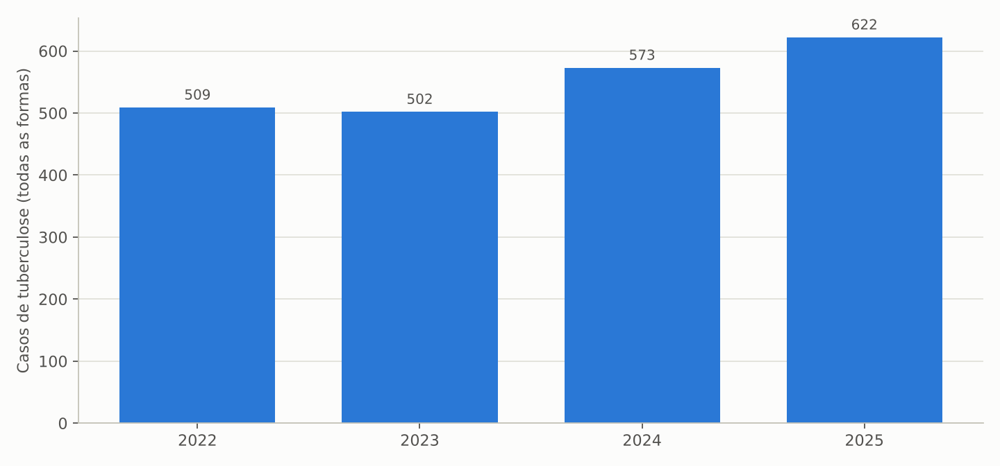
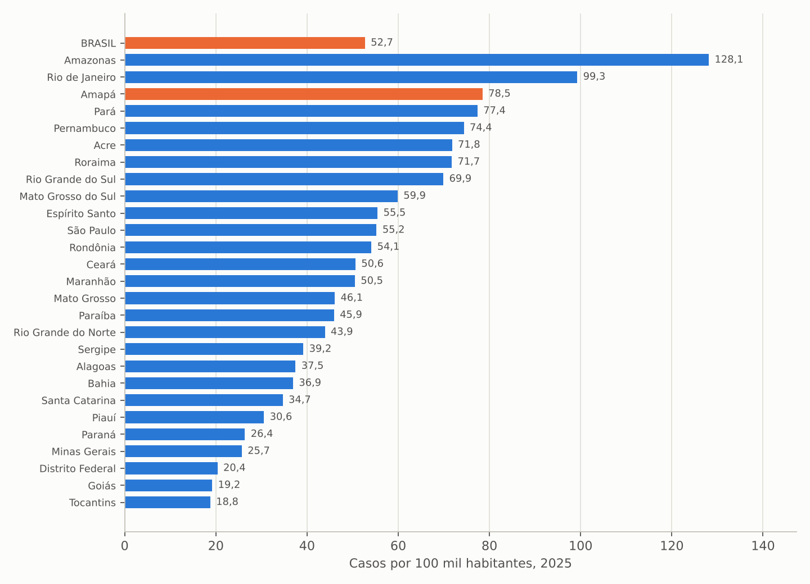
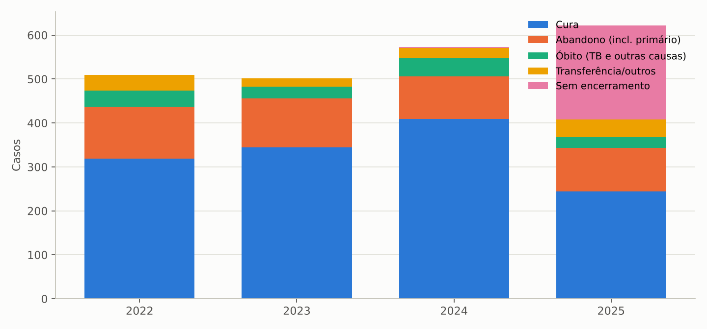
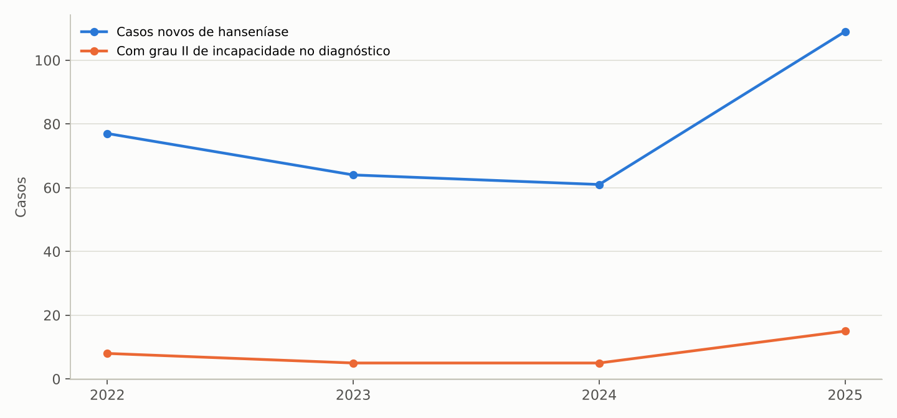
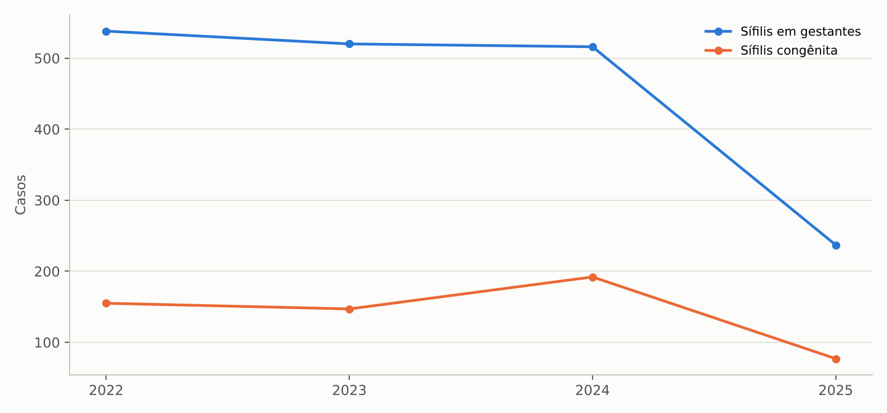
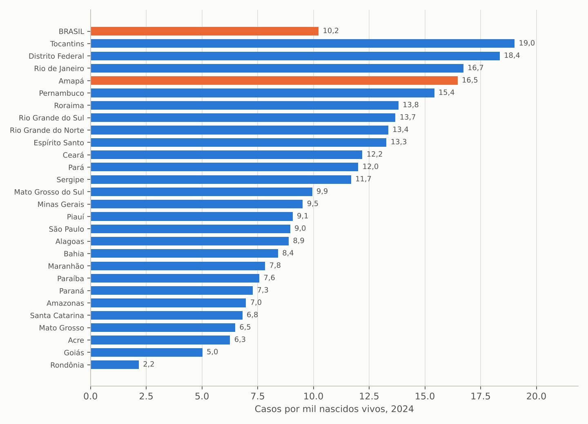
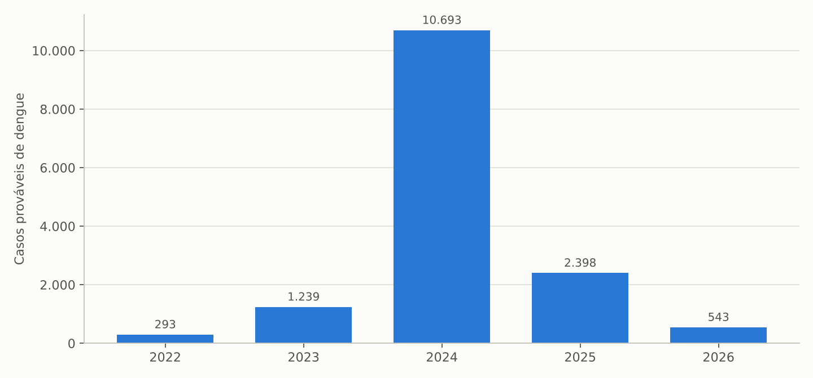
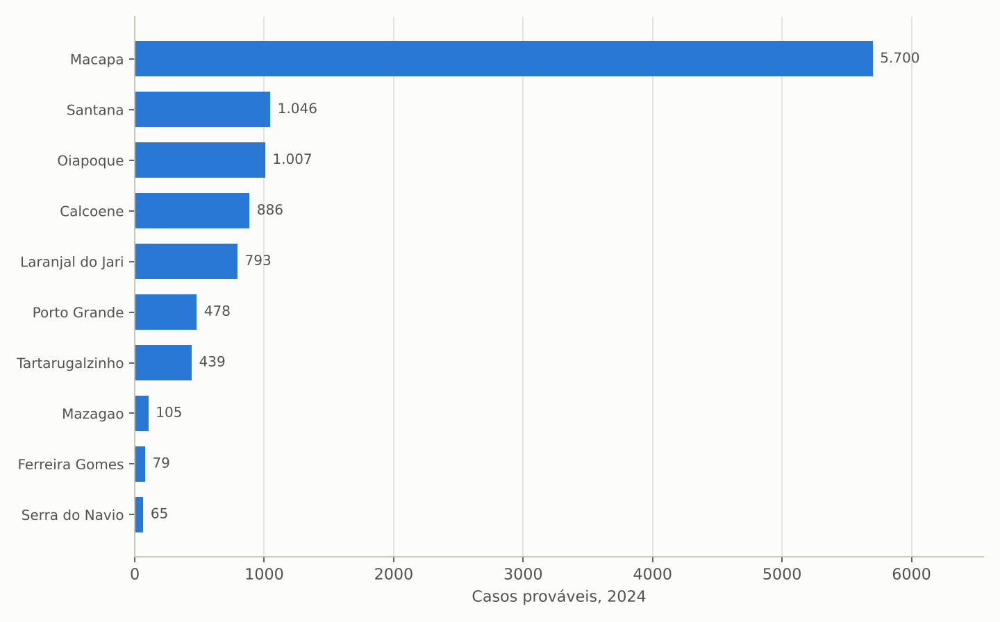
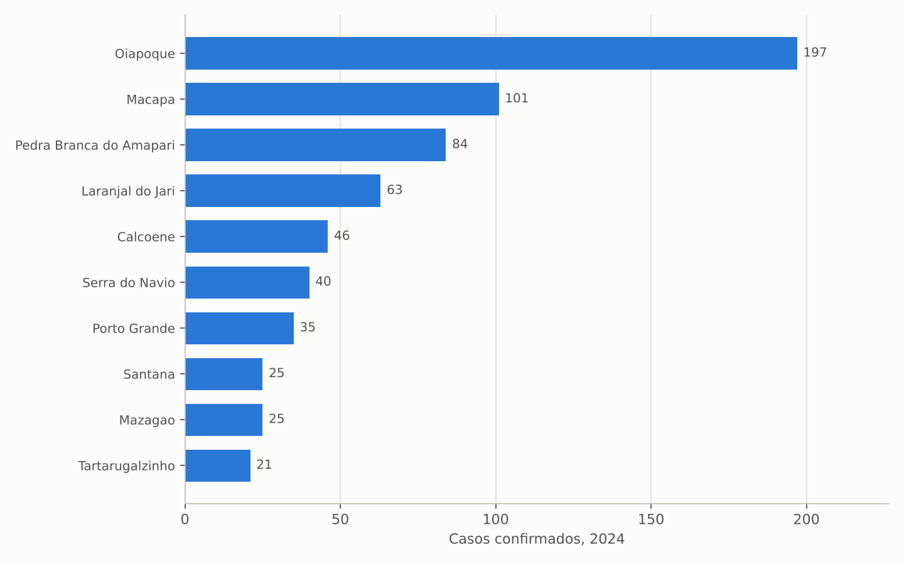
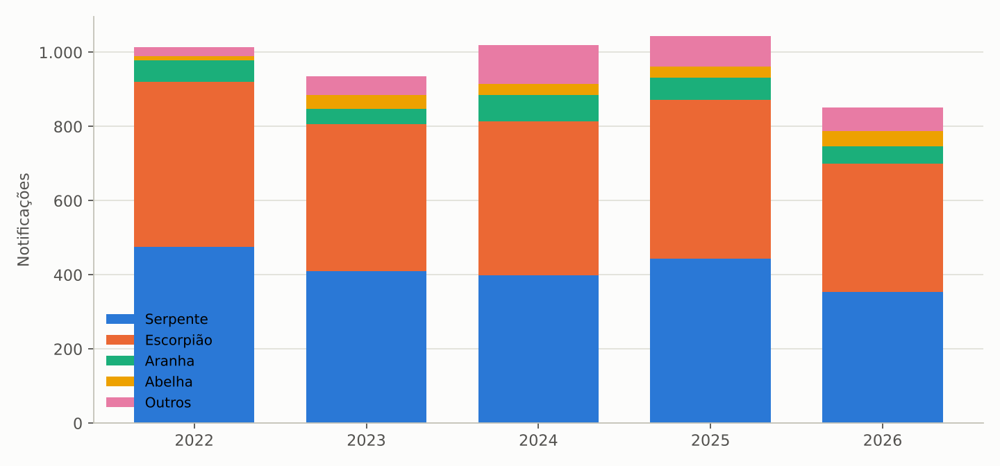

# 1. Introdução

## 1.1 Objetivo e contexto

Este estudo complementa o levantamento geral da saúde no Amapá elaborado para a transição de governo 2026/2027 (ALMEIDA, 2026) com o retrato da vigilância epidemiológica das doenças transmissíveis e dos agravos de notificação compulsória no período 2022–2026. O objetivo é oferecer à equipe de transição e à futura direção da Secretaria de Estado da Saúde (SESA/AP) uma linha de base auditável sobre a magnitude, a tendência, a distribuição territorial e a qualidade da resposta a tuberculose, hanseníase, sífilis, arboviroses, leishmanioses, meningites, acidentes por animais peçonhentos, intoxicações exógenas e doenças infecciosas de maior letalidade, com os indicadores operacionais que o Ministério da Saúde utiliza para monitorar os programas estaduais.

## 1.2 Objeto

Casos notificados e confirmados no Sistema de Informação de Agravos de Notificação (SINAN), por ano de diagnóstico ou de início dos sintomas e por município de residência, com seus desfechos (cura, abandono, óbito, hospitalização) e características clínico-epidemiológicas; óbitos por doenças infecciosas e parasitárias do Sistema de Informações sobre Mortalidade (SIM); e comparativos entre as unidades da federação para tuberculose e sífilis congênita.

## 1.3 Período

Série histórica de 2022 a 2026: 2022 como ano-base, 2023 a 2025 como anos completos e 2026 parcial (notificações até a extração). Os dados de 2025 e 2026 do SINAN são sujeitos a atualização, sobretudo nos campos de encerramento.

## 1.4 Fontes e extração

Todas as tabelas foram extraídas em 7/11/2026 do TABNET/DATASUS (SINAN, SIM, SINASC) e da API SIDRA do IBGE (população), por meio de scripts reproduzíveis que acompanham este documento. As taxas de incidência usam as estimativas populacionais pós-Censo 2022 (2024: 802.837; 2025: 806.517 habitantes) e os nascidos vivos do SINASC.

## 1.5 Limitações

(a) A malária, principal endemia do estado, é registrada no SIVEP-Malária, cujo painel não estava acessível a partir do ambiente de extração; o SINAN contém apenas registros residuais (menos de cinco por ano), por isso os dados de malária aqui citados vêm de divulgações do Ministério da Saúde e devem ser confirmados com a Superintendência de Vigilância em Saúde (SVS/AP). (b) O painel de HIV/aids e o SI-PNI (coberturas vacinais) não estavam acessíveis; a aids é abordada pelos óbitos do SIM e pela coinfecção TB-HIV. (c) A base de hepatites virais do Amapá no SINAN não traz a classificação etiológica (100% em branco), o que impede análise por tipo. (d) Os comparativos entre UFs de hanseníase e dengue não puderam ser tabulados por indisponibilidade das tabulações nacionais no momento da extração.

# 2. Síntese dos achados

Os dez achados centrais são apresentados a seguir e detalhados nas seções 3 a 8.

1. **A tuberculose cresceu 22% entre 2022 e 2025** (de 509 para 622 casos de todas as formas) e o Amapá tem a terceira maior incidência do país (77,1 casos por 100 mil habitantes em 2025 pela residência; Brasil: 52,7). Macapá concentra 74% dos casos (94,1 por 100 mil) e 17% dos casos de 2025 ocorreram em pessoas privadas de liberdade.
2. **Os desfechos da tuberculose estão longe das metas:** cura de 71,4% e abandono de 16,9% nos casos de 2024 (metas do Ministério da Saúde: cura igual ou superior a 85% e abandono inferior a 5%); os reingressos após abandono quase dobraram (46 em 2022, 83 em 2025) e um terço dos casos de 2025 ainda está sem encerramento.
3. **A coinfecção TB-HIV disparou:** 125 casos com HIV positivo em 2025 (20,1% dos casos de tuberculose), contra 59 em 2024, ao mesmo tempo em que a testagem se universalizou (casos sem teste caíram de 63 para 16). Os óbitos por HIV/aids somaram 62 em 2025 (7,7 por 100 mil habitantes), o maior valor da série.
4. **A hanseníase voltou a subir e é detectada tarde:** 109 casos novos em 2025 (61 em 2024, alta de 79%), 88% multibacilares e 14% com grau II de incapacidade física no diagnóstico (parâmetro de alta proporção: 10% ou mais). Apenas 9 casos (8%) foram descobertos por exame de contatos.
5. **A sífilis é o principal problema de transmissão vertical:** 192 casos de sífilis congênita em 2024 (15,6 por mil nascidos vivos, quarta maior incidência do país; Brasil: 10,2) e 516 gestantes com sífilis (41,9 por mil nascidos vivos). Em 72% dos casos congênitos a mãe fez pré-natal e em apenas 5,7% o parceiro foi tratado, o que aponta para falha na linha de cuidado e não na captação.
6. **A epidemia de dengue de 2024 foi a maior da história recente:** 10.693 casos prováveis (1.332 por 100 mil habitantes, 36 vezes o patamar de 2022), 762 hospitalizações, 392 casos com sinais de alarme ou graves e 15 óbitos confirmados pelo SINAN, contra 31 óbitos por arboviroses registrados no SIM no mesmo ano, divergência que indica óbitos não encerrados na vigilância. Em 2025 os casos recuaram para 2.398 e em 2026 (parcial) para 543.
7. **A leishmaniose tegumentar é endêmica em patamar elevado:** 658 casos em 2024 (82 por 100 mil habitantes) e 526 em 2025, com Oiapoque (197 casos, 646 por 100 mil), Macapá, Pedra Branca do Amapari e Laranjal do Jari como principais focos.
8. **Os acidentes por animais peçonhentos são o agravo de maior volume:** 1.070 notificações em 2025 (serpentes 443, escorpiões 429), 12 óbitos entre 2022 e 2025 e 16% dos pacientes atendidos mais de seis horas após o acidente; Laranjal do Jari responde sozinho por 221 casos (583 por 100 mil), dos quais 133 por escorpião.
9. **As intoxicações exógenas revelam dois sinais de alerta:** as tentativas de suicídio por intoxicação (33 em 2024, 14 em 2025) e um agrupamento de 52 intoxicações por metal, de circunstância ambiental, em Oiapoque em 2024 (56 notificações no município), compatível com exposição ligada ao garimpo, que exige investigação ambiental e toxicológica.
10. **A qualidade da informação limita a gestão:** 214 casos de tuberculose de 2025 sem encerramento, 51 casos de hanseníase de 2025 sem tipo de saída, hepatites sem etiologia, tratamento diretamente observado (TDO) não registrado em nenhum caso de tuberculose e divergência entre óbitos por dengue no SINAN e no SIM. Corrigir o registro é condição para pactuar metas com os municípios.

# 3. Tuberculose

## 3.1 Magnitude e tendência

Tabela: Tuberculose: casos de todas as formas por município de residência e ano de diagnóstico, Amapá, 2022–2025

| Município de residência | 2022 | 2023 | 2024 | 2025 | Incidência 2025 (por 100 mil hab.) |
|---|---:|---:|---:|---:|---:|
| Macapá | 315 | 333 | 405 | 461 | 94,1 |
| Santana | 81 | 67 | 60 | 57 | 48,0 |
| Laranjal do Jari | 23 | 19 | 18 | 29 | 76,6 |
| Oiapoque | 20 | 17 | 22 | 21 | 68,2 |
| Mazagão | 16 | 11 | 8 | 14 | 58,9 |
| Porto Grande | 11 | 13 | 9 | 13 | 68,2 |
| Calçoene | 9 | 7 | 7 | 7 | 61,1 |
| Itaubal | 3 | 2 | 7 | 5 | 82,0 |
| Serra do Navio | 2 | 1 | 1 | 4 | 79,9 |
| Pedra Branca do Amapari | 7 | 5 | 5 | 3 | 21,6 |
| Tartarugalzinho | 8 | 4 | 13 | 3 | 21,7 |
| Cutias | 0 | 3 | 3 | 2 | 42,3 |
| Amapá (município) | 2 | 6 | 7 | 1 | 11,8 |
| Vitória do Jari | 7 | 12 | 2 | 1 | 8,4 |
| Ferreira Gomes | 3 | 2 | 3 | 0 | 0,0 |
| Pracuúba | 2 | 0 | 3 | 1 | 24,7 |
| **Amapá** | **509** | **502** | **573** | **622** | **77,1** |

Fonte: SINAN/DATASUS (BRASIL, 2026); população IBGE 2025 (aba `TB_mun_ano`).

Figura: Casos de tuberculose (todas as formas) por ano de diagnóstico, Amapá, 2022–2025

Fonte: elaboração própria a partir de SINAN/DATASUS (BRASIL, 2026).

Os casos de tuberculose cresceram 22,2% em três anos, de 509 (2022) para 622 (2025), e a incidência passou de 71,4 (2024) para 77,1 por 100 mil habitantes (2025). Pelo critério de notificação, o Amapá ocupa a terceira posição entre as UFs em 2025 (78,5 por 100 mil), atrás apenas de Amazonas (128,1) e Rio de Janeiro (99,3) e à frente do Pará (77,4); a média nacional é 52,7. Macapá concentra 461 casos (74,1%) e tem incidência de 94,1 por 100 mil; Santana, com 57 casos, está em 48,0. O perfil é o clássico da tuberculose urbana: 74,6% dos casos em homens, 52,7% entre 20 e 39 anos, 78,1% de forma pulmonar (486 casos, os de maior potencial de transmissão) e 17,0% em população privada de liberdade (106 casos em 2025), proporção que sinaliza o sistema prisional como foco prioritário de busca ativa.

Figura: Casos de tuberculose por 100 mil habitantes, por UF de notificação, 2025

Fonte: elaboração própria a partir de SINAN/DATASUS e IBGE (BRASIL, 2026).

## 3.2 Desfechos e qualidade do programa

Tabela: Tuberculose: indicadores operacionais do programa, Amapá, 2022–2025

| Indicador | 2022 | 2023 | 2024 | 2025 | Parâmetro |
|---|---:|---:|---:|---:|---|
| Casos novos | 401 | 393 | 443 | 485 | — |
| Reingresso após abandono | 46 | 50 | 72 | 83 | — |
| Recidiva | 31 | 30 | 19 | 26 | — |
| Cura (% dos casos do ano) | 62,7 | 68,7 | 71,4 | 39,2* | ≥ 85% |
| Abandono (% dos casos do ano) | 23,2 | 22,1 | 16,9 | 15,9* | < 5% |
| Óbito por tuberculose (casos) | 13 | 17 | 14 | 9* | — |
| Casos sem encerramento | 0 | 0 | 2 | 214 | — |
| HIV positivo (casos) | 50 | 41 | 59 | 125 | — |
| HIV positivo (% dos casos) | 9,8 | 8,2 | 10,3 | 20,1 | — |
| Teste de HIV não realizado | 63 | 39 | 31 | 16 | 0 |
| TDO realizado (registro) | 0 | 0 | 0 | 0 | — |
| População privada de liberdade (casos) | 113 | 91 | 120 | 106 | — |

\* 2025 com 214 casos (34%) ainda sem encerramento; percentuais provisórios. Abandono inclui abandono primário. Fonte: SINAN/DATASUS (abas `TB_entrada_ano`, `TB_encerr_ano`, `TB_hiv_ano`, `TB_tdo_ano`, `TB_ppl_ano`).

Figura: Situação de encerramento dos casos de tuberculose, Amapá, 2022–2025

Fonte: elaboração própria a partir de SINAN/DATASUS (BRASIL, 2026).

A cura melhorou de 62,7% (2022) para 71,4% (2024), mas permanece 14 pontos abaixo da meta de 85%, e o abandono, embora em queda (23,2% para 16,9%), é mais de três vezes o limite aceitável de 5%. O crescimento dos reingressos após abandono (46 para 83) confirma que uma parcela crescente da incidência é retroalimentada por tratamentos interrompidos, situação que eleva o risco de resistência (oito casos de TB drogarresistente entre 2022 e 2025). O campo de tratamento diretamente observado está vazio em todos os anos, o que significa que a principal estratégia de adesão não está sendo registrada ou não está sendo realizada. A coinfecção com HIV mais que dobrou em 2025 (125 casos, 20,1%), em parte por efeito da ampliação da testagem (só 16 casos sem teste), mas em magnitude que exige integração entre os programas de tuberculose e de IST/aids, inclusive nas unidades prisionais. Os óbitos por tuberculose no SIM se mantêm em 20 por ano (2024 e 2025), acima dos registrados como desfecho no SINAN (14 e 9), outra evidência de encerramentos incompletos.

# 4. Hanseníase

Tabela: Hanseníase: casos novos e indicadores de detecção, Amapá, 2022–2026

| Indicador | 2022 | 2023 | 2024 | 2025 | 2026 (parcial) |
|---|---:|---:|---:|---:|---:|
| Casos novos | 77 | 64 | 61 | 109 | 37 |
| Taxa de detecção (por 100 mil hab.) | — | — | 7,6 | 13,5 | — |
| Multibacilares (%) | 70,1 | 82,8 | 80,3 | 88,1 | 73,0 |
| Grau II de incapacidade no diagnóstico | 8 | 5 | 5 | 15 | 5 |
| Grau II (% dos avaliados) | 11,3 | 7,9 | 8,3 | 14,0 | 13,5 |
| Casos em menores de 15 anos | 5 | 0 | 4 | 3 | 1 |
| Detectados por exame de contatos | 1 | 2 | 5 | 9 | 3 |
| Saída: cura | 68 | 48 | 45 | 41 | 0 |
| Saída: abandono | 5 | 3 | 7 | 4 | 0 |
| Saída não preenchida | 0 | 6 | 3 | 51 | 35 |

Fonte: SINAN/DATASUS (abas `HANS_classe_ano`, `HANS_incap_ano`, `HANS_fx_ano`, `HANS_deteccao_ano`, `HANS_saida_ano`).

Figura: Casos novos de hanseníase e casos com grau II de incapacidade no diagnóstico, Amapá, 2022–2025

Fonte: elaboração própria a partir de SINAN/DATASUS (BRASIL, 2026).

Após três anos de queda (77, 64 e 61 casos), a hanseníase saltou para 109 casos novos em 2025, elevando a taxa de detecção de 7,6 para 13,5 por 100 mil habitantes, patamar classificado como "muito alto" pelos parâmetros do Ministério da Saúde (10 a 19,99). Dois indicadores apontam diagnóstico tardio e transmissão ativa: 88% dos casos são multibacilares e 14% dos avaliados já apresentavam grau II de incapacidade física (deformidades) no diagnóstico, acima do limiar de 10% que caracteriza alta proporção. A vigilância de contatos é incipiente (9 casos detectados por exame de contatos em 2025) e os casos em menores de 15 anos (3 a 5 por ano) confirmam cadeias de transmissão recentes. Territorialmente, Macapá concentra 49 casos (2025), seguido de Mazagão, que passou de 2 para 17 casos em um ano, Porto Grande (9) e Laranjal do Jari (7). O preenchimento do tipo de saída se deteriorou (51 casos de 2025 sem saída registrada), o que compromete o cálculo da cura.

# 5. Sífilis em gestantes e sífilis congênita

Tabela: Sífilis em gestantes e sífilis congênita, Amapá, 2022–2025

| Indicador | 2022 | 2023 | 2024 | 2025 (parcial) |
|---|---:|---:|---:|---:|
| Sífilis em gestantes (casos) | 538 | 520 | 516 | 237 |
| Taxa de detecção em gestantes (por mil NV) | 39,5 | 40,2 | 41,9 | 18,8 |
| Gestantes de 10 a 19 anos (%) | 26,4 | 30,0 | 24,8 | 21,9 |
| Sífilis congênita (casos) | 155 | 147 | 192 | 77 |
| Incidência de sífilis congênita (por mil NV) | 11,4 | 11,4 | 15,6 | 6,1 |
| Natimorto ou aborto por sífilis | 0 | 1 | 6 | 3 |
| Mãe realizou pré-natal (%) | 68,4 | 71,4 | 72,4 | 74,0 |
| Parceiro tratado (%) | 21,9 | 12,2 | 5,7 | 9,1 |
| Mãe de 10 a 19 anos (%) | 31,0 | 29,9 | 25,5 | 20,8 |

Fonte: SINAN e SINASC/DATASUS (abas `SIFG_*`, `SIFC_*`). NV = nascidos vivos de mães residentes.

Figura: Casos de sífilis em gestantes e de sífilis congênita, Amapá, 2022–2025

Fonte: elaboração própria a partir de SINAN/DATASUS (BRASIL, 2026).

Figura: Incidência de sífilis congênita por mil nascidos vivos, por UF, 2024

Fonte: elaboração própria a partir de SINAN e SINASC/DATASUS (BRASIL, 2026).

A sífilis congênita atingiu 192 casos em 2024 (15,6 por mil nascidos vivos), a quarta maior incidência entre as UFs e 52% acima da média nacional (10,2), com seis natimortos ou abortos por sífilis no ano. O dado mais importante para a gestão é que a epidemia não decorre da falta de pré-natal: 72% das mães dos casos congênitos fizeram pré-natal, mas o parceiro foi tratado em apenas 5,7% dos casos, proporção que caiu de 21,9% em 2022. Em outras palavras, as gestantes são diagnosticadas (516 casos em 2024, 41,9 por mil nascidos vivos), mas o tratamento oportuno e completo da gestante e do parceiro falha na atenção primária, e a reinfecção durante a gestação resulta em sífilis congênita. Um quarto das gestantes com sífilis e das mães dos casos congênitos são adolescentes. Macapá concentra 160 dos 192 casos congênitos de 2024.

# 6. Arboviroses, leishmanioses e meningites

## 6.1 Dengue, chikungunya e zika

Tabela: Arboviroses: casos e gravidade, Amapá, 2022–2026

| Indicador | 2022 | 2023 | 2024 | 2025 | 2026 (parcial) |
|---|---:|---:|---:|---:|---:|
| Dengue: casos prováveis | 293 | 1.239 | 10.693 | 2.398 | 543 |
| Dengue: incidência (por 100 mil hab.) | — | — | 1.332 | 297 | — |
| Dengue com sinais de alarme | 3 | 8 | 367 | 44 | 39 |
| Dengue grave | 0 | 0 | 25 | 7 | 1 |
| Dengue: hospitalizações | 23 | 110 | 762 | 191 | 77 |
| Dengue: óbitos confirmados (SINAN) | 0 | 0 | 15 | 2 | 0 |
| Óbitos por arboviroses no SIM (A90-A99) | 0 | 0 | 31 | 8 | 1 |
| Chikungunya: casos confirmados | 25 | 37 | 244 | 61 | 17 |
| Zika: casos confirmados | 20 | 16 | 16 | 10 | 5 |

Fonte: SINAN e SIM/DATASUS (abas `DENGUE_*`, `CHIK_class_ano`, `ZIKA_class_ano`, `SIM_infecciosas_sel`).

Figura: Casos prováveis de dengue por ano de início dos sintomas, Amapá, 2022–2026

Fonte: elaboração própria a partir de SINAN/DATASUS (BRASIL, 2026).

Figura: Casos prováveis de dengue por município de residência, Amapá, 2024 (dez maiores)

Fonte: elaboração própria a partir de SINAN/DATASUS (BRASIL, 2026).

A epidemia de 2024 multiplicou por 36 os casos de 2022 e atingiu todos os municípios: Macapá (5.700 casos), Santana (1.046), Oiapoque (1.007), Calçoene (886), Laranjal do Jari (793), Porto Grande (478) e Tartarugalzinho (439). Foram 762 hospitalizações e 392 casos com sinais de alarme ou graves, que pressionaram a rede de urgência no primeiro semestre. A diferença entre os 15 óbitos por dengue confirmados no SINAN e os 31 óbitos por arboviroses no SIM em 2024 (30 deles codificados como dengue) indica que cerca de metade das mortes não foi investigada e encerrada na vigilância, com reflexo na letalidade oficial. Os casos de chikungunya (244 confirmados em 2024, sobretudo em Macapá, Mazagão e Laranjal do Jari) acompanharam a epidemia de dengue; a zika permanece em baixa transmissão. A queda de 2025 (2.398 casos) e de 2026 (543 até a extração) segue o ciclo epidêmico, mas a presença contínua do vetor e dos quatro sorotipos circulantes no país recomenda que o plano de contingência e o controle vetorial sejam mantidos antes do período chuvoso de 2027.

## 6.2 Leishmanioses

Tabela: Leishmaniose tegumentar: casos confirmados por município de residência, Amapá, 2022–2025

| Município | 2022 | 2023 | 2024 | 2025 | Incidência 2024 (por 100 mil hab.) |
|---|---:|---:|---:|---:|---:|
| Oiapoque | 31 | 50 | 197 | 138 | 646,3 |
| Macapá | 36 | 29 | 101 | 72 | 20,7 |
| Pedra Branca do Amapari | 16 | 86 | 84 | 37 | 608,8 |
| Laranjal do Jari | 158 | 96 | 63 | 45 | 165,9 |
| Calçoene | 77 | 42 | 46 | 70 | 403,8 |
| Serra do Navio | 38 | 47 | 40 | 18 | 802,2 |
| Porto Grande | 43 | 44 | 35 | 52 | 184,3 |
| Mazagão | 7 | 9 | 25 | 18 | 106,0 |
| Santana | 11 | 20 | 25 | 25 | 21,1 |
| Tartarugalzinho | 39 | 56 | 21 | 25 | 152,3 |
| Demais municípios | 16 | 16 | 21 | 26 | — |
| **Amapá** | **472** | **495** | **658** | **526** | **82,0** |

Fonte: SINAN/DATASUS (aba `LTA_mun_ano`); população IBGE 2024.

Figura: Casos confirmados de leishmaniose tegumentar por município de residência, Amapá, 2024 (dez maiores)

Fonte: elaboração própria a partir de SINAN/DATASUS (BRASIL, 2026).

A leishmaniose tegumentar americana é endêmica em todo o interior, com incidência estadual de 82 por 100 mil habitantes em 2024 e picos locais acima de 600 por 100 mil em Serra do Navio, Oiapoque e Pedra Branca do Amapari, áreas de garimpo, extrativismo e fronteira. A forma mucosa, mais grave e mutilante, somou 15 casos em 2024 e 10 em 2025. A leishmaniose visceral é esporádica (um a três casos por ano). O tratamento depende de medicamentos de distribuição centralizada (antimoniato, anfotericina B e miltefosina) e de acompanhamento prolongado, o que torna o abastecimento e a capacitação das unidades do interior pontos críticos.

## 6.3 Meningites

Os casos confirmados de meningite oscilaram entre 6 e 13 por ano (2022–2025), com predomínio das formas bacterianas não especificadas, pneumocócicas e virais, e letalidade elevada: 12 óbitos em 38 casos no período (31,6%), 5 deles em 2025. A letalidade acima de 30% sugere diagnóstico tardio e baixa confirmação etiológica, e justifica revisão dos fluxos de coleta de líquor, cultura e notificação imediata nas portas de urgência.

# 7. Agravos ambientais e de causas externas notificáveis

## 7.1 Acidentes por animais peçonhentos

Tabela: Acidentes por animais peçonhentos: notificações por tipo de animal, desfecho e tempo até o atendimento, Amapá, 2022–2026

| Indicador | 2022 | 2023 | 2024 | 2025 | 2026 (parcial) |
|---|---:|---:|---:|---:|---:|
| Total de notificações | 1.020 | 959 | 1.053 | 1.070 | 867 |
| Serpente | 476 | 410 | 398 | 443 | 354 |
| Escorpião | 445 | 396 | 416 | 429 | 345 |
| Aranha | 58 | 41 | 71 | 59 | 48 |
| Abelha | 10 | 38 | 29 | 31 | 41 |
| Outros/ignorado | 31 | 74 | 139 | 108 | 79 |
| Óbitos pelo agravo | 2 | 1 | 4 | 5 | 3 |
| Atendimento após 6 h (% das notificações) | 15,6 | 13,1 | 14,9 | 16,2 | 14,5 |
| Atendimento após 24 h | 41 | 27 | 58 | 57 | 47 |

Fonte: SINAN/DATASUS (abas `ANIMAIS_tipo_ano`, `ANIMAIS_evol_ano`, `ANIMAIS_tempo_ano`).

Figura: Notificações de acidentes por animais peçonhentos por tipo de animal, Amapá, 2022–2026

Fonte: elaboração própria a partir de SINAN/DATASUS (BRASIL, 2026).

Com cerca de mil notificações por ano, os acidentes por animais peçonhentos são o agravo de notificação mais frequente do estado e um dos mais dependentes da logística da rede: o soro antiofídico e antiescorpiônico precisa estar disponível nas unidades do interior em tempo hábil. Em 2025, 16% dos pacientes foram atendidos mais de seis horas após o acidente e 57 depois de 24 horas, intervalo associado a complicações e aos cinco óbitos do ano. Laranjal do Jari é o município de maior risco (221 notificações em 2025, 583 por 100 mil habitantes, 133 delas por escorpião), seguido de Macapá (236 casos, risco baixo pela população) e Oiapoque (125, com 50 classificados como "outros", possivelmente acidentes com animais aquáticos). Os acidentes com abelhas quadruplicaram desde 2022.

## 7.2 Intoxicações exógenas

As notificações de intoxicação exógena variaram entre 41 e 120 por ano. Dois sinais merecem atenção: (i) as tentativas de suicídio por intoxicação, predominantemente com medicamentos e em jovens de 15 a 39 anos (31 em 2022, 33 em 2024 e 14 em 2025, com provável subnotificação), que devem ser cruzadas com a vigilância de violência autoprovocada tratada no estudo complementar sobre saúde mental; e (ii) o agrupamento de 2024, quando 52 intoxicações por metal de circunstância ambiental foram notificadas, 56 delas em Oiapoque, quadro compatível com exposição ao mercúrio em áreas de garimpo e que exige investigação pela vigilância ambiental e em saúde do trabalhador, com monitoramento biológico das populações expostas, inclusive indígenas.

# 8. Mortalidade por doenças infecciosas e agravos sem tabulação pública

Tabela: Óbitos de residentes por doenças infecciosas selecionadas, Amapá, 2022–2026

| Grupo de causas (CID-10) | 2022 | 2023 | 2024 | 2025 | 2026 (parcial) |
|---|---:|---:|---:|---:|---:|
| HIV/aids (B20-B24) | 60 | 53 | 48 | 62 | 26 |
| Outras doenças bacterianas, incl. sepse (A30-A49) | 94 | 65 | 84 | 85 | 67 |
| Tuberculose (A15-A19) | 19 | 15 | 20 | 20 | 23 |
| Arboviroses (A90-A99) | 0 | 0 | 31 | 8 | 1 |
| Protozooses, incl. malária (B50-B64) | 6 | 7 | 11 | 3 | 3 |
| Doenças infecciosas intestinais (A00-A09) | 9 | 17 | 9 | 9 | 2 |
| Hepatites virais (B15-B19) | 2 | 0 | 6 | 3 | 1 |
| IST (A50-A64) | 7 | 2 | 2 | 2 | 0 |

Fonte: SIM/DATASUS (aba `SIM_infecciosas_sel`); 2025 preliminar.

Os óbitos por HIV/aids (62 em 2025, 7,7 por 100 mil habitantes) são a principal causa de morte infecciosa evitável do estado e crescem junto com a coinfecção TB-HIV, o que indica diagnóstico tardio e falhas de retenção no tratamento antirretroviral; sem acesso ao painel de HIV/aids, a transição deve solicitar à SESA a cascata de cuidado (diagnosticados, em tratamento, com carga viral suprimida) por município. A tuberculose mata 20 pessoas por ano e já soma 23 óbitos em 2026 (parcial). As mortes por sepse e outras doenças bacterianas (84 e 85 em 2024 e 2025) remetem à qualidade do cuidado hospitalar. Quanto à malária, as divulgações do Ministério da Saúde indicam média de cerca de 10 mil casos por ano no Amapá entre 2014 e 2024 e queda de 16,8% no primeiro trimestre de 2025 (1.017 casos contra 1.222 em 2024), com concentração histórica em Oiapoque e Calçoene; os óbitos por protozooses no SIM (11 em 2024) e a única internação por malária registrada no SIH em 2025 mostram que a doença é tratada majoritariamente na atenção primária e nos postos de diagnóstico, cuja rede de microscopia e de agentes de combate a endemias precisa ser dimensionada com os dados do SIVEP-Malária.

# 9. Pontos de atenção para a transição

## 9.1 Tuberculose e HIV

Cura de 71% e abandono de 17% em 2024, reingressos após abandono em alta, TDO sem registro, 20% de coinfecção com HIV e um terço dos casos de 2025 sem encerramento. A meta de 85% de cura exige TDO efetivo nas unidades de Macapá e Santana, articulação com o sistema prisional (17% dos casos) e integração com o programa de IST/aids.

## 9.2 Sífilis

Incidência de sífilis congênita entre as quatro maiores do país, com pré-natal realizado em 72% dos casos e parceiro tratado em 6%: o problema está no tratamento oportuno na atenção primária (penicilina benzatina na unidade, teste rápido no primeiro e terceiro trimestres, tratamento do parceiro) e na vigilância das gestantes diagnosticadas, majoritariamente em Macapá.

## 9.3 Hanseníase

Salto de 79% nos casos em 2025, 88% multibacilares, 14% com grau II de incapacidade e poucos casos detectados por contatos: indicam prevalência oculta e necessidade de campanhas de busca ativa, exame de contatos e capacitação para diagnóstico precoce, com atenção a Mazagão.

## 9.4 Arboviroses

Após a epidemia de 2024 (10.693 casos, 762 hospitalizações, 15 a 31 óbitos conforme a fonte), a prioridade é o plano de contingência 2027 (controle vetorial, salas de hidratação, leitos de retaguarda, protocolo de manejo) e a investigação e encerramento de todos os óbitos suspeitos.

## 9.5 Agravos do interior

Leishmaniose tegumentar (Oiapoque, Serra do Navio, Pedra Branca, Calçoene), acidentes por animais peçonhentos (Laranjal do Jari) e intoxicações por metal (Oiapoque) são problemas de territórios de garimpo, fronteira e floresta, que exigem estoque descentralizado de soros e medicamentos, capacitação das unidades mistas e vigilância ambiental.

## 9.6 Qualidade da informação

Encerramentos de tuberculose e hanseníase, etiologia das hepatites, TDO, óbitos por dengue e intoxicações exigem rotina de crítica de dados e de retroalimentação aos municípios; sem isso, os indicadores pactuados não podem ser monitorados.

# 10. Recomendações e agenda dos primeiros 100 dias

**Documentos e dados a requisitar à SVS/SESA:**

1. Série do SIVEP-Malária 2022–2026 por município (casos, espécie, incidência, óbitos), rede de diagnóstico (microscopia e testes rápidos) e estoque de antimaláricos.
2. Cascata de cuidado de HIV (diagnosticados, vinculados, em tratamento, supressão viral) e de sífilis em gestantes por município; estoque e distribuição de penicilina benzatina e de testes rápidos.
3. Coberturas vacinais 2024–2026 por município e por vacina (SI-PNI), com estoque e rede de frio.
4. Relatórios de investigação dos óbitos por dengue, meningite, tuberculose e animais peçonhentos de 2024–2026.
5. Situação do estoque e da distribuição de soros antipeçonhentos e de medicamentos para leishmaniose e tuberculose por unidade.
6. Investigação ambiental e toxicológica das intoxicações por metal em Oiapoque (2024) e resultados de monitoramento de mercúrio.
7. Estrutura da vigilância: quadro de agentes de combate a endemias, vigilância epidemiológica e laboratório central (LACEN), contratos e convênios vigentes.

**Prioridades de gestão sugeridas:**

1. Pactuar com Macapá e Santana metas de cura e abandono de tuberculose, com TDO registrado e busca de faltosos, e implantar rotina conjunta TB-HIV, inclusive no sistema prisional.
2. Instituir força-tarefa de eliminação da sífilis congênita na atenção primária (teste e tratamento no mesmo dia, tratamento do parceiro, monitoramento das gestantes positivas).
3. Realizar campanha estadual de busca ativa e exame de contatos de hanseníase em 2027, com capacitação para diagnóstico precoce.
4. Aprovar o plano de contingência de arboviroses 2027 até fevereiro, com investigação de 100% dos óbitos suspeitos.
5. Descentralizar soros e medicamentos para os municípios do interior com maior risco e padronizar protocolos de tempo de atendimento.
6. Implantar comitê mensal de qualidade da informação em vigilância, com devolutiva aos municípios e metas de encerramento oportuno.

# 11. Considerações finais

A vigilância em saúde do Amapá enfrenta um duplo desafio: endemias amazônicas de territórios remotos (malária, leishmaniose, animais peçonhentos, exposição a metais) e doenças de transmissão urbana e social em crescimento (tuberculose, HIV, sífilis, hanseníase, arboviroses). Os dados públicos mostram que o estado notifica muito, mas encerra pouco e trata de forma incompleta: as metas de cura, de tratamento de parceiros e de diagnóstico precoce não são alcançadas, e parte dos óbitos não chega à vigilância. A nova gestão dispõe neste estudo de uma linha de base por agravo e por município para pactuar metas, redistribuir insumos e organizar a resposta às epidemias de 2027.

# APÊNDICE A – Conteúdo da planilha de tabelas

A planilha `Tabelas_Vigilancia_Amapa_2022_2026.xlsx` contém a aba `Indice` com hiperlinks, o painel-resumo `00_Painel_Vigilancia` e as abas por agravo: `TB_*` (município, faixa etária, sexo, entrada, forma, HIV, encerramento, PPL), `HANS_*`, `SIFC_*` e `SIFG_*`, `DENGUE_*`, `CHIK_*`, `ZIKA_*`, `LTA_*`, `LV_*`, `MENING_*`, `MALARIA_SINAN_*`, `ANIMAIS_*`, `INTOX_*`, `HEPATITES_*`, `SIM_*` (óbitos por grupo e categoria da CID-10), `ARBO_resumo`, `BENCH_TB_UF_2025`, `BENCH_SIFC_UF_2024` e `Fontes_Notas`. Todas as séries estão recortadas para 2022–2026.
