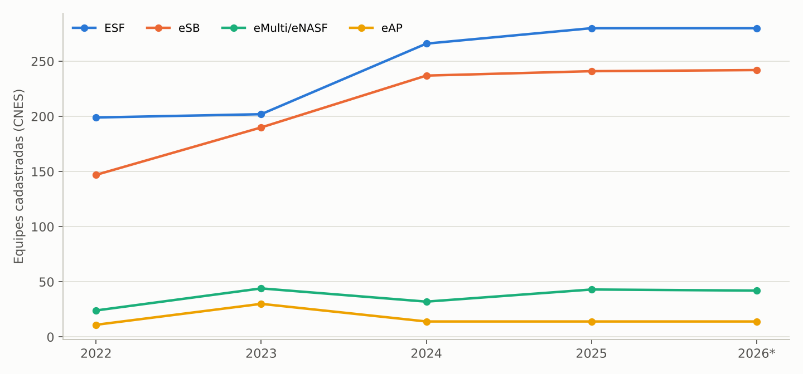
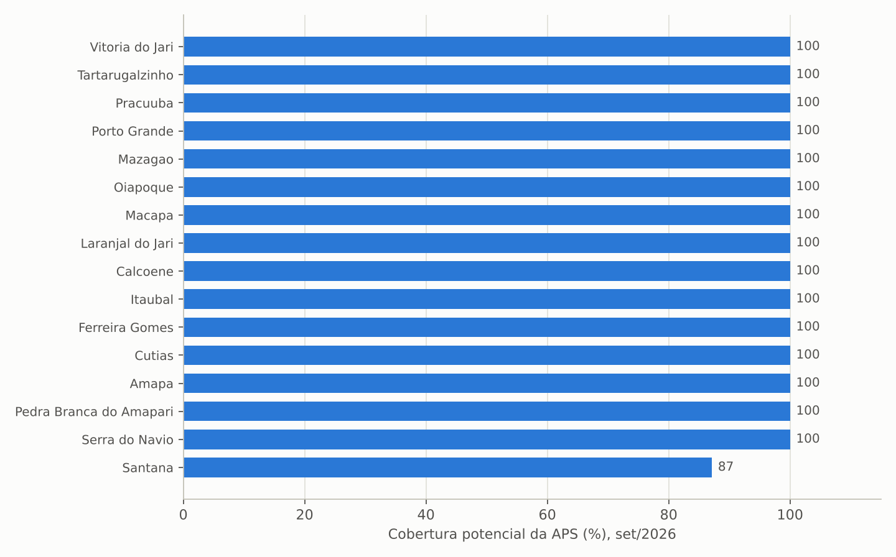
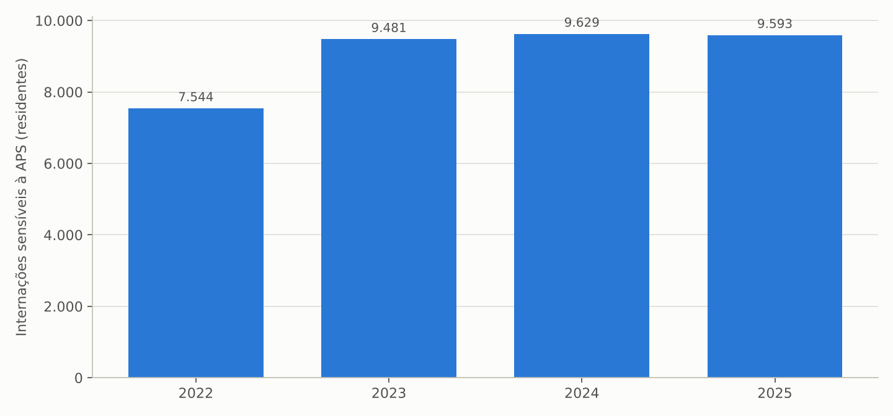
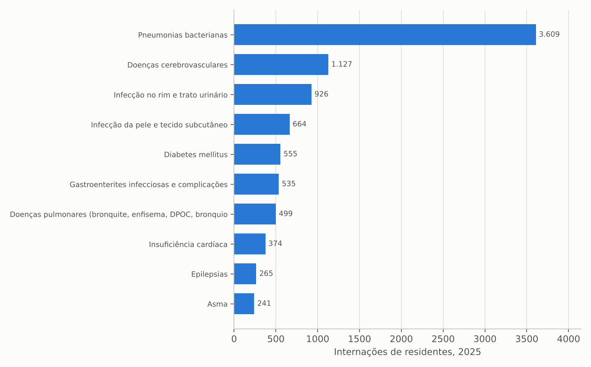
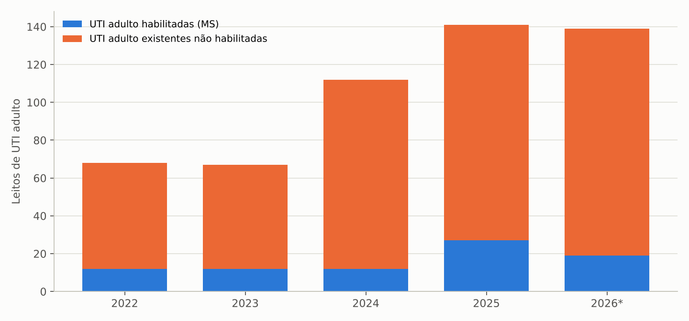
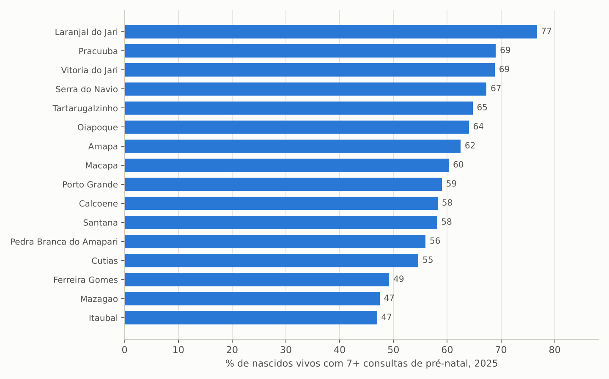
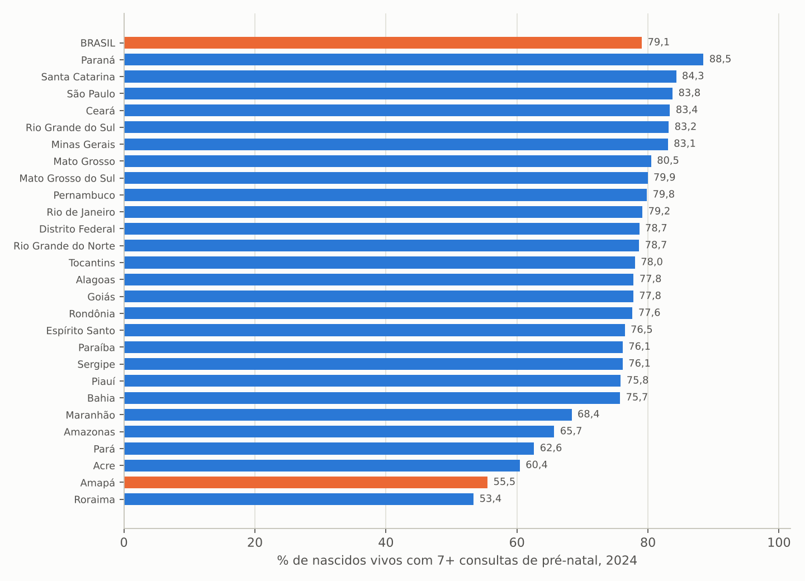
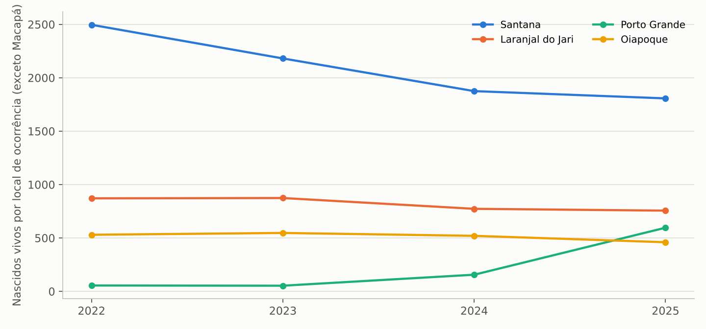
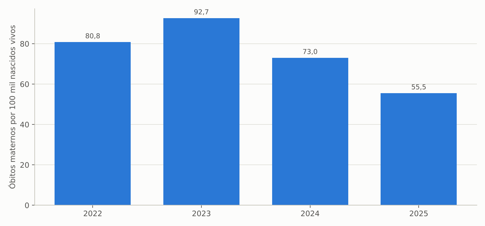
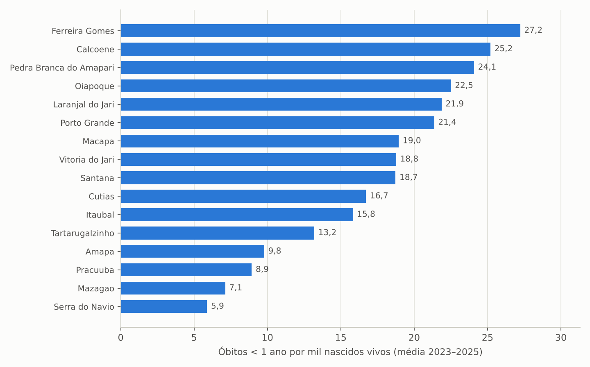

# 1. Introdução

## 1.1 Objetivo e contexto

Este estudo complementa o levantamento geral da saúde no Amapá para a transição de governo 2026/2027 (ALMEIDA, 2026) com o diagnóstico da atenção primária à saúde (APS), da regionalização da rede e da saúde materno-infantil no período 2022–2026. A atenção primária é de gestão municipal, mas o Estado é responsável pela coordenação regional, pelo cofinanciamento, pelo apoio técnico e pela rede de referência (maternidades, UTI neonatal, regulação). Os indicadores aqui reunidos permitem à equipe de transição medir o quanto a expansão de equipes se converteu em acesso, resolutividade e redução de mortes evitáveis.

## 1.2 Objeto

Equipes de atenção primária e habilitações de serviços registradas no CNES; produção ambulatorial de atenção básica no SIA/SUS; internações por condições sensíveis à atenção primária (ICSAP) de residentes do Amapá (SIH/SUS); nascidos vivos por município de residência e por município de ocorrência (SINASC); óbitos infantis, fetais e maternos (SIM); comparativos entre as unidades da federação.

## 1.3 Período

Série 2022–2026: 2022 como ano-base, 2023 a 2025 como anos completos e 2026 parcial (CNES até setembro; SIH até agosto; SINASC e SIM com dados preliminares de 2025 e parciais de 2026).

## 1.4 Fontes e extração

Tabulações do TABNET/DATASUS (CNES, SIH, SIA, SINASC, SIM) e API SIDRA do IBGE, extraídas em 7/11/2026 por scripts reproduzíveis que acompanham o documento. A cobertura potencial da APS segue o parâmetro da Política Nacional de Atenção Básica usado pelo e-Gestor (3.450 pessoas por equipe de Saúde da Família e 3.000 por equipe de Atenção Primária, limitada a 100% da população). As ICSAP foram aproximadas da Lista Brasileira (Portaria SAS 221/2008) a partir da Lista de Morbidade CID-10 do TABNET.

## 1.5 Limitações

(a) O e-Gestor AB/SISAB (cobertura por cadastro, indicadores de desempenho do financiamento federal) e o SI-PNI (vacinação) não estavam acessíveis, por isso a cobertura aqui calculada é potencial, não efetiva; (b) desde 2021 a produção da APS é registrada no SISAB e não no SIA/SUS, que capta apenas parte dos procedimentos de atenção básica; (c) a aproximação da lista de ICSAP não contempla integralmente alguns grupos (infecções urinárias, condições do pré-natal); (d) taxas por município com pequenos números são instáveis e foram apresentadas como médias trienais quando possível.

# 2. Síntese dos achados

Os dez achados centrais são apresentados a seguir e detalhados nas seções 3 a 8.

1. **A rede de atenção primária cresceu 41% em equipes de Saúde da Família** (199 em dezembro de 2022, 280 em setembro de 2026) e 65% em equipes de saúde bucal (147 para 242), com cobertura potencial de 100% da população em 15 dos 16 municípios (Santana: 87%). O Amapá tem 2.880 habitantes por equipe, contra 3.720 na média nacional, e está entre as seis UFs com maior cobertura potencial.
2. **A cobertura potencial não se converteu em cobertura efetiva de cuidado.** Apenas 60,3% dos nascidos vivos de 2025 tiveram sete ou mais consultas de pré-natal (55,5% em 2024, 26ª posição entre as UFs; Brasil: 79,1%), e as internações por condições sensíveis à atenção primária cresceram de 7.544 (2022) para 9.593 (2025), ou 119 por 10 mil habitantes, puxadas por pneumonias (3.609), doenças cerebrovasculares (1.127, mais que o dobro de 2022), infecções urinárias (926), diabetes (555) e insuficiência cardíaca (374).
3. **O Estado opera UTIs sem habilitação federal.** Em setembro de 2026 o CNES registra 139 leitos de UTI adulto existentes, mas apenas 19 habilitados pelo Ministério da Saúde (12 até 2024); em UTI pediátrica, 31 existentes e 20 habilitados; em UTI neonatal, 53 e 40. Cada leito não habilitado deixa de receber o custeio federal da diária de UTI e sobrecarrega o Tesouro estadual.
4. **A mortalidade materna é a segunda maior do país:** razão de 82,3 óbitos por 100 mil nascidos vivos no triênio 2022–2024 (Brasil: 53,7), com 39 óbitos maternos entre 2022 e 2025, 77% por causas obstétricas diretas (hipertensão, hemorragia, aborto), isto é, evitáveis com pré-natal, parto e puerpério de qualidade. Em 2025 (preliminar) houve 7 óbitos (55,5 por 100 mil).
5. **A mortalidade infantil permanece a terceira maior do Brasil** (17,8 por mil nascidos vivos em 2024; média de 18,7 no triênio 2023–2025) e é mais alta no interior: Ferreira Gomes (27,2), Calçoene (25,2), Pedra Branca do Amapari (24,1), Oiapoque (22,5), Laranjal do Jari (21,9) e Porto Grande (21,4) superam a média estadual no triênio. Um quarto a um terço dos óbitos infantis (24,6% em 2024; 31,2% em 2025) não é investigado.
6. **A assistência ao parto está se regionalizando, mas de forma desigual:** Macapá concentra 72% dos partos de ocorrência; Santana perdeu 28% dos partos realizados (2.496 em 2022 para 1.807 em 2025) e Porto Grande passou de 55 para 596 partos com a transformação do Hospital Maria Lúcia Guimarães da Silva em polo; Laranjal do Jari (756) e Oiapoque (460) mantêm maternidades regionais. A cesariana subiu de 38,8% para 46,9% dos nascimentos, ainda abaixo da média nacional (60,6%), mas com Laranjal do Jari, Santana, Macapá e Porto Grande acima de 48%.
7. **Os determinantes do pré-natal insuficiente são locais:** em 2025, menos da metade dos nascidos vivos de Itaubal (47,0%), Mazagão (47,4%) e Ferreira Gomes (49,2%) teve sete ou mais consultas, enquanto Laranjal do Jari alcançou 76,7%; a gravidez na adolescência atinge 28,6% em Pracuúba, 26,3% em Vitória do Jari e 25,6% em Cutias (média estadual 17,7%); a prematuridade chegou a 22,0% em Laranjal do Jari e 21,2% em Serra do Navio.
8. **Os óbitos fetais caíram de 164 (2022) para 120 (2025)**, taxa de 11,9 para 9,4 por mil nascimentos, mas 21% dos óbitos fetais de 2024 não foram investigados, e a maioria ocorre entre 22 e 36 semanas, janela em que o pré-natal pode intervir.
9. **A regionalização da rede especializada avançou em habilitações recentes:** 19 estabelecimentos habilitados no Programa Mais Acesso a Especialistas, 10 no Programa Nacional de Redução de Filas, 12 Centros Especializados em Reabilitação, 5 Centros de Especialidades Odontológicas, 8 CAPS, 3 serviços de hemodiálise e 1 UNACON com radioterapia; fora de Macapá, porém, as habilitações se concentram em Santana e Laranjal do Jari.
10. **A informação de atenção primária disponível ao público é insuficiente para gestão.** A produção da APS migrou para o SISAB, e o SIA/SUS registra apenas 1,97 milhão de procedimentos de atenção básica em 2025, 84% deles em Macapá, com municípios sem registro; a transição deve obter da SESA e do COSEMS os indicadores de cadastro, vínculo e qualidade do cofinanciamento federal por município.

# 3. Rede de atenção primária

## 3.1 Equipes e cobertura

Tabela: Equipes de atenção primária cadastradas no CNES, Amapá, dez./2022 a set./2026

| Tipo de equipe | dez/2022 | dez/2023 | dez/2024 | dez/2025 | set/2026 | Var. 2022–2026 |
|---|---:|---:|---:|---:|---:|---:|
| Equipe de Saúde da Família (ESF) | 199 | 202 | 266 | 280 | 280 | +41% |
| Equipe de Saúde Bucal (eSB) | 147 | 190 | 237 | 241 | 242 | +65% |
| Equipe multiprofissional (eNASF/eMulti) | 24 | 44 | 32 | 43 | 42 | +75% |
| Equipe de Atenção Primária (eAP) | 11 | 30 | 14 | 14 | 14 | +27% |
| Equipe de Atenção Primária Prisional | 2 | 2 | 5 | 5 | 5 | +150% |
| Consultório na Rua | 2 | 4 | 4 | 4 | 4 | +100% |
| Atenção domiciliar (EMAD) | 5 | 6 | 6 | 6 | 6 | +20% |
| **Total de equipes** | **392** | **481** | **567** | **596** | **596** | **+52%** |

Fonte: CNES/DATASUS (BRASIL, 2026) (aba `EQUIPES_tipo_ano`).

Figura: Equipes de atenção primária cadastradas no CNES por tipo, Amapá, 2022–2026

Fonte: elaboração própria a partir de CNES/DATASUS (BRASIL, 2026).

O número de equipes de Saúde da Família cresceu 41% em quatro anos, com o salto concentrado em 2024 (de 202 para 266), sobretudo em Macapá (de 88 equipes em 2022 para 161 em 2026). Pelo parâmetro de 3.450 pessoas por equipe, a cobertura potencial do estado passou de 85,5% (2022) para 100% (2026), e o Amapá tem 2.880 habitantes por ESF, densidade superior à média nacional (3.720) e a sexta maior cobertura potencial entre as UFs. Santana é o único município abaixo de 100% (30 equipes para 118.803 habitantes, 3.960 pessoas por equipe, cobertura de 87%). As equipes de saúde bucal acompanharam a expansão (242) e as equipes multiprofissionais, prisionais e de consultório na rua dobraram ou mais, ainda que em números pequenos.

Tabela: Cobertura potencial da atenção primária por município, Amapá, set./2026

| Município | População 2025 | ESF dez/2022 | ESF set/2026 | eAP | eSB | Cobertura potencial APS (%) | Pessoas por ESF |
|---|---:|---:|---:|---:|---:|---:|---:|
| Macapá | 489.676 | 88 | 161 | 0 | 134 | 100 | 3.041 |
| Santana | 118.803 | 30 | 30 | 0 | 25 | 87 | 3.960 |
| Laranjal do Jari | 37.872 | 20 | 20 | 0 | 16 | 100 | 1.894 |
| Oiapoque | 30.786 | 7 | 10 | 1 | 5 | 100 | 3.079 |
| Mazagão | 23.773 | 9 | 10 | 0 | 11 | 100 | 2.377 |
| Porto Grande | 19.048 | 8 | 9 | 0 | 9 | 100 | 2.116 |
| Pedra Branca do Amapari | 13.888 | 5 | 5 | 0 | 5 | 100 | 2.778 |
| Tartarugalzinho | 13.816 | 5 | 6 | 6 | 7 | 100 | 2.303 |
| Vitória do Jari | 11.899 | 7 | 8 | 2 | 7 | 100 | 1.487 |
| Calçoene | 11.461 | 4 | 4 | 2 | 4 | 100 | 2.865 |
| Amapá (município) | 8.440 | 3 | 3 | 1 | 3 | 100 | 2.813 |
| Ferreira Gomes | 7.184 | 4 | 4 | 0 | 4 | 100 | 1.796 |
| Itaubal | 6.097 | 2 | 2 | 2 | 4 | 100 | 3.048 |
| Serra do Navio | 5.003 | 3 | 3 | 0 | 3 | 100 | 1.668 |
| Cutias | 4.723 | 2 | 2 | 0 | 2 | 100 | 2.362 |
| Pracuúba | 4.048 | 2 | 3 | 0 | 3 | 100 | 1.349 |
| **Amapá** | **806.517** | **199** | **280** | **14** | **242** | **100** | **2.880** |

Fonte: CNES/DATASUS e IBGE (aba `COBERTURA_APS_mun`). ESF inclui equipes ribeirinhas e fluviais. Cobertura potencial limitada a 100%.

Figura: Cobertura potencial da atenção primária por município, Amapá, set./2026

Fonte: elaboração própria a partir de CNES/DATASUS e IBGE (BRASIL, 2026).

## 3.2 Produção registrada e lacuna de informação

O SIA/SUS registrou 1,97 milhão de procedimentos de atenção básica em 2025 (769 mil em 2022), 84% em Macapá, mas esse número não representa a produção real da APS: desde 2021 os atendimentos individuais, visitas e procedimentos das equipes são registrados no SISAB/e-SUS APS, e o SIA capta sobretudo testes rápidos, odontologia, vigilância e atendimentos de enfermagem de unidades específicas. Municípios como Mazagão (135 procedimentos em 2025), Pracuúba (nenhum) e Oiapoque (4 mil) praticamente não aparecem no SIA, o que não significa ausência de atendimento. Para avaliar a APS a nova gestão precisa dos relatórios do SISAB por município (cadastros, vínculos, indicadores do cofinanciamento federal, como gestantes com pré-natal e exames, hipertensos e diabéticos acompanhados, cobertura vacinal e saúde bucal), que não estão em bases públicas acessíveis.

# 4. Internações por condições sensíveis à atenção primária

Tabela: Internações por condições sensíveis à atenção primária (ICSAP) de residentes do Amapá, por grupo de causas, 2022–2026

| Grupo (Lista Brasileira, aproximada) | 2022 | 2023 | 2024 | 2025 | 2026 (jan–ago) | Var. 2022–2025 |
|---|---:|---:|---:|---:|---:|---:|
| Pneumonias bacterianas | 3.445 | 4.365 | 3.874 | 3.609 | 2.696 | +5% |
| Doenças cerebrovasculares | 475 | 736 | 815 | 1.127 | 954 | +137% |
| Infecção no rim e trato urinário | 622 | 892 | 1.006 | 926 | 691 | +49% |
| Infecção da pele e tecido subcutâneo | 529 | 596 | 786 | 664 | 465 | +26% |
| Diabetes mellitus | 363 | 528 | 425 | 555 | 417 | +53% |
| Gastroenterites infecciosas | 468 | 440 | 529 | 535 | 416 | +14% |
| Insuficiência cardíaca | 231 | 343 | 395 | 374 | 283 | +62% |
| Doenças pulmonares (DPOC, bronquites) | 299 | 502 | 625 | 499 | 369 | +67% |
| Epilepsias | 130 | 135 | 223 | 265 | 261 | +104% |
| Asma | 244 | 219 | 256 | 241 | 126 | -1% |
| Hipertensão | 172 | 211 | 132 | 198 | 144 | +15% |
| Demais grupos (imunopreveníveis, anemia, desnutrição, otites, úlcera, angina, DIP) | 566 | 514 | 563 | 600 | 484 | +6% |
| **Total ICSAP (aproximação)** | **7.544** | **9.481** | **9.629** | **9.593** | **7.306** | **+27%** |
| Internações de residentes, exceto obstétricas | 24.219 | 40.246 | 40.521 | 41.100 | 32.324 | +70% |
| ICSAP sobre internações não obstétricas (%) | 31,1 | 23,6 | 23,8 | 23,3 | 22,6 | — |
| ICSAP por 10 mil habitantes | — | — | 119,9 | 118,9 | — | — |

Fonte: SIH/SUS, morbidade por local de residência (aba `ICSAP_grupos_ano`). Aproximação da Portaria SAS 221/2008 pela Lista de Morbidade CID-10.

Figura: Internações por condições sensíveis à atenção primária de residentes do Amapá, 2022–2025

Fonte: elaboração própria a partir de SIH/SUS/DATASUS (BRASIL, 2026).

Figura: Internações sensíveis à atenção primária por grupo de causas, Amapá, 2025 (dez maiores)

Fonte: elaboração própria a partir de SIH/SUS/DATASUS (BRASIL, 2026).

As internações sensíveis à atenção primária cresceram 27% entre 2022 e 2025 (7.544 para 9.593), ritmo próximo ao crescimento populacional das equipes, o que indica que a expansão de ESF ainda não reduziu a demanda hospitalar evitável. A queda da participação relativa (31,1% para 23,3% das internações não obstétricas) é artificial: decorre do salto de internações eletivas vasculares e cirúrgicas a partir de 2023, não da redução das ICSAP. Os grupos que mais cresceram são justamente os marcadores de controle de doenças crônicas na APS: doenças cerebrovasculares (+137%), epilepsias (+104%), doenças pulmonares crônicas (+67%), insuficiência cardíaca (+62%) e diabetes (+53%). As pneumonias (3.609 em 2025), concentradas em menores de 5 anos e idosos, respondem por 38% das ICSAP e dependem de vacinação, manejo precoce e acesso oportuno. A taxa de 119 ICSAP por 10 mil habitantes em 2025 deve ser pactuada como indicador de resultado com os municípios, com metas por grupo de causa.

# 5. Habilitações e regionalização da rede especializada

Tabela: Leitos de UTI existentes (CNES) e habilitados pelo Ministério da Saúde, Amapá, 2022–2026

| Tipo de leito | dez/2022 | dez/2023 | dez/2024 | dez/2025 | set/2026 |
|---|---:|---:|---:|---:|---:|
| UTI adulto existentes (CNES) | 68 | 67 | 112 | 141 | 139 |
| UTI adulto habilitadas (MS) | 12 | 12 | 12 | 27 | 19 |
| UTI pediátrica existentes | 20 | 20 | 20 | 36 | 31 |
| UTI pediátrica habilitadas | 5 | 5 | 5 | 20 | 20 |
| UTI neonatal existentes | 50 | 53 | 53 | 53 | 53 |
| UTI neonatal habilitadas | 40 | 40 | 40 | 40 | 40 |
| UCI neonatal convencional habilitadas | 39 | 44 | 44 | 44 | 44 |

Fonte: CNES/DATASUS (abas `UTI_existentes_x_habilitadas`, `HABILITACOES_leitos_ano`).

Figura: Leitos de UTI adulto existentes e habilitados pelo Ministério da Saúde, Amapá, 2022–2026

Fonte: elaboração própria a partir de CNES/DATASUS (BRASIL, 2026).

O quadro esclarece a divergência apontada no estudo geral entre leitos de UTI "existentes" e "SUS": os 19 leitos de UTI adulto classificados como SUS no CNES são exatamente os habilitados pelo Ministério da Saúde. Entre 2022 e 2024 o Estado manteve de 67 a 112 leitos de UTI adulto com apenas 12 habilitados; em 2025 obteve a habilitação de 19 leitos tipo II e 15 de UTI pediátrica, mas, em setembro de 2026, 120 leitos de UTI adulto (86% dos existentes), 11 pediátricos e 13 neonatais seguem sem habilitação, sem a diária federal correspondente e, em parte, operados por prestadores privados contratados. A habilitação dos leitos que cumprem os requisitos (equipe, equipamentos, registro) é uma das medidas de maior retorno financeiro disponível à nova gestão.

As demais habilitações registradas em setembro de 2026 (aba `HABILITACOES_set2026`) mostram uma rede especializada em expansão recente, mas concentrada: 19 estabelecimentos no Programa Mais Acesso a Especialistas e 10 no Programa Nacional de Redução de Filas de Cirurgias Eletivas (ambos de 2025–2026), 12 Centros Especializados em Reabilitação (4 físicos, 4 intelectuais, 2 auditivos, 2 visuais), 5 Centros de Especialidades Odontológicas, 8 CAPS, 3 serviços de hemodiálise e 1 de diálise peritoneal, 1 UNACON com radioterapia, 1 unidade de alta complexidade cardiovascular, 1 serviço hospitalar para aids e 1 hospital tipo II em urgência. Fora de Macapá (54 habilitações), apenas Santana (13), Laranjal do Jari (10), Oiapoque (5) e Porto Grande (5) têm conjuntos de serviços habilitados; Mazagão e Pedra Branca do Amapari têm uma habilitação cada (CAPS I e CEO) e os nove municípios restantes dependem integralmente da referência.

# 6. Nascimentos e assistência ao parto

Tabela: Indicadores do nascimento por município de residência da mãe, Amapá, 2022 e 2025

| Município | NV 2025 | Pré-natal 7+ cons. 2022 (%) | Pré-natal 7+ cons. 2025 (%) | Cesáreas 2025 (%) | Mães 10–19 anos 2025 (%) | Prematuros 2025 (%) | Baixo peso 2025 (%) |
|---|---:|---:|---:|---:|---:|---:|---:|
| Macapá | 7.481 | 48,8 | 60,3 | 49,0 | 15,9 | 12,9 | 9,6 |
| Santana | 1.765 | 44,5 | 58,1 | 51,4 | 18,1 | 14,2 | 9,3 |
| Laranjal do Jari | 558 | 60,7 | 76,7 | 53,6 | 20,8 | 22,0 | 6,6 |
| Oiapoque | 523 | 47,4 | 64,1 | 40,3 | 19,9 | 16,3 | 10,7 |
| Mazagão | 489 | 41,6 | 47,4 | 38,7 | 21,9 | 11,9 | 8,2 |
| Porto Grande | 327 | 66,0 | 59,0 | 48,9 | 22,0 | 16,8 | 12,2 |
| Tartarugalzinho | 278 | 54,0 | 64,7 | 31,3 | 21,9 | 11,5 | 7,2 |
| Pedra Branca do Amapari | 234 | 52,1 | 56,0 | 27,8 | 24,8 | 13,2 | 7,3 |
| Calçoene | 170 | 66,7 | 58,2 | 31,2 | 17,6 | 17,1 | 11,2 |
| Vitória do Jari | 167 | 67,0 | 68,9 | 42,5 | 26,3 | 15,0 | 5,4 |
| Amapá | 136 | 66,3 | 62,5 | 25,7 | 14,7 | 8,8 | 5,9 |
| Itaubal | 132 | 44,6 | 47,0 | 33,3 | 22,7 | 15,2 | 9,8 |
| Ferreira Gomes | 130 | 48,3 | 49,2 | 40,0 | 23,8 | 16,9 | 6,9 |
| Cutias | 86 | 39,6 | 54,7 | 36,0 | 25,6 | 8,1 | 4,7 |
| Pracuúba | 84 | 32,1 | 69,0 | 28,6 | 28,6 | 15,5 | 6,0 |
| Serra do Navio | 52 | 62,3 | 67,3 | 46,2 | 17,3 | 21,2 | 11,5 |
| **Amapá** | **12.612** | **49,6** | **60,3** | **46,9** | **17,7** | **13,8** | **9,3** |

Fonte: SINASC/DATASUS (aba `MATERNO_INFANTIL_mun`). NV = nascidos vivos; 2025 preliminar.

Figura: Proporção de nascidos vivos com sete ou mais consultas de pré-natal por município, Amapá, 2025

Fonte: elaboração própria a partir de SINASC/DATASUS (BRASIL, 2026).

Figura: Proporção de nascidos vivos com sete ou mais consultas de pré-natal por UF, 2024

Fonte: elaboração própria a partir de SINASC/DATASUS (BRASIL, 2026).

O pré-natal adequado avançou dez pontos em três anos (49,6% para 60,3% dos nascidos vivos com sete ou mais consultas), mas o Amapá ainda é a penúltima UF nesse indicador (55,5% em 2024, contra 79,1% no Brasil). As piores coberturas estão em municípios com equipes suficientes no papel (Itaubal, Mazagão, Ferreira Gomes, Cutias), o que indica problema de captação precoce, de registro ou de acesso a exames, e não de número de equipes; Laranjal do Jari (76,7%) mostra que a meta é atingível no interior. A proporção de cesarianas (46,9%) cresceu oito pontos, com Laranjal do Jari, Santana, Macapá e Porto Grande acima de 48%; a classificação de Robson (abas `SINASC_mun_robson_*`) mostra que o crescimento está nos grupos 2 e 5 (nulíparas com indução ou cesárea programada e mulheres com cesárea anterior), passíveis de redução com boas práticas obstétricas. A gravidez na adolescência (17,7%) e a prematuridade (13,8%, com 22,0% em Laranjal do Jari) completam o quadro de risco perinatal.

Figura: Nascidos vivos por município de ocorrência do parto, Amapá, 2022–2025 (exceto Macapá)

Fonte: elaboração própria a partir de SINASC/DATASUS (BRASIL, 2026).

Pelo local de ocorrência, Macapá realizou 72% dos partos de 2025 (10.314), Santana 1.807 (2.496 em 2022, queda de 28%), Laranjal do Jari 756, Porto Grande 596 (55 em 2022, com a transformação do Hospital Maria Lúcia Guimarães da Silva em polo de referência da região central) e Oiapoque 460. A redução em Santana, segundo município do estado, merece verificação (capacidade da maternidade do Hospital Estadual de Santana, regulação para Macapá), pois a distância até a capital em trabalho de parto é fator de risco materno e neonatal.

# 7. Mortalidade materna, fetal e infantil

Tabela: Óbitos maternos, fetais e infantis e indicadores derivados, Amapá, 2022–2026

| Indicador | 2022 | 2023 | 2024 | 2025* | 2026 (parcial) |
|---|---:|---:|---:|---:|---:|
| Nascidos vivos (residência) | 13.615 | 12.948 | 12.327 | 12.612 | 7.386 |
| Óbitos maternos | 11 | 12 | 9 | 7 | 7 |
| Razão de mortalidade materna (por 100 mil NV) | 80,8 | 92,7 | 73,0 | 55,5 | — |
| Óbitos fetais | 164 | 166 | 130 | 120 | 83 |
| Taxa de mortalidade fetal (por mil nascimentos) | 11,9 | 12,7 | 10,4 | 9,4 | — |
| Óbitos infantis (< 1 ano) | 246 | 271 | 220 | 218 | 130 |
| Taxa de mortalidade infantil (por mil NV) | 18,1 | 20,9 | 17,8 | 17,3 | — |
| Óbitos infantis não investigados (%) | 32,1 | 35,1 | 24,6 | 31,2 | — |

\* preliminar. Fonte: SIM e SINASC/DATASUS (abas `SIM_materna_ano`, `SIM_fetal_ano`, `SIM_infantil_investigacao_ano`).

Figura: Razão de mortalidade materna, Amapá, 2022–2025

Fonte: elaboração própria a partir de SIM e SINASC/DATASUS (BRASIL, 2026).

A razão de mortalidade materna do triênio 2022–2024 (82,3 por 100 mil nascidos vivos) é a segunda maior entre as UFs e 53% superior à média nacional (53,7). Dos 39 óbitos maternos de 2022 a 2025, 30 (77%) foram por causas obstétricas diretas, entre elas 8 por transtornos hipertensivos, 8 por complicações do trabalho de parto e do parto e 6 por aborto, todas evitáveis com pré-natal de qualidade, acesso oportuno à maternidade de referência e atenção segura ao abortamento. Todos os óbitos maternos foram investigados, o que permite ao Comitê Estadual de Mortalidade Materna produzir recomendações por caso. Macapá (23 óbitos no período) e Santana (6) concentram as mortes.

Figura: Taxa de mortalidade infantil por município de residência, Amapá, média 2023–2025

Fonte: elaboração própria a partir de SIM e SINASC/DATASUS (BRASIL, 2026).

A mortalidade infantil (17,8 por mil em 2024; 3ª maior do país; Brasil 12,6) tem metade dos óbitos no período neonatal precoce (108 dos 220 óbitos de 2024 entre 0 e 6 dias), 50 por malformações congênitas e 15 por doenças respiratórias. Pela média trienal 2023–2025, os municípios de maior risco são Ferreira Gomes (27,2), Calçoene (25,2), Pedra Branca do Amapari (24,1), Oiapoque (22,5), Laranjal do Jari (21,9) e Porto Grande (21,4); Macapá (19,0) e Santana (18,7) concentram o volume (122 e 39 óbitos em 2024). A investigação dos óbitos infantis, obrigatória, cobre apenas 69% a 75% dos casos, e a dos óbitos fetais 79% (2024), lacuna que impede identificar as falhas assistenciais evitáveis.

# 8. Comparativo entre UFs

Tabela: Indicadores de atenção primária e materno-infantil: Amapá, Brasil e posição entre as UFs

| Indicador | Amapá | Brasil | Posição do AP |
|---|---:|---:|---:|
| Habitantes por equipe de Saúde da Família (set/2026) | 2.893 | 3.720 | 6ª maior cobertura potencial |
| Nascidos vivos com 7+ consultas de pré-natal, 2024 (%) | 55,5 | 79,1 | 26º |
| Cesáreas, 2024 (%) | 43,9 | 60,6 | 26º (menor proporção) |
| Taxa de mortalidade infantil, 2024 (por mil NV) | 17,8 | 12,6 | 3º |
| Razão de mortalidade materna, 2022–2024 (por 100 mil NV) | 82,3 | 53,7 | 2º |

Fonte: CNES, SINASC, SIM/DATASUS e IBGE (abas `BENCH_EQUIPES_UF`, `BENCH_MATERNO_INFANTIL_UF`, `BENCH_RMM_UF`).

O contraste entre a sexta maior cobertura potencial de equipes e as piores posições em pré-natal, mortalidade infantil e materna resume o problema da atenção primária no Amapá: a estrutura existe, mas o processo de cuidado (captação precoce da gestante, exames, vinculação à maternidade, acompanhamento de crônicos, vacinação, visita domiciliar) não produz os resultados esperados. A baixa proporção de cesarianas é o único indicador em que o estado está em posição favorável, e deve ser preservada.

# 9. Pontos de atenção para a transição

## 9.1 Leitos de UTI sem habilitação

120 leitos de UTI adulto, 11 pediátricos e 13 neonatais existentes sem habilitação federal: cada leito habilitado garante custeio por diária; o levantamento das condições de habilitação (RDC 7/2010, equipes, equipamentos) e o envio das solicitações ao Ministério da Saúde são ações imediatas.

## 9.2 Mortalidade materna e infantil

RMM e TMI entre as três piores do país, com predomínio de causas evitáveis. Prioridade: plano estadual de redução com metas por maternidade e município, investigação de 100% dos óbitos, comitês ativos, qualificação do pré-natal (captação até a 12ª semana, exames, vinculação) e protocolos de hipertensão e hemorragia nas maternidades.

## 9.3 Cobertura efetiva versus potencial

Equipes suficientes, mas pré-natal insuficiente e ICSAP crescentes: a SESA deve usar os indicadores do SISAB e do cofinanciamento federal por município para apoio institucional e pactuação de metas (pré-natal, hipertensos e diabéticos acompanhados, vacinação, saúde bucal), com atenção a Itaubal, Mazagão, Ferreira Gomes, Cutias e Santana.

## 9.4 Regionalização do parto e das urgências

Queda dos partos em Santana, concentração em Macapá, novo polo em Porto Grande: revisar o desenho regional das maternidades (Santana, Laranjal, Oiapoque, Porto Grande), o transporte sanitário e a vinculação da gestante à maternidade de referência.

## 9.5 Doenças crônicas na APS

Crescimento de ICSAP por AVC, diabetes, insuficiência cardíaca e DPOC indica falha no acompanhamento longitudinal; integrar APS, Mais Acesso a Especialistas e telessaúde com protocolos de risco cardiovascular.

## 9.6 Informação

Sem SISAB, SI-PNI e e-Gestor públicos acessíveis, a transição deve solicitar os painéis municipais à SESA e ao COSEMS e instituir um painel estadual de APS por município.

# 10. Recomendações e agenda dos primeiros 100 dias

**Documentos e dados a requisitar à SESA e ao COSEMS:**

1. Indicadores do SISAB/e-Gestor por município: população cadastrada e vinculada, indicadores do cofinanciamento federal (pré-natal, hipertensão, diabetes, vacinação, saúde bucal, cuidado da pessoa idosa), cobertura vacinal (SI-PNI) 2024–2026.
2. Situação de cada leito de UTI (habilitado, solicitado, apto, inapto) e processos de habilitação pendentes no Ministério da Saúde.
3. Relatórios do Comitê Estadual de Mortalidade Materna e dos comitês de mortalidade infantil e fetal 2022–2026, com recomendações e providências.
4. Mapa das maternidades (leitos obstétricos e neonatais, partos/mês, equipe, cobertura de pediatra e anestesista), fluxos de vinculação e transporte sanitário por região.
5. Contratos e repasses de cofinanciamento estadual da APS e de regionalização (incentivos, consórcios, policlínicas regionais).
6. Produção e metas do Programa Mais Acesso a Especialistas e do Programa de Redução de Filas por estabelecimento.

**Prioridades de gestão sugeridas:**

1. Protocolar as habilitações de UTI aptas nos primeiros 60 dias e adequar os leitos restantes.
2. Lançar o plano de redução da mortalidade materna e infantil com metas por maternidade e município e investigação integral dos óbitos.
3. Pactuar com os 16 municípios metas de pré-natal (sete consultas, captação precoce, testes e tratamento de sífilis e HIV), de acompanhamento de crônicos e de ICSAP por 10 mil habitantes, com apoio institucional da SESA.
4. Revisar a regionalização das maternidades e das urgências, com atenção a Santana e às regiões Norte e Sudoeste.
5. Integrar telessaúde e especialistas (PMAE) à APS para hipertensão, diabetes, AVC e DPOC, reduzindo as ICSAP.
6. Instituir painel estadual de atenção primária e materno-infantil, publicado mensalmente por município.

# 11. Considerações finais

Entre 2022 e 2026 o Amapá expandiu a estrutura da atenção primária até a cobertura potencial universal e ampliou a rede especializada e de terapia intensiva, mas não converteu a estrutura em resultados: o pré-natal segue entre os piores do país, as internações evitáveis crescem e as mortes maternas e infantis permanecem entre as mais altas do Brasil. A agenda da próxima gestão não é de novas equipes, e sim de qualidade do processo de cuidado, de habilitação do que já existe e de regionalização efetiva das maternidades e urgências, apoiada por um sistema de informação que hoje a Secretaria não disponibiliza ao público.

# APÊNDICE A – Conteúdo da planilha de tabelas

A planilha `Tabelas_APS_MaternoInfantil_Amapa_2022_2026.xlsx` contém a aba `Indice`, o painel `00_Painel_APS_MaternoInfantil` e as abas `EQUIPES_*` (tipo, ESF, eSB, eAP por município), `COBERTURA_APS_mun`, `BENCH_EQUIPES_UF`, `HABILITACOES_*`, `UTI_existentes_x_habilitadas`, `SIA_AB_*` e `SIA_forma_*`, `ICSAP_*` e `INTERNACOES_res_cap_ano`, `SINASC_mun_*` (pré-natal, parto, peso, idade da mãe, gestação, Robson e local, 2022 e 2025), `SINASC_ocorrencia_mun_ano`, `MATERNO_INFANTIL_mun`, `SIM_infantil_*`, `SIM_materna_*`, `SIM_fetal_*`, `BENCH_RMM_UF`, `BENCH_MATERNO_INFANTIL_UF` e `Fontes_Notas`. Séries recortadas para 2022–2026.
