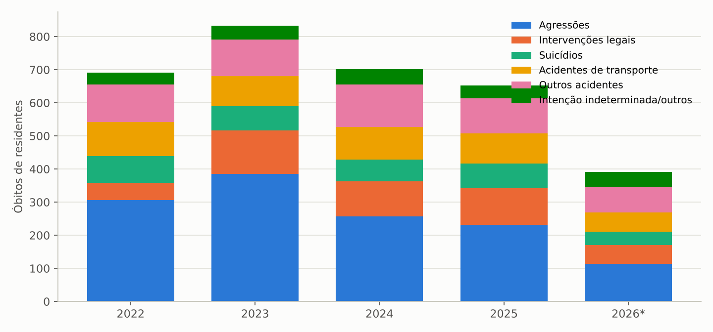
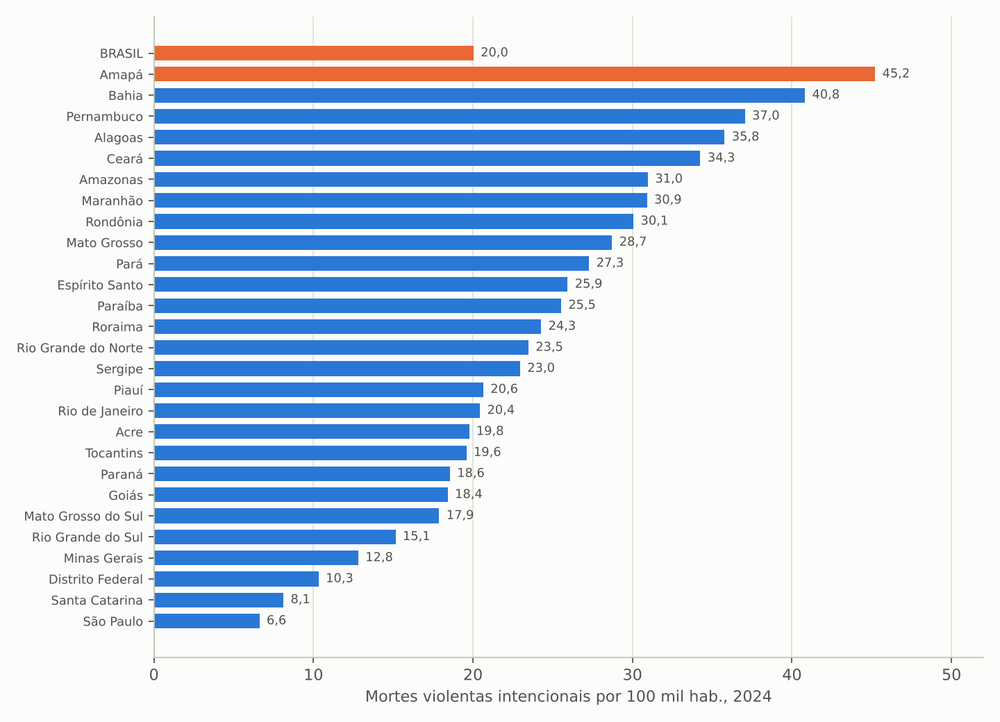
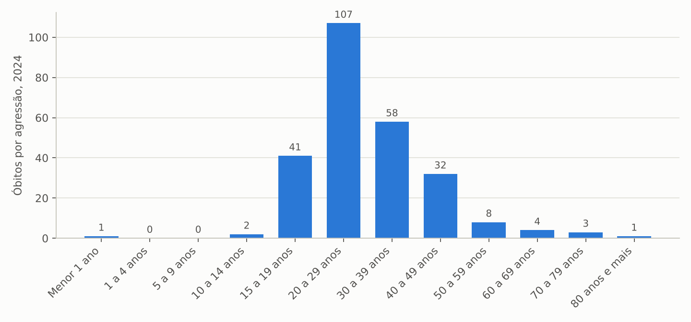
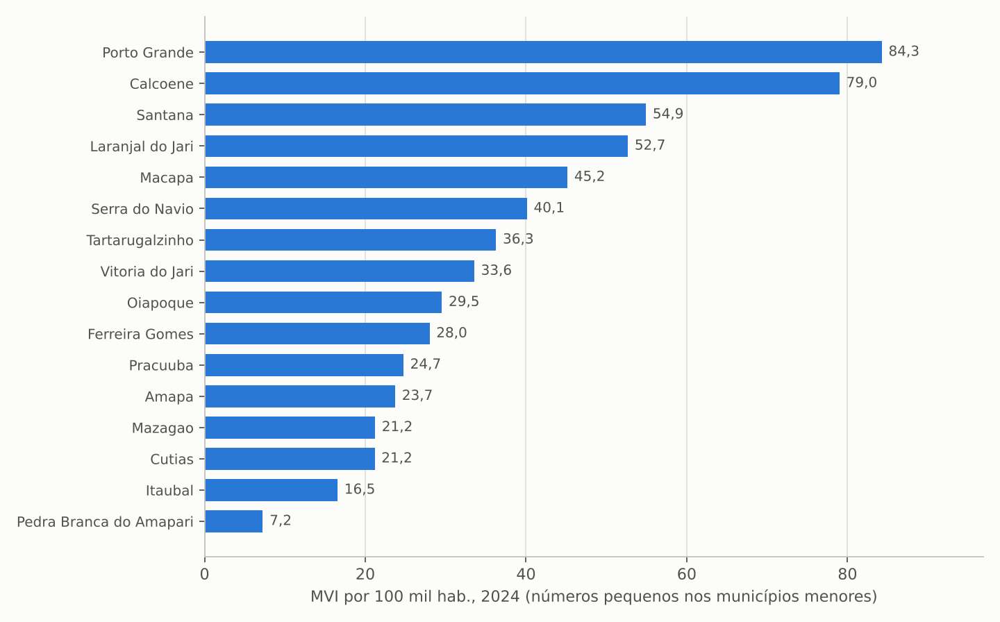
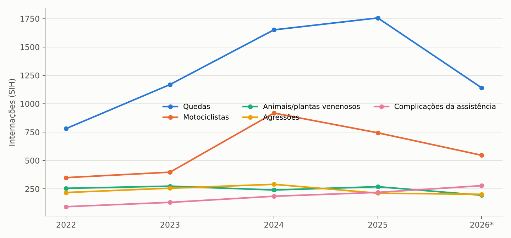
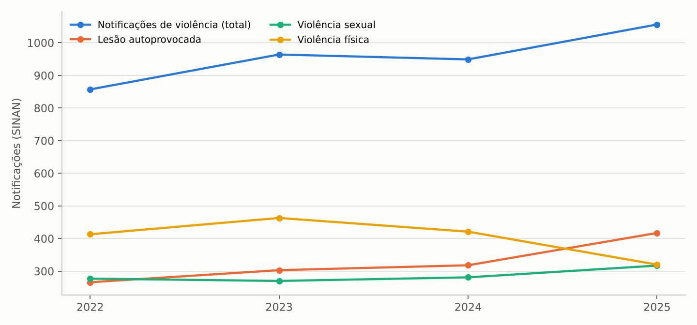
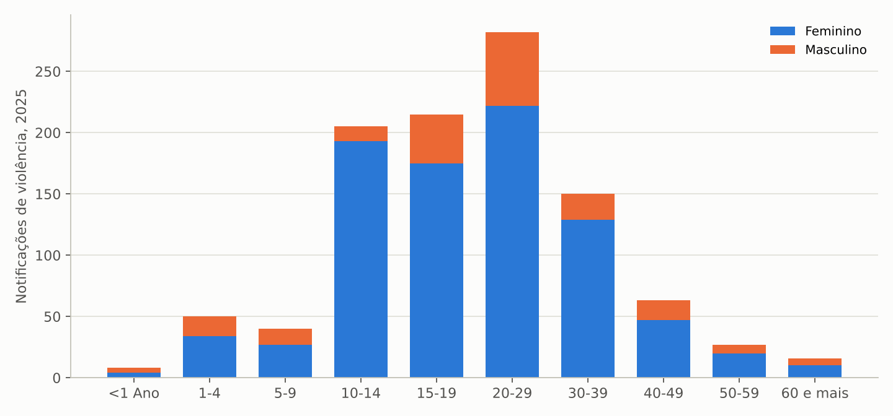
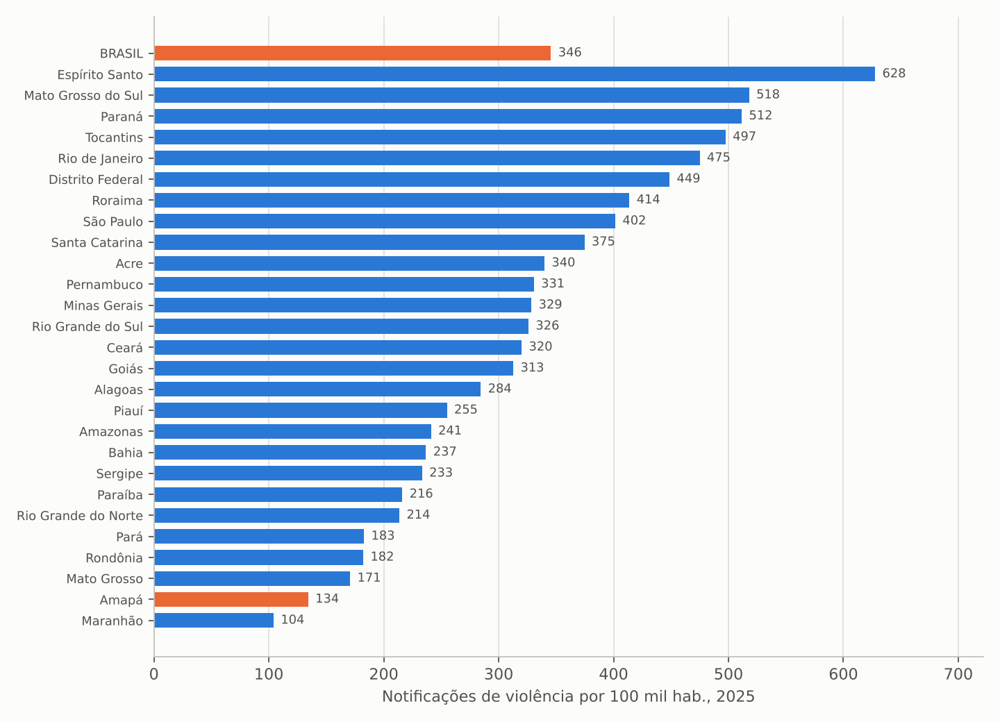
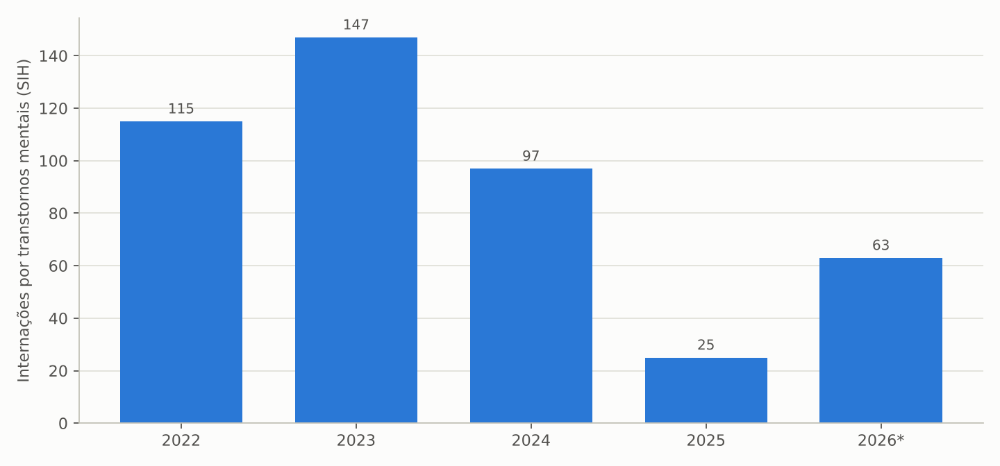

# 1. Introdução

## 1.1 Objetivo e contexto

Este estudo complementa o levantamento geral da saúde no Amapá para a transição de governo 2026/2027 (ALMEIDA, 2026) com o diagnóstico das violências, das causas externas e da saúde mental no período 2022–2026. As causas externas são a segunda causa de morte no estado, a primeira entre jovens, e um dos maiores geradores de demanda para a rede de urgência; as violências interpessoal e autoprovocada notificadas e a Rede de Atenção Psicossocial (RAPS) completam o quadro de um campo em que a Secretaria de Estado da Saúde (SESA/AP) atua na vigilância, na urgência, na reabilitação e na atenção psicossocial, em articulação com segurança pública, assistência social e municípios.

## 1.2 Objeto

Óbitos de residentes por causas externas (SIM), internações por causas externas e por transtornos mentais (SIH/SUS), notificações de violência interpessoal e autoprovocada e de intoxicações exógenas (SINAN), componentes da RAPS registrados no CNES (CAPS habilitados, leitos de psiquiatria, equipes de consultório na rua e de atenção domiciliar) e produção ambulatorial psicossocial (SIA/SUS), com comparativos entre as unidades da federação.

## 1.3 Período

Série 2022–2026: 2022 como ano-base, 2023 a 2025 como anos completos (2025 preliminar no SIM) e 2026 parcial (SIM e SINAN até a extração; SIH até agosto; CNES em setembro).

## 1.4 Fontes e extração

Tabulações do TABNET/DATASUS (SIM, SIH, SINAN, CNES, SIA) e API SIDRA do IBGE, extraídas em 7/11/2026 por scripts reproduzíveis. As taxas usam as estimativas populacionais pós-Censo 2022; para 2023 utilizou-se a população de 2024 nos comparativos entre UFs. "Mortes violentas intencionais" somam agressões (X85-Y09) e intervenções legais (Y35-Y36), conforme a convenção do Fórum Brasileiro de Segurança Pública.

## 1.5 Limitações

(a) Dados de segurança pública (ocorrências policiais, armas apreendidas, população carcerária) e do SAMU (chamados, tempo-resposta) não estão em bases públicas acessíveis; (b) a produção dos CAPS (RAAS) não é tabulável no TABNET e foi aproximada pela forma de organização "atendimento psicossocial" do SIA; (c) a notificação de violência no SINAN é fortemente influenciada pela sensibilidade dos serviços notificadores, de modo que variações podem refletir mudança de registro e não de ocorrência; (d) números pequenos nos municípios do interior tornam as taxas municipais instáveis.

# 2. Síntese dos achados

Os dez achados centrais são apresentados a seguir e detalhados nas seções 3 a 8.

1. **O Amapá tem a maior taxa de mortes violentas intencionais do país:** 45,2 por 100 mil habitantes em 2024 (257 agressões e 106 intervenções legais), contra 20,0 na média nacional; em 2023 o estado registrou 516 mortes violentas intencionais (385 agressões e 131 intervenções legais), o pior ano da série. Em 2025 (preliminar) foram 342 (42,4 por 100 mil).
2. **As mortes por intervenção legal são um caso à parte:** 106 em 2024, 4,0% de todas as mortes por intervenção legal do Brasil, em um estado com 0,4% da população; 81% das vítimas tinham entre 15 e 29 anos. A letalidade da ação policial é componente central da violência no estado e exige articulação com a Secretaria de Segurança, o Ministério Público e a Defensoria.
3. **A violência letal é jovem, masculina e negra:** 96% das vítimas de agressão são homens, 58% têm entre 15 e 29 anos e 98% são pretos ou pardos. Macapá (144 agressões e 76 intervenções legais em 2024; 45,2 por 100 mil) e Santana (49 e 16; 54,9 por 100 mil) concentram 79% das mortes violentas; Porto Grande (84,3), Calçoene (79,0) e Laranjal do Jari (52,7) têm taxas ainda mais altas, com números pequenos.
4. **Os suicídios cresceram para 74 em 2025** (9,2 por 100 mil, acima da média nacional de 7,9 em 2024), 80% entre 15 e 39 anos, enquanto as lesões autoprovocadas notificadas no SINAN subiram 57% (266 em 2022, 417 em 2025), três quartos delas em pessoas de 10 a 29 anos e 159 em adolescentes de 10 a 19 anos. As tentativas de suicídio por intoxicação (33 em 2024) são subnotificadas.
5. **Os afogamentos matam cerca de 50 pessoas por ano** (6,1 por 100 mil habitantes, uma das maiores taxas do país), reflexo da geografia fluvial e da ausência de ações de prevenção; os acidentes de transporte matam de 91 a 103 por ano (12,3 por 100 mil, abaixo da média nacional), com motociclistas como principal vítima.
6. **As internações por causas externas cresceram 84% entre 2022 e 2025** (2.442 para 4.503), com quedas (781 para 1.756), motociclistas (349 para 744) e complicações da assistência médica (93 para 219) como grupos de maior crescimento; o Hospital de Emergência absorve 51% dessas internações (2.308 em 2025), seguido de Laranjal do Jari (496) e do Hospital Maria Lúcia (397).
7. **A violência contra mulheres, crianças e adolescentes domina as notificações:** 1.056 notificações em 2025 (857 em 2022), 82% de vítimas do sexo feminino, 49% em menores de 20 anos, 77% ocorridas na residência e 52% de repetição; a violência sexual atingiu 317 notificações (269 estupros), 200 delas contra crianças e adolescentes até 14 anos.
8. **O Amapá notifica pouco:** 134 notificações de violência por 100 mil habitantes em 2025, contra 346 na média nacional (26ª posição), o que indica subnotificação, sobretudo no interior (Calçoene e Serra do Navio com uma notificação cada em 2025). O município de Pedra Branca do Amapari teve pico de 66 notificações em 2024, parte delas de população indígena (34 notificações indígenas no estado em 2024).
9. **A rede de saúde mental encolheu no componente hospitalar sem expandir proporcionalmente o comunitário:** as internações por transtornos mentais caíram de 115 (2022) para 25 (2025), com o fim das internações psiquiátricas no Hospital de Clínicas (81 para 5), restando 19 leitos de psiquiatria no Hospital de Emergência e 5 de acolhimento noturno; os atendimentos psicossociais registrados no SIA dobraram (15,5 mil para 33,5 mil), mas há apenas 8 CAPS habilitados (4 CAPS I, 2 infantis, 1 AD, 1 AD III) para 16 municípios e 4 equipes de consultório na rua.
10. **A mortalidade por transtornos mentais e por uso de substâncias é subestimada nos registros,** enquanto os óbitos por eventos de intenção indeterminada (26 em 2024) e por complicações da assistência médica (19) sinalizam problemas de qualidade da certificação e do cuidado hospitalar.

# 3. Mortalidade por causas externas

## 3.1 Magnitude e composição

Tabela: Óbitos de residentes por causas externas segundo grande grupo da CID-10, Amapá, 2022–2026

| Grande grupo (CID-10) | 2022 | 2023 | 2024 | 2025* | 2026 (parcial) | Taxa 2024 (por 100 mil) |
|---|---:|---:|---:|---:|---:|---:|
| Agressões (X85-Y09) | 306 | 385 | 257 | 232 | 113 | 32,0 |
| Intervenções legais (Y35-Y36) | 52 | 131 | 106 | 110 | 57 | 13,2 |
| Outras causas externas acidentais (W00-X59) | 113 | 110 | 129 | 107 | 76 | 16,1 |
| Acidentes de transporte (V01-V99) | 103 | 92 | 99 | 91 | 58 | 12,3 |
| Lesões autoprovocadas (X60-X84) | 81 | 73 | 65 | 74 | 41 | 8,1 |
| Eventos de intenção indeterminada (Y10-Y34) | 21 | 20 | 26 | 25 | 27 | 3,2 |
| Complicações da assistência médica (Y40-Y84) | 14 | 21 | 19 | 13 | 19 | 2,4 |
| Sequelas (Y85-Y89) | 1 | 1 | 0 | 1 | 0 | 0,0 |
| **Total** | **691** | **833** | **701** | **653** | **391** | **87,3** |
| Mortes violentas intencionais (agressões + intervenções legais) | 358 | 516 | 363 | 342 | 170 | 45,2 |

\* preliminar. Fonte: SIM/DATASUS (BRASIL, 2026) (aba `SIM_ext_grande_grupo_ano`).

Figura: Óbitos de residentes por causas externas segundo grupo, Amapá, 2022–2026

Fonte: elaboração própria a partir de SIM/DATASUS (BRASIL, 2026).

As causas externas mataram de 653 a 833 pessoas por ano (87,3 por 100 mil habitantes em 2024, 9ª maior taxa do país), com dois movimentos opostos: as agressões caíram de 385 (2023) para 232 (2025), enquanto as intervenções legais subiram de 52 (2022) para 110 (2025). Somadas, as mortes violentas intencionais passaram de 358 para 516 em 2023 e recuaram para 342 em 2025, taxa de 42,4 por 100 mil, ainda mais que o dobro da média nacional. Entre os acidentes, destacam-se os afogamentos (47 a 50 por ano, estáveis) e as quedas (35 a 47), além dos acidentes de transporte (91 a 103, com motociclistas em primeiro lugar).

Figura: Mortes violentas intencionais por 100 mil habitantes, por UF, 2024

Fonte: elaboração própria a partir de SIM/DATASUS e IBGE (BRASIL, 2026).

## 3.2 Perfil das vítimas e distribuição territorial

Figura: Óbitos por agressão segundo faixa etária, Amapá, 2024

Fonte: elaboração própria a partir de SIM/DATASUS (BRASIL, 2026).

Em 2024, 87% das vítimas de causas externas eram homens e 88% pardas; nas agressões, 96% homens e 98% pretos ou pardos; 148 das 257 vítimas de agressão (58%) e 86 das 106 vítimas de intervenção legal (81%) tinham entre 15 e 29 anos. As 106 mortes por intervenção legal registradas no Amapá em 2024 correspondem a 4,0% das 2.644 mortes dessa natureza no país, para 0,4% da população, proporção dez vezes superior ao peso demográfico do estado.

Tabela: Mortalidade por causas externas e mortes violentas intencionais por município de residência, Amapá, 2024

| Município | População 2024 | Óbitos por causas externas | Taxa (por 100 mil) | Agressões | Intervenções legais | MVI por 100 mil | Suicídios | Acid. transporte |
|---|---:|---:|---:|---:|---:|---:|---:|---:|
| Macapá | 487.200 | 404 | 82,9 | 144 | 76 | 45,2 | 34 | 58 |
| Santana | 118.353 | 111 | 93,8 | 49 | 16 | 54,9 | 11 | 12 |
| Laranjal do Jari | 37.969 | 47 | 123,8 | 11 | 9 | 52,7 | 3 | 10 |
| Oiapoque | 30.481 | 26 | 85,3 | 8 | 1 | 29,5 | 6 | 4 |
| Mazagão | 23.575 | 22 | 93,3 | 5 | 0 | 21,2 | 2 | 6 |
| Porto Grande | 18.988 | 22 | 115,9 | 14 | 2 | 84,3 | 2 | 2 |
| Calçoene | 11.391 | 15 | 131,7 | 9 | 0 | 79,0 | 2 | 1 |
| Tartarugalzinho | 13.785 | 11 | 79,8 | 4 | 1 | 36,3 | 0 | 0 |
| Cutias | 4.725 | 8 | 169,3 | 1 | 0 | 21,2 | 2 | 2 |
| Amapá (município) | 8.434 | 7 | 83,0 | 2 | 0 | 23,7 | 0 | 0 |
| Vitória do Jari | 11.922 | 6 | 50,3 | 3 | 1 | 33,6 | 0 | 0 |
| Pedra Branca do Amapari | 13.798 | 5 | 36,2 | 1 | 0 | 7,2 | 0 | 2 |
| Ferreira Gomes | 7.145 | 5 | 70,0 | 2 | 0 | 28,0 | 1 | 0 |
| Pracuúba | 4.042 | 5 | 123,7 | 1 | 0 | 24,7 | 0 | 2 |
| Itaubal | 6.043 | 4 | 66,2 | 1 | 0 | 16,5 | 2 | 0 |
| Serra do Navio | 4.986 | 3 | 60,2 | 2 | 0 | 40,1 | 0 | 0 |
| **Amapá** | **802.837** | **701** | **87,3** | **257** | **106** | **45,2** | **65** | **99** |

Fonte: SIM/DATASUS e IBGE (aba `SIM_ext_taxas_mun_2024`). MVI = mortes violentas intencionais. Taxas municipais com números pequenos são instáveis.

Figura: Mortes violentas intencionais por 100 mil habitantes, por município de residência, Amapá, 2024

Fonte: elaboração própria a partir de SIM/DATASUS e IBGE (BRASIL, 2026).

Macapá e Santana concentram 79% das mortes violentas intencionais (220 e 65 de 363), e Santana tem taxa superior à da capital (54,9 contra 45,2). No interior, Porto Grande (14 agressões, 84,3 por 100 mil), Calçoene (9; 79,0) e Laranjal do Jari (20 mortes violentas; 52,7) destacam-se como territórios de violência letal associados a garimpo, fronteira e rodovia. Cutias (169,3 por 100 mil, oito óbitos) e Laranjal do Jari (123,8) têm as maiores taxas gerais de causas externas, com peso de acidentes e afogamentos.

## 3.3 Suicídios e afogamentos

Os suicídios oscilaram entre 65 e 81 por ano e chegaram a 74 em 2025 (9,2 por 100 mil habitantes; Brasil 7,9 em 2024), 80% entre 15 e 39 anos e três quartos em homens; Macapá registrou 34 e Santana 11 em 2024. Os afogamentos (47 a 50 óbitos por ano, 6,1 por 100 mil em 2024) representam quase metade das mortes acidentais não relacionadas a transporte e atingem sobretudo crianças, adolescentes e trabalhadores ribeirinhos, o que recomenda ações intersetoriais de prevenção (coletes, sinalização, educação, resgate aquático).

# 4. Internações por causas externas

Tabela: Internações por causas externas segundo grupo de causas, Amapá, 2022–2026

| Grupo de causas | 2022 | 2023 | 2024 | 2025 | 2026 (jan–ago) | Var. 2022–2025 |
|---|---:|---:|---:|---:|---:|---:|
| Quedas | 781 | 1.169 | 1.651 | 1.756 | 1.140 | +125% |
| Acidentes de transporte | 652 | 742 | 1.283 | 1.030 | 842 | +58% |
| dos quais motociclistas | 349 | 397 | 918 | 744 | 546 | +113% |
| Contato com animais e plantas venenosos | 255 | 274 | 240 | 269 | 194 | +5% |
| Agressões | 218 | 256 | 290 | 212 | 202 | −3% |
| Complicações da assistência médica e cirúrgica | 93 | 131 | 185 | 219 | 278 | +135% |
| Exposição a corrente elétrica, radiação e temperaturas extremas | 5 | 284 | 190 | 418 | 409 | — |
| Lesões autoprovocadas | 23 | 12 | 12 | 17 | 11 | −26% |
| Demais causas externas | 415 | 468 | 538 | 582 | 358 | +40% |
| **Total** | **2.442** | **3.336** | **4.389** | **4.503** | **3.434** | **+84%** |

Fonte: SIH/SUS, local de internação (abas `SIH_ext_grande_grupo_ano`, `SIH_ext_grupo_ano`).

Figura: Internações por causas externas selecionadas, Amapá, 2022–2026

Fonte: elaboração própria a partir de SIH/SUS/DATASUS (BRASIL, 2026).

As internações por causas externas quase dobraram em três anos e custaram R$ 3,4 milhões em 2025, com permanência média de 5,2 dias e 59 óbitos hospitalares. O crescimento das quedas (sobretudo em idosos e crianças) e das internações de motociclistas (+113%, com pico de 918 em 2024) reflete o envelhecimento, a motorização e a maior capacidade de registro do Hospital de Emergência, que concentra 51% das internações (2.308 em 2025); o Hospital Estadual de Laranjal do Jari (496, com 154 acidentes de transporte) e o Hospital Maria Lúcia Guimarães da Silva, em Porto Grande (397, quase todas por "outras causas acidentais"), são os polos do interior. Dois grupos merecem auditoria de codificação: as complicações da assistência médica e cirúrgica (93 para 219, e 278 só em jan–ago/2026, 71% delas "reações anormais ou complicações tardias de procedimentos") e a "exposição a corrente elétrica, radiação e temperaturas extremas" (5 em 2022 para 418 em 2025), código raramente usado nessa escala e possivelmente aplicado a outras condições. As internações por lesão autoprovocada (12 a 23 por ano) são muito inferiores às notificações (417) e aos óbitos (74), o que sugere subregistro do motivo da internação.

# 5. Violências notificadas (SINAN)

Tabela: Notificações de violência interpessoal e autoprovocada por característica, Amapá, 2022–2025

| Característica | 2022 | 2023 | 2024 | 2025 |
|---|---:|---:|---:|---:|
| Total de notificações | 857 | 964 | 949 | 1.056 |
| Vítimas do sexo feminino (%) | 84,4 | 83,1 | 78,5 | 81,5 |
| Vítimas de 0 a 19 anos (%) | 46,8 | 41,2 | 42,5 | 49,1 |
| Violência física | 413 | 463 | 421 | 320 |
| Violência psicológica/moral | 228 | 224 | 184 | 139 |
| Violência sexual | 277 | 270 | 281 | 317 |
| dos quais estupro | 218 | 222 | 248 | 269 |
| Negligência/abandono | 36 | 28 | 50 | 49 |
| Lesão autoprovocada | 266 | 303 | 318 | 417 |
| Ocorrida na residência (%) | 78,8 | 75,8 | 72,7 | 77,4 |
| Violência de repetição (%) | 54,0 | 51,2 | 48,8 | 51,6 |
| Vítimas indígenas | 9 | 32 | 34 | 20 |
| Com arma de fogo | 7 | 22 | 16 | 11 |

Fonte: SINAN/DATASUS (abas `SINAN_viol_*`).

Figura: Notificações de violência por tipo, Amapá, 2022–2025

Fonte: elaboração própria a partir de SINAN/DATASUS (BRASIL, 2026).

Figura: Notificações de violência por faixa etária e sexo, Amapá, 2025

Fonte: elaboração própria a partir de SINAN/DATASUS (BRASIL, 2026).

As notificações cresceram 23% e mudaram de perfil: a violência física e a psicológica caíram, enquanto a sexual (317 em 2025, 269 estupros) e a lesão autoprovocada (417, +57%) aumentaram. Em 2025, 861 das 1.056 vítimas eram mulheres e meninas; 420 tinham entre 10 e 19 anos; 200 das 317 vítimas de violência sexual tinham até 14 anos; e 159 das 417 lesões autoprovocadas ocorreram em adolescentes de 10 a 19 anos. Três quartos das violências ocorrem dentro de casa e metade é de repetição, o que caracteriza violência doméstica e familiar crônica. Macapá (580), Santana (109), Oiapoque (108) e Laranjal do Jari (94) concentram as notificações; Pedra Branca do Amapari teve pico de 66 em 2024, ano em que as vítimas indígenas chegaram a 34.

Figura: Notificações de violência por 100 mil habitantes, por UF, 2025

Fonte: elaboração própria a partir de SINAN/DATASUS e IBGE (BRASIL, 2026).

Com 134 notificações por 100 mil habitantes, o Amapá está na 26ª posição entre as UFs (média nacional: 346), apesar de ter uma das maiores taxas de homicídio do país: a baixa notificação indica que serviços de urgência, atenção primária, escolas e conselhos tutelares não estão alimentando a vigilância, condição necessária para as redes de proteção e para a vigilância de tentativas de suicídio.

# 6. Saúde mental e Rede de Atenção Psicossocial

Tabela: Componentes da Rede de Atenção Psicossocial e indicadores de saúde mental, Amapá, 2022–2026

| Componente ou indicador | 2022 | 2025/2026 | Observação |
|---|---:|---:|---|
| CAPS cadastrados no CNES | 10 | 12 | 8 habilitados pelo MS: 4 CAPS I, 2 CAPS infantis, 1 CAPS AD, 1 CAPS AD III |
| Leitos SUS de psiquiatria em hospital geral | — | 19 | Hospital de Emergência; 5 leitos de acolhimento noturno |
| Equipes de Consultório na Rua | 2 | 4 | — |
| Equipes de atenção domiciliar (EMAD) | 5 | 6 | — |
| Atendimentos psicossociais registrados no SIA (030108) | 15.526 | 33.509 | 2024: 30.222 |
| Internações por transtornos mentais (SIH) | 115 | 25 | 2023: 147; 2024: 97; jan–ago/2026: 63 |
| Internações por esquizofrenia e transtornos delirantes | 78 | 7 | HCAL: 81 (2022) para 5 (2025) |
| Internações por uso de álcool e outras substâncias | 17 | 13 | — |
| Óbitos por transtornos mentais e comportamentais (SIM) | 20 | 25 | — |
| Lesões autoprovocadas notificadas (SINAN) | 266 | 417 | — |
| Suicídios (SIM) | 81 | 74 | 9,2 por 100 mil em 2025 |

Fonte: CNES, SIA, SIH, SIM e SINAN/DATASUS (aba `RAPS_componentes`).

Figura: Internações por transtornos mentais e comportamentais, Amapá, 2022–2026

Fonte: elaboração própria a partir de SIH/SUS/DATASUS (BRASIL, 2026).

As internações por transtornos mentais caíram 78% entre 2022 e 2025 e as por esquizofrenia de 78 para 7, resultado do encerramento das internações psiquiátricas no Hospital de Clínicas Dr. Alberto Lima (81 em 2022, 105 em 2023, 5 em 2025); no primeiro semestre de 2026 elas voltaram a subir (63), com reabertura parcial no HCAL (37). A rede substitutiva, porém, não cresceu na mesma proporção: há 8 CAPS habilitados para 16 municípios (nenhum CAPS III 24 horas para adultos, exceto o CAPS AD III), 19 leitos de saúde mental em hospital geral, 4 equipes de consultório na rua e 6 de atenção domiciliar, e os atendimentos psicossociais ambulatoriais, embora tenham dobrado, somam 33,5 mil por ano para uma população de 806 mil habitantes. A combinação de suicídios em alta, lesões autoprovocadas em adolescentes, intoxicações por tentativa de suicídio (33 em 2024) e uso de álcool e drogas com rede de crise insuficiente levou o Ministério Público a recomendar, em 2026, a ampliação de leitos de saúde mental e a abertura de residências terapêuticas, conforme noticiado no estudo geral.

# 7. Comparativo entre UFs

Tabela: Mortalidade por causas externas e notificação de violência: Amapá, Brasil e posição entre as UFs

| Indicador | Amapá | Brasil | Posição do AP |
|---|---:|---:|---:|
| Mortes violentas intencionais por 100 mil hab., 2024 | 45,2 | 20,0 | 1º |
| Óbitos por causas externas por 100 mil hab., 2024 | 87,3 | 75,0 | 9º |
| Suicídios por 100 mil hab., 2024 | 8,1 | 7,9 | 17º |
| Acidentes de transporte por 100 mil hab., 2024 | 12,3 | 18,0 | 24º |
| Notificações de violência por 100 mil hab., 2025 | 134 | 346 | 26º |

Fonte: SIM, SINAN/DATASUS e IBGE (abas `BENCH_CAUSAS_EXTERNAS_UF`, `BENCH_VIOLENCIA_UF_2025`).

O Amapá combina a maior taxa de mortes violentas intencionais do país com uma das menores taxas de notificação de violência, mortalidade por suicídio acima da média e mortalidade no trânsito abaixo da média. A assimetria entre violência letal elevada e notificação baixa é o principal sinal de que a vigilância de violências e acidentes (VIVA) precisa ser reestruturada nos serviços de urgência e na atenção primária.

# 8. Pontos de atenção para a transição

## 8.1 Violência letal e intervenções legais

Taxa de mortes violentas intencionais mais alta do Brasil e 106 mortes por intervenção legal em 2024: além da articulação com a segurança pública, a SESA deve garantir a qualidade da certificação (necropsia, causa básica), a vigilância de óbitos violentos e a atenção às vítimas e famílias, com foco em jovens negros de Macapá, Santana, Porto Grande, Calçoene e Laranjal do Jari.

## 8.2 Suicídio e adolescentes

Suicídios em alta (74 em 2025), 417 lesões autoprovocadas notificadas (159 em adolescentes) e tentativas por intoxicação: implantar linha de cuidado de crise com porta de entrada nas UPAs e no HE, CAPS infantojuvenis regionais, protocolo escolar e vigilância das tentativas.

## 8.3 Violência sexual contra crianças

200 notificações de violência sexual contra menores de 15 anos em 2025, majoritariamente intrafamiliar: garantir serviços de referência para profilaxia e acolhimento (Macapá, Santana e um polo por região), fluxo com o conselho tutelar e o Judiciário e capacitação da APS para notificação.

## 8.4 Rede de urgência e trauma

Internações por causas externas em alta (+84%), concentradas no HE (51%): dimensionar leitos de trauma e ortopedia, regular transferências do interior (Laranjal do Jari, Porto Grande, Oiapoque) e revisar a codificação de complicações da assistência e de exposição a agentes físicos.

## 8.5 Rede de Atenção Psicossocial

Fim das internações psiquiátricas sem CAPS III adulto, residências terapêuticas e leitos de crise suficientes: planejar com os municípios a expansão de CAPS (incluindo CAPS III em Macapá e CAPS i regionais), leitos de saúde mental em hospitais gerais do interior e serviços residenciais terapêuticos, em cumprimento às recomendações do Ministério Público.

## 8.6 Afogamentos e prevenção

Cerca de 50 mortes por ano por afogamento exigem ação intersetorial (Defesa Civil, Corpo de Bombeiros, educação, transporte fluvial) com metas de redução.

## 8.7 Informação

Subnotificação de violências (26ª posição), subregistro das lesões autoprovocadas nas internações e codificações anômalas no SIH comprometem a vigilância; pactuar metas de notificação por unidade de urgência e por município.

# 9. Recomendações e agenda dos primeiros 100 dias

**Documentos e dados a requisitar à SESA e a órgãos parceiros:**

1. Produção dos CAPS (RAAS) por unidade e município, equipes, filas e cobertura de medicamentos psiquiátricos; situação dos CAPS cadastrados e não habilitados.
2. Protocolos e fluxos de atenção à crise em saúde mental no HE e nas UPAs; leitos de saúde mental em uso; projetos de residências terapêuticas.
3. Dados do SAMU (chamados, tempo-resposta, bases no interior) e de regulação de trauma.
4. Relatório da vigilância de violências e acidentes (VIVA) por unidade notificadora, com serviços de referência para violência sexual.
5. Dados de segurança pública (SEJUSP, IML): ocorrências de homicídio e intervenção legal por município, para pareamento com o SIM.
6. Situação do Comitê de Prevenção do Suicídio e das ações do Setembro Amarelo, com indicadores de tentativas e óbitos por município.

**Prioridades de gestão sugeridas:**

1. Instituir, com SEJUSP, MP e Defensoria, um observatório de mortes violentas intencionais com dados pareados SIM/SEJUSP e metas de redução.
2. Implantar a linha de cuidado da crise em saúde mental e do risco de suicídio (UPAs, HE, CAPS, APS, escolas), com vigilância das tentativas.
3. Expandir a RAPS: CAPS III adulto em Macapá, CAPS i regionais, leitos de saúde mental em hospitais gerais e residências terapêuticas.
4. Qualificar a notificação de violências nas urgências e na APS, com metas por unidade e fluxos de proteção de crianças, adolescentes e mulheres.
5. Dimensionar a rede de trauma e ortopedia e a regulação do interior, e auditar as codificações anômalas do SIH.
6. Lançar programa intersetorial de prevenção de afogamentos e de acidentes com motociclistas.

# 10. Considerações finais

A violência é, no Amapá, um problema de saúde pública de primeira grandeza: o estado tem a maior taxa de mortes violentas intencionais do país, com peso singular das intervenções legais, suicídios em alta entre jovens e violência sexual e doméstica contra crianças e mulheres que chega aos serviços, mas é pouco notificada. Ao mesmo tempo, a rede de saúde mental perdeu o componente hospitalar sem ganhar o comunitário. Os dados reunidos neste estudo permitem à nova gestão definir metas por município e por unidade, articular-se com a segurança pública e o sistema de justiça e reconstruir a Rede de Atenção Psicossocial a partir de uma linha de base verificável.

# APÊNDICE A – Conteúdo da planilha de tabelas

A planilha `Tabelas_Violencias_SaudeMental_Amapa_2022_2026.xlsx` contém a aba `Indice`, o painel `00_Painel_Violencias` e as abas `SIM_ext_*` (grande grupo, grupo, categoria, município, sexo, faixa etária, cor/raça e taxas municipais 2024), `BENCH_CAUSAS_EXTERNAS_UF`, `SIH_ext_*` (grande grupo, grupo, faixa etária, sexo, estabelecimento e indicadores de 2025), `SINAN_viol_*` (município, faixa etária, sexo, tipos de violência, local, repetição, raça/cor, arma de fogo, estupro e cruzamentos de 2025), `BENCH_VIOLENCIA_UF_2025`, `SINAN_intox_circunstancia_ano`, `SIH_transtornos_mentais_*`, `RAPS_componentes` e `Fontes_Notas`. Séries recortadas para 2022–2026.
