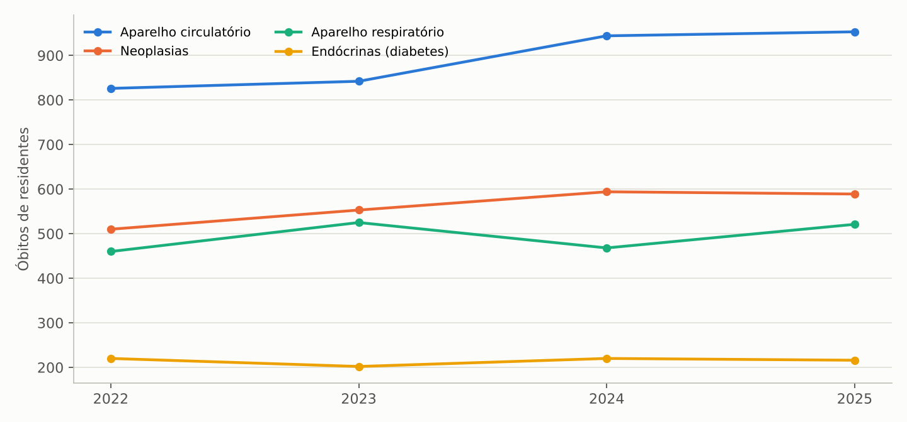
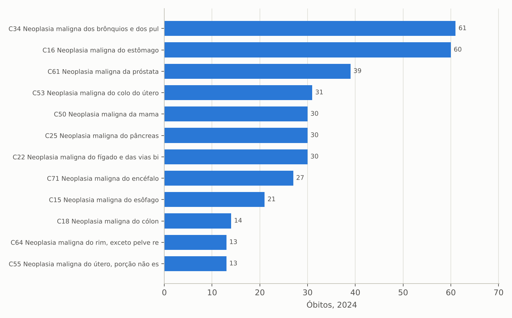
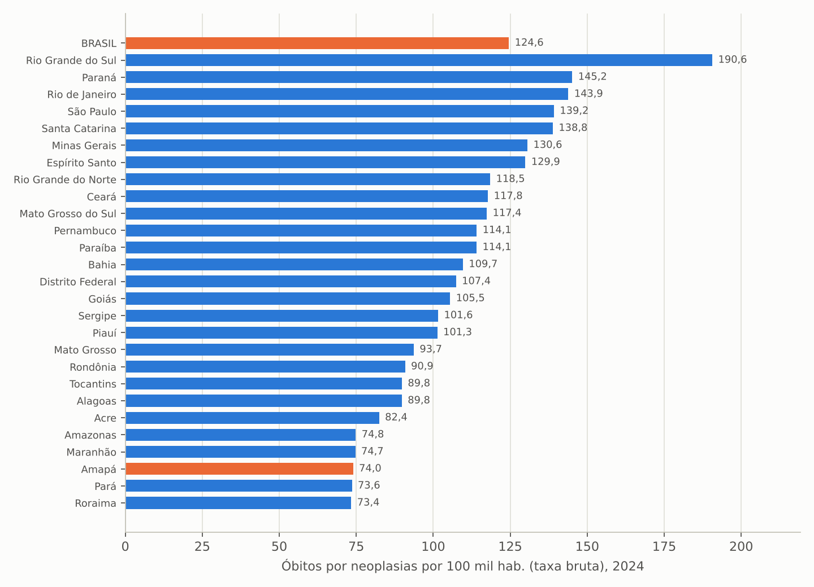
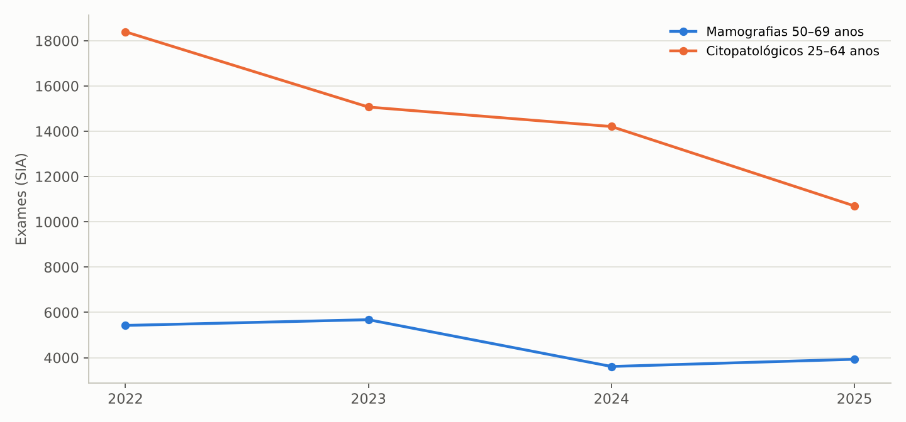
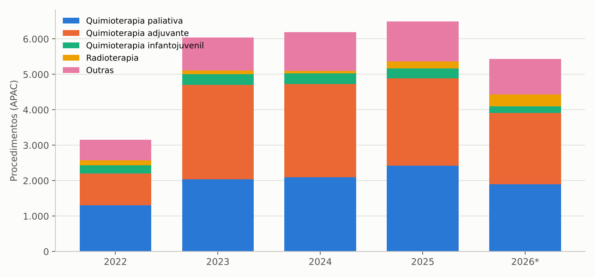
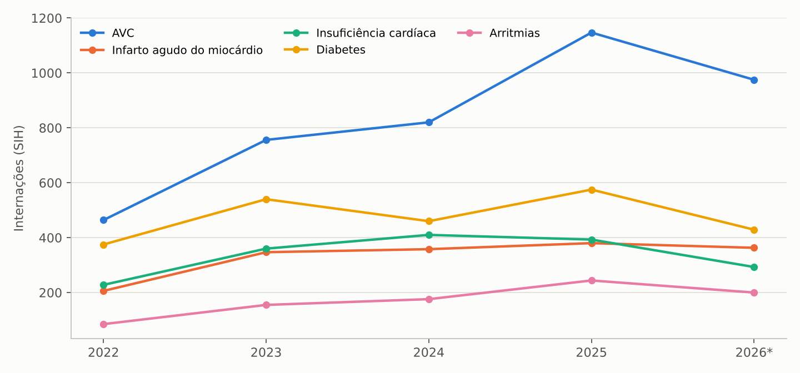
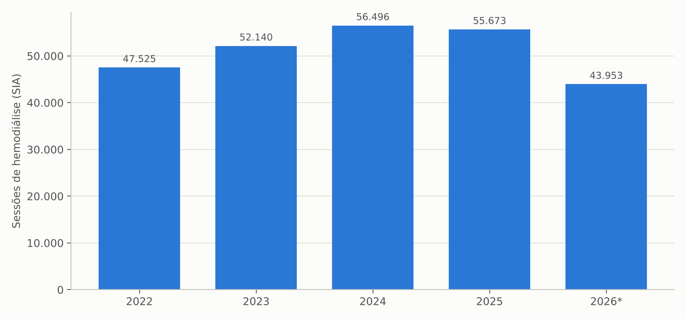

# 1. Introdução

## 1.1 Objetivo e contexto

Este estudo complementa o levantamento geral da saúde no Amapá para a transição de governo 2026/2027 (ALMEIDA, 2026) com o diagnóstico da oncologia, do rastreamento do câncer e das doenças crônicas não transmissíveis (DCNT) no período 2022–2026. As doenças do aparelho circulatório e as neoplasias são, respectivamente, a primeira e a terceira causas de morte no estado e crescem com o envelhecimento da população; a oncologia e a terapia renal substitutiva estão entre as linhas de cuidado de maior custo e maior dependência de serviços de alta complexidade, inclusive fora do estado.

## 1.2 Objeto

Óbitos de residentes por neoplasias e por doenças crônicas (SIM); produção ambulatorial de oncologia (quimioterapia, radioterapia e hormonioterapia), de nefrologia (diálise) e de rastreamento (mamografia e exame citopatológico) por faixa etária e sexo (SIA/SUS); internações por neoplasias, doenças circulatórias e endócrinas (SIH/SUS); habilitações e equipamentos (CNES); populações-alvo do Censo 2022 (IBGE); comparativos entre as unidades da federação.

## 1.3 Período

Série 2022–2026: 2022 como ano-base, 2023 a 2025 como anos completos (2025 preliminar no SIM) e 2026 parcial (SIA e SIH até agosto; CNES em setembro).

## 1.4 Fontes e extração

Tabulações do TABNET/DATASUS (SIM, SIA, SIH, CNES) e API SIDRA do IBGE (Censo 2022, tabela 9514; estimativas, tabela 6579), extraídas em 7/11/2026 por scripts reproduzíveis. A razão de exames de rastreamento segue a metodologia do Ministério da Saúde: mamografias em mulheres de 50 a 69 anos divididas pela metade da população-alvo (periodicidade bienal) e exames citopatológicos em mulheres de 25 a 64 anos divididos por um terço da população-alvo (periodicidade trienal); razão igual a 1,0 indica cobertura compatível com a recomendação.

## 1.5 Limitações

(a) O Painel-Oncologia e o SISCAN (tempo entre diagnóstico e tratamento, estadiamento, resultados de exames) e os registros de câncer de base populacional e hospitalar não estavam acessíveis; (b) o SIA registra o local de atendimento, de modo que pacientes tratados fora do estado (via Tratamento Fora de Domicílio) não aparecem na produção amapaense; (c) as taxas de mortalidade por UF são brutas, não padronizadas por idade, o que favorece o Amapá, cuja população é mais jovem; (d) o número de pacientes em diálise foi estimado pelas sessões de hemodiálise (156 sessões por paciente-ano), na ausência do censo de diálise.

# 2. Síntese dos achados

Os dez achados centrais são apresentados a seguir e detalhados nas seções 3 a 8.

1. **As doenças crônicas já dominam a mortalidade:** em 2024, as doenças do aparelho circulatório causaram 944 óbitos (24% do total; infarto 276, acidente vascular cerebral 281, doenças hipertensivas 107), as neoplasias 594 (15%), o diabetes 177 e a doença pulmonar obstrutiva crônica 100. As taxas brutas (117,6 e 74,0 por 100 mil habitantes) estão abaixo da média nacional por efeito da estrutura etária jovem, mas 44% das mortes cardiovasculares e 56% das mortes por câncer ocorrem antes dos 70 anos, isto é, são prematuras.
2. **O perfil do câncer é o de um estado com pouco rastreamento e diagnóstico tardio:** os sítios que mais matam são estômago (60 óbitos em 2024; 69 em 2025), pulmão (61; 53), próstata (39; 43), colo do útero (31; 34), mama (30; 38), pâncreas e fígado (30 cada); o câncer de colo do útero, evitável por rastreamento, mata tanto quanto o de mama, o inverso do padrão nacional.
3. **O rastreamento está em queda:** as mamografias de rastreamento em mulheres de 50 a 69 anos caíram de 5.424 (2022) para 3.929 (2025), razão de 0,15 (meta 1,0), e os citopatológicos em mulheres de 25 a 64 anos de 18.393 para 10.702, razão de 0,18 (meta 1,0); mais de 40% das mamografias de rastreamento são feitas fora da faixa etária recomendada (40 a 49 anos).
4. **A produção oncológica dobrou e se especializou:** 3.155 procedimentos de quimioterapia, radioterapia e hormonioterapia em 2022, 6.495 em 2025 (R$ 7,8 milhões), com quimioterapia adjuvante (893 para 2.467) e paliativa (1.311 para 2.422) em alta; a radioterapia, que havia caído a 64 procedimentos em 2024 por dependência de serviços externos, voltou a crescer com o Centro de Radioterapia do Amapá (187 em 2025; 348 em jan–ago/2026, R$ 1,7 milhão), e a braquiterapia ginecológica começou em 2026 com 32 procedimentos já em 2025.
5. **A assistência oncológica é concentrada e frágil institucionalmente:** 73% dos procedimentos são de pacientes de Macapá; há apenas uma UNACON (com radioterapia desde 2025); as internações por neoplasias (1.823 em 2025, 130 óbitos, letalidade de 7,1%) distribuem-se entre o Hospital de Clínicas (553), o Hospital São Camilo (559, filantrópico com contrato em disputa) e o HU-UNIFAP (304, de zero em 2022), e a cirurgia oncológica registrada no SIH é residual (77 AIH em 2025, 123 em jan–ago/2026).
6. **Quase metade das internações por "neoplasias" é benigna:** 777 internações por leiomioma do útero e 309 por tumores benignos ou de comportamento incerto em 2025, contra cerca de 690 por neoplasias malignas, perfil que indica alta demanda cirúrgica ginecológica e baixa capacidade de cirurgia oncológica no estado.
7. **As internações por doenças crônicas agudizadas crescem rapidamente:** acidente vascular cerebral de 464 (2022) para 1.147 (2025), infarto agudo do miocárdio de 206 para 380, arritmias de 85 para 244, insuficiência cardíaca de 228 para 393, diabetes de 375 para 575 e cirurgia bariátrica (obesidade) de 2 para 66, enquanto as flebites e tromboses venosas (7.410 em 2025) seguem o padrão atípico analisado no estudo geral.
8. **A terapia renal substitutiva atende cerca de 357 pacientes** (55.673 sessões de hemodiálise em 2025, 442 pacientes por milhão de habitantes), em três serviços habilitados, com crescimento de 17% desde 2022 e diálise peritoneal incipiente (52 registros em 2025); 41% dos pacientes têm 60 anos ou mais, e a hemodiálise custa R$ 13,4 milhões por ano.
9. **A mortalidade por câncer cresceu 16% entre 2022 e 2024** (510 para 594 óbitos) e a cardiovascular 14% (826 para 944), ritmos superiores ao crescimento populacional, com destaque para as neoplasias hematológicas (35 para 58 em 2025) e de mama (30 para 38).
10. **A gestão carece de informação de linha de cuidado:** sem acesso público ao SISCAN, ao Painel-Oncologia e ao cadastro de hipertensos e diabéticos da atenção primária, não é possível medir o tempo até o tratamento (Lei 12.732/2012), o estadiamento ao diagnóstico e o controle pressórico e glicêmico; a transição deve requisitar esses painéis à SESA e ao UNACON.

# 3. Mortalidade por doenças crônicas e neoplasias

Tabela: Óbitos de residentes por grupos de doenças crônicas não transmissíveis, Amapá, 2022–2025

| Grupo de causas | 2022 | 2023 | 2024 | 2025* | Taxa bruta 2024 (por 100 mil) |
|---|---:|---:|---:|---:|---:|
| Doenças do aparelho circulatório (cap. IX) | 826 | 842 | 944 | 953 | 117,6 |
| Neoplasias (cap. II) | 510 | 553 | 594 | 589 | 74,0 |
| Doenças do aparelho respiratório (cap. X) | 460 | 525 | 468 | 521 | 58,3 |
| Doenças endócrinas, nutricionais e metabólicas (cap. IV) | 220 | 202 | 220 | 216 | 27,4 |
| Total de óbitos (todas as causas) | 3.846 | 3.926 | 3.903 | 3.988 | 486,2 |

\* preliminar. Fonte: SIM/DATASUS (BRASIL, 2026) (aba `SIM_grupo_cid_ano` e estudo geral).

Figura: Óbitos de residentes por grupos de doenças crônicas, Amapá, 2022–2025

Fonte: elaboração própria a partir de SIM/DATASUS (BRASIL, 2026).

Em 2024 as doenças cardiovasculares responderam por 944 óbitos (infarto agudo do miocárdio 276, doenças cerebrovasculares 281, doenças hipertensivas 107), as neoplasias por 594, o diabetes por 177, a doença pulmonar obstrutiva crônica por 100 e a doença renal crônica por 27. Por serem taxas brutas em uma população jovem, os valores do Amapá (117,6 óbitos cardiovasculares e 74,0 por câncer por 100 mil) ficam abaixo da média nacional (187,5 e 124,6) e nas posições 24ª e 25ª entre as UFs; a mortalidade prematura, porém, é alta: 415 das 944 mortes cardiovasculares (44%) e 335 das 594 por câncer (56%) ocorreram entre 30 e 69 anos. As mortes por câncer cresceram 16% entre 2022 e 2024 e as cardiovasculares 14%.

Tabela: Óbitos por neoplasias malignas segundo localização, Amapá, 2024 e 2025

| Localização (CID-10) | 2024 | 2025* | Sexo predominante |
|---|---:|---:|---|
| Estômago (C16) | 60 | 69 | Masculino (46 de 69 em 2025) |
| Brônquios e pulmões (C34) | 61 | 53 | Masculino |
| Próstata (C61) | 39 | 43 | — |
| Mama (C50) | 30 | 38 | Feminino |
| Colo do útero (C53) | 31 | 34 | Feminino |
| Pâncreas (C25) | 30 | 27 | Equilibrado |
| Fígado e vias biliares (C22) | 30 | 23 | Masculino |
| Encéfalo (C71) | 27 | 18 | Feminino |
| Esôfago (C15) | 21 | 13 | Masculino |
| Cólon, reto e ânus (C18-C21) | 25 | 27 | Equilibrado |
| Leucemias e linfomas (C81-C96) | 53 | 58 | — |
| **Todas as neoplasias (cap. II)** | **594** | **589** | **—** |

\* preliminar. Fonte: SIM/DATASUS (abas `SIM_neoplasias_categoria_sexo_2024`, `SIM_neoplasias_categoria_sexo_2025`, `SIM_neoplasias_grupo_ano`).

Figura: Óbitos por neoplasias malignas segundo localização, Amapá, 2024 (12 maiores)

Fonte: elaboração própria a partir de SIM/DATASUS (BRASIL, 2026).

O câncer de estômago, associado à infecção por Helicobacter pylori e a condições sanitárias, é a principal causa de morte por câncer, seguido do de pulmão; entre as mulheres, o câncer de colo do útero (31 e 34 óbitos) mata tanto quanto o de mama (30 e 38), o que caracteriza falha de rastreamento, pois o câncer cervical é quase totalmente evitável pela detecção de lesões precursoras. As neoplasias dos órgãos digestivos somam 181 a 190 óbitos por ano e as hematológicas cresceram de 35 (2022) para 58 (2025).

Figura: Óbitos por neoplasias por 100 mil habitantes (taxa bruta), por UF, 2024

Fonte: elaboração própria a partir de SIM/DATASUS e IBGE (BRASIL, 2026).

# 4. Rastreamento do câncer de mama e do colo do útero

Tabela: Indicadores de rastreamento do câncer de mama e do colo do útero, Amapá, 2022–2026

| Indicador | 2022 | 2023 | 2024 | 2025 | 2026 (jan–ago) |
|---|---:|---:|---:|---:|---:|
| Mamografias de rastreamento (total) | 10.712 | 11.022 | 6.584 | 7.256 | 1.249 |
| Mamografias de rastreamento em mulheres de 50 a 69 anos | 5.424 | 5.677 | 3.611 | 3.929 | 625 |
| Mamografias de rastreamento em mulheres de 40 a 49 anos | 5.192 | 5.121 | 2.765 | 3.136 | 552 |
| Razão de mamografias 50–69 anos (meta 1,0) | 0,21 | 0,22 | 0,14 | 0,15 | — |
| Mamografias diagnósticas | 741 | 610 | 273 | 838 | 42 |
| Exames citopatológicos (total) | 21.303 | 18.350 | 17.012 | 12.718 | 2.971 |
| Citopatológicos em mulheres de 25 a 64 anos | 18.393 | 15.070 | 14.209 | 10.702 | 2.568 |
| Razão de citopatológicos 25–64 anos (meta 1,0) | 0,30 | 0,25 | 0,23 | 0,18 | — |

Fonte: SIA/SUS e IBGE (aba `RASTREAMENTO_indicadores`). População-alvo (Censo 2022): 51.090 mulheres de 50 a 69 anos e 183.279 de 25 a 64 anos.

Figura: Exames de rastreamento nas faixas etárias recomendadas, Amapá, 2022–2025

Fonte: elaboração própria a partir de SIA/SUS/DATASUS (BRASIL, 2026).

A razão de mamografias na faixa de 50 a 69 anos caiu de 0,21 para 0,15 entre 2022 e 2025, ou seja, apenas 15% das mulheres que deveriam fazer o exame no biênio o fizeram pelo SUS no estado, e quase metade das mamografias de rastreamento é feita em mulheres de 40 a 49 anos, fora da recomendação do Ministério da Saúde e do INCA. O rastreamento cervical caiu ainda mais: 10.702 citopatológicos na faixa de 25 a 64 anos em 2025 (razão 0,18), metade dos 18.393 de 2022. Em 2026 (jan–ago) o registro é residual (1.249 mamografias e 2.971 citopatológicos), o que pode refletir atraso de processamento ou interrupção do serviço e deve ser verificado. A queda contrasta com o parque instalado (26 mamógrafos em uso, apenas um na rede estadual, e 11 estabelecimentos com equipamento para o SUS) e com a mortalidade por câncer de colo do útero e de mama, e indica desorganização da oferta (agendamento, laudo, busca ativa pela atenção primária).

# 5. Assistência oncológica

Tabela: Procedimentos de oncologia (APAC) por forma de organização, Amapá, 2022–2026

| Forma de organização | 2022 | 2023 | 2024 | 2025 | 2026 (jan–ago) | Valor 2025 (R$) |
|---|---:|---:|---:|---:|---:|---:|
| Quimioterapia paliativa (adulto) | 1.311 | 2.037 | 2.098 | 2.422 | 1.898 | 2.219.230 |
| Quimioterapia adjuvante (adulto) | 893 | 2.664 | 2.626 | 2.467 | 2.017 | 1.803.511 |
| Quimioterapia prévia/neoadjuvante (adulto) | 273 | 323 | 485 | 470 | 423 | 795.209 |
| Quimioterapia para controle temporário (adulto) | 221 | 389 | 399 | 410 | 368 | 315.109 |
| Quimioterapia curativa (adulto) | 56 | 162 | 158 | 186 | 187 | 422.535 |
| Quimioterapia de tumores de criança e adolescente | 226 | 301 | 309 | 284 | 177 | 1.367.705 |
| Radioterapia (incl. braquiterapia) | 143 | 106 | 64 | 187 | 348 | 825.670 |
| Procedimentos especiais | 32 | 62 | 56 | 69 | 23 | 50.332 |
| **Total** | **3.155** | **6.044** | **6.196** | **6.495** | **5.441** | **7.799.300** |

Fonte: SIA/SUS (abas `SIA_onco_forma_ano_qtd`, `SIA_onco_forma_ano_valor`).

Figura: Procedimentos de oncologia por forma de organização, Amapá, 2022–2026

Fonte: elaboração própria a partir de SIA/SUS/DATASUS (BRASIL, 2026).

A produção oncológica ambulatorial dobrou entre 2022 e 2023 e seguiu em alta (R$ 7,8 milhões em 2025), com predomínio de quimioterapia adjuvante e paliativa; os maiores itens de 2025 são a quimioterapia do carcinoma de mama em estádio III (2.169 procedimentos, R$ 1,7 milhão), o tratamento de leucemias e linfomas (R$ 1,3 milhão), do câncer de colo do útero (293, R$ 381 mil), do melanoma avançado (45, R$ 338 mil) e a hormonioterapia da próstata (979, R$ 295 mil). O peso da quimioterapia paliativa (37% dos procedimentos) e a proporção elevada de tumores de mama em estádio III confirmam o diagnóstico tardio. A radioterapia caiu a 64 procedimentos em 2024, quando pacientes eram encaminhados para fora do estado, e voltou a crescer com o Centro de Radioterapia do Amapá, inaugurado em dezembro de 2025 (187 em 2025; 348 em jan–ago/2026, R$ 1,7 milhão), incluindo braquiterapia ginecológica. Pacientes de 0 a 19 anos somaram 350 procedimentos em 2025, a maior parte em quimioterapia infantojuvenil, linha que depende de referência especializada; 73% de todos os procedimentos são de residentes de Macapá, e Santana responde por 15%.

Tabela: Internações por neoplasias: estabelecimentos e perfil, Amapá, 2022–2026

| Indicador | 2022 | 2023 | 2024 | 2025 | 2026 (jan–ago) |
|---|---:|---:|---:|---:|---:|
| Internações por neoplasias (cap. II) | 1.422 | 1.443 | 1.817 | 1.823 | 1.308 |
| das quais leiomioma do útero | 754 | 635 | 747 | 777 | 450 |
| das quais tumores benignos ou de comportamento incerto | 173 | 152 | 230 | 309 | 238 |
| Hospital de Clínicas Dr. Alberto Lima | 512 | 562 | 693 | 553 | 563 |
| Hospital São Camilo e São Luís | 624 | 648 | 718 | 559 | 268 |
| HU-UNIFAP | 0 | 3 | 168 | 304 | 175 |
| Hospital Maria Lúcia Guimarães da Silva | 0 | 0 | 0 | 155 | 136 |
| AIH de tratamento clínico oncológico (0304) | 305 | 566 | 648 | 493 | 330 |
| AIH de cirurgia oncológica (0416) | 119 | 41 | 57 | 77 | 123 |
| Óbitos hospitalares por neoplasias | — | — | — | 130 | — |

Fonte: SIH/SUS (abas `SIH_neoplasias_lista_ano`, `SIH_neoplasias_estab_ano`, `SIH_subgrupo_ano_aih`, `SIH_neoplasias_lista_2025`).

As internações por neoplasias são dominadas por tumores benignos (leiomioma do útero, 777 em 2025) e por tumores de comportamento incerto; as internações por câncer confirmado somam cerca de 690, com letalidade de 7,1% (130 óbitos), alta para os cânceres de estômago (31%), esôfago (33%), mama (22%) e colo do útero (21%), compatível com internações de pacientes avançados. A cirurgia oncológica registrada é residual (77 AIH em 2025, R$ 231 mil), sinal de que grande parte das cirurgias é feita fora do estado via TFD ou registrada em outros subgrupos. O HU-UNIFAP passou a ser um terceiro polo (304 internações em 2025) e o Hospital Maria Lúcia Guimarães da Silva, em Porto Grande, iniciou internações oncológicas em 2025 (155), o que merece verificação quanto ao perfil assistencial. O Hospital São Camilo, filantrópico com contrato judicializado em 2025, reduziu sua produção em 2026.

# 6. Doenças cardiovasculares, diabetes e doença renal crônica

Tabela: Internações por doenças crônicas selecionadas, Amapá, 2022–2026

| Causa (lista de morbidade) | 2022 | 2023 | 2024 | 2025 | 2026 (jan–ago) | Var. 2022–2025 |
|---|---:|---:|---:|---:|---:|---:|
| Acidente vascular cerebral (hemorrágico, isquêmico e não especificado) | 464 | 756 | 820 | 1.147 | 975 | +147% |
| Infarto agudo do miocárdio | 206 | 347 | 358 | 380 | 363 | +84% |
| Outras doenças isquêmicas do coração | 534 | 683 | 796 | 854 | 643 | +60% |
| Insuficiência cardíaca | 228 | 360 | 410 | 393 | 293 | +72% |
| Transtornos de condução e arritmias | 85 | 155 | 176 | 244 | 200 | +187% |
| Diabetes mellitus | 375 | 540 | 460 | 575 | 429 | +53% |
| Obesidade (cirurgia bariátrica) | 2 | 0 | 0 | 66 | 121 | — |
| Flebite, tromboflebite e trombose venosa | 19 | 12.711 | 8.195 | 7.410 | 5.975 | — |
| Internações de nefrologia (AIH 0305) | 744 | 890 | 1.034 | 1.164 | 1.012 | +56% |

Fonte: SIH/SUS (abas `SIH_circulatorias_lista_ano`, `SIH_endocrinas_lista_ano`, `SIH_subgrupo_ano_aih`).

Figura: Internações por doenças crônicas agudizadas, Amapá, 2022–2026

Fonte: elaboração própria a partir de SIH/SUS/DATASUS (BRASIL, 2026).

As internações por acidente vascular cerebral mais que dobraram (464 para 1.147) e as por infarto, insuficiência cardíaca, arritmias e diabetes cresceram entre 53% e 187%, movimento que combina envelhecimento, melhoria do registro no Hospital de Emergência e no HU-UNIFAP e, sobretudo, controle insuficiente da hipertensão e do diabetes na atenção primária, como mostram as internações sensíveis analisadas no estudo complementar de atenção primária. A rede de alta complexidade cardiovascular tem uma única unidade habilitada (cirurgia cardiovascular e cardiologia intervencionista), e parte dos casos agudos segue para fora do estado. As 7.410 internações por flebite e trombose venosa em 2025, de permanência zero e concentradas no Hospital de Clínicas, reproduzem a anomalia de faturamento vascular tratada no estudo geral e não devem ser lidas como carga de doença.

Tabela: Terapia renal substitutiva, Amapá, 2022–2026

| Indicador | 2022 | 2023 | 2024 | 2025 | 2026 (jan–ago) |
|---|---:|---:|---:|---:|---:|
| Sessões de hemodiálise (todas as modalidades) | 47.525 | 52.140 | 56.496 | 55.673 | 43.953 |
| Pacientes-ano equivalentes (sessões/156) | 305 | 334 | 362 | 357 | — |
| Pacientes por milhão de habitantes | — | — | 451 | 442 | — |
| Diálise peritoneal (acompanhamento domiciliar) | 3 | 4 | 31 | 52 | 27 |
| Valor da nefrologia no SIA (R$ milhões) | 10,4 | 12,0 | 13,7 | 13,4 | 11,3 |
| Pacientes com 60 anos ou mais (% das sessões) | — | — | — | 40,7 | — |
| Serviços de hemodiálise habilitados | 3 | 3 | 3 | 3 | 3 |

Fonte: SIA/SUS e CNES (abas `SIA_nefrologia_proc_ano`, `SIA_nefrologia_fx_ano`, `HABILITACOES` do estudo de APS).

Figura: Sessões de hemodiálise, Amapá, 2022–2026

Fonte: elaboração própria a partir de SIA/SUS/DATASUS (BRASIL, 2026).

Cerca de 357 pacientes estão em hemodiálise (442 por milhão de habitantes, abaixo da prevalência nacional de diálise, o que sugere acesso restrito e não menor necessidade), em três serviços habilitados, todos em Macapá, com crescimento de 17% nas sessões desde 2022 e diálise peritoneal ainda incipiente; o transplante renal não é realizado no estado. A mortalidade por doença renal crônica (27 óbitos em 2024) e o crescimento das internações de nefrologia (744 para 1.164) indicam necessidade de prevenção da progressão (controle de hipertensão e diabetes), de ampliação da diálise peritoneal e de um serviço de diálise no interior (região Sudoeste).

# 7. Comparativo entre UFs

Tabela: Mortalidade por neoplasias e doenças circulatórias: Amapá, Brasil e posição entre as UFs, 2024

| Indicador | Amapá | Brasil | Posição do AP |
|---|---:|---:|---:|
| Óbitos por neoplasias por 100 mil hab. (taxa bruta) | 74,0 | 124,6 | 25º |
| Óbitos por doenças circulatórias por 100 mil hab. (taxa bruta) | 117,6 | 187,5 | 24º |
| Neoplasias no total de óbitos (%) | 15,2 | 17,3 | — |
| Mortes cardiovasculares entre 30 e 69 anos (%) | 44,0 | — | — |
| Mortes por câncer entre 30 e 69 anos (%) | 56,4 | — | — |

Fonte: SIM/DATASUS e IBGE (aba `BENCH_MORTALIDADE_UF_2024`). Taxas não padronizadas por idade.

As taxas brutas baixas refletem a juventude da população amapaense e não menor risco: a elevada proporção de mortes prematuras e o perfil de sítios (estômago, colo do útero, fígado) apontam para diagnóstico tardio e rastreamento insuficiente. Uma comparação padronizada por idade, que exige as populações por faixa etária de todas as UFs, deve ser produzida pela vigilância estadual.

# 8. Pontos de atenção para a transição

## 8.1 Rastreamento em colapso

Razões de 0,15 (mamografia) e 0,18 (citopatológico) em 2025 e registro residual em 2026: reorganizar a linha de rastreamento com a atenção primária (busca ativa por faixa etária), contratação ou uso do parque privado de mamógrafos, laudo e seguimento no SISCAN, e meta de dobrar os exames na faixa-alvo em 2027.

## 8.2 Tempo até o tratamento e estadiamento

Predomínio de quimioterapia paliativa e de mama em estádio III, letalidade hospitalar alta e cirurgia oncológica residual: implantar monitoramento do prazo de 60 dias (Lei 12.732/2012) e do estadiamento no UNACON, com regulação única de oncologia.

## 8.3 Rede oncológica

Um único UNACON, dependência do Hospital São Camilo e do HU-UNIFAP para internações, cirurgia oncológica majoritariamente fora do estado e radioterapia recém-implantada: consolidar o Centro de Radioterapia, contratualizar metas de cirurgia oncológica com HCAL, HU e São Camilo e avaliar a habilitação de um segundo serviço (CACON ou UNACON pediátrico).

## 8.4 Doenças cardiovasculares e diabetes

AVC e infarto em alta: estruturar linha de cuidado do AVC (trombólise no HE, unidade de AVC, reabilitação) e do infarto (hemodinâmica 24 horas, rede de dor torácica), com controle de hipertensão e diabetes na APS como meta pactuada.

## 8.5 Terapia renal substitutiva

Três serviços em Macapá, diálise peritoneal incipiente e sem transplante: expandir diálise peritoneal e cadastro de transplante, planejar serviço de hemodiálise regional e programa de prevenção da doença renal crônica.

## 8.6 Codificação e faturamento

As internações por trombose venosa e as internações oncológicas em unidades sem perfil (Hospital Maria Lúcia) devem ser verificadas pela auditoria antes de qualquer contratualização.

# 9. Recomendações e agenda dos primeiros 100 dias

**Documentos e dados a requisitar à SESA e ao UNACON:**

1. Painel-Oncologia e SISCAN: casos novos por sítio, estadiamento, tempo entre diagnóstico e tratamento, fila de radioterapia, quimioterapia e cirurgia oncológica; pacientes em TFD por tipo de câncer e destino.
2. Relatório do Centro de Radioterapia (equipamentos, equipe, produção, manutenção) e do serviço de braquiterapia.
3. Cadastro de hipertensos e diabéticos acompanhados na APS (e-SUS) por município, com indicadores de controle; produção do Programa Mais Acesso a Especialistas em cardiologia, endocrinologia, nefrologia e oncologia.
4. Censo de diálise: pacientes por serviço, modalidade, município de residência, lista de transplante e acesso vascular; contratos e valores dos serviços de hemodiálise.
5. Contratos e metas de cirurgia oncológica e de hemodinâmica (HCAL, São Camilo, HU-UNIFAP); habilitações solicitadas ao Ministério da Saúde.
6. Produção de mamografia e citopatologia por estabelecimento (público e contratado) e situação dos laudos e do seguimento das alteradas.

**Prioridades de gestão sugeridas:**

1. Pacto estadual de rastreamento (mama e colo do útero) com metas por município e uso integral da capacidade instalada.
2. Regulação única de oncologia com monitoramento do prazo legal de tratamento e do estadiamento.
3. Consolidação do Centro de Radioterapia e contratualização de cirurgia oncológica, com avaliação de segundo serviço habilitado.
4. Linhas de cuidado do AVC e do infarto com meta de redução de mortalidade prematura.
5. Expansão da diálise peritoneal, cadastro de transplante renal e planejamento de serviço regional.
6. Auditoria das codificações anômalas (trombose venosa; internações oncológicas em unidades sem perfil) antes de novas contratualizações.

# 10. Considerações finais

O Amapá vive a transição epidemiológica com uma rede desenhada para o agudo: as doenças crônicas e o câncer crescem, matam cedo e chegam tarde aos serviços, enquanto o rastreamento recua e a alta complexidade oncológica, cardiovascular e renal permanece concentrada em poucos serviços da capital ou fora do estado. A radioterapia própria e a expansão da quimioterapia são avanços recentes que precisam ser consolidados com rastreamento, diagnóstico precoce, cirurgia oncológica e cuidado de crônicos na atenção primária. Este estudo entrega à nova gestão uma linha de base por sítio, por serviço e por indicador de rastreamento para pactuar metas verificáveis.

# APÊNDICE A – Conteúdo da planilha de tabelas

A planilha `Tabelas_Oncologia_Cronicas_Amapa_2022_2026.xlsx` contém a aba `Indice`, o painel `00_Painel_Onco_DCNT` e as abas `SIM_*` (grupos e categorias da CID-10 por sexo, capítulos por faixa etária e por município), `BENCH_MORTALIDADE_UF_2024`, `SIA_onco_*` (forma de organização, faixa etária, sexo, município e procedimentos), `SIA_mamografia_*`, `SIA_citopatologico_fx_ano`, `RASTREAMENTO_indicadores`, `SIH_*` (subgrupos, neoplasias por lista e estabelecimento, doenças circulatórias e endócrinas), `SIA_nefrologia_*` e `Fontes_Notas`. Séries recortadas para 2022–2026.
