# 1. Introdução

## 1.1 Objetivo e contexto

Este estudo complementa o levantamento geral da saúde no Amapá para a transição de governo 2026/2027 (ALMEIDA, 2026) com o diagnóstico do financiamento, dos recursos e dos gastos públicos em saúde no período 2022–2026. Enquanto os estudos anteriores descreveram a produção assistencial, a vigilância, a atenção primária, as violências e as doenças crônicas, este volume responde a perguntas que toda equipe de transição precisa enfrentar nos primeiros dias: quanto o Estado gasta com saúde, de onde vem o dinheiro, em que ele é aplicado, quanto está comprometido com restos a pagar e qual é a margem de manobra fiscal para 2027.

## 1.2 Objeto

Despesa do Estado do Amapá na função Saúde e em ações e serviços públicos de saúde (ASPS), por subfunção, categoria econômica e fase da despesa; receitas que formam a base de cálculo do mínimo constitucional; transferências da União para a saúde; composição da despesa (pessoal, terceiros, investimentos, entidades privadas sem fins lucrativos); restos a pagar; emendas parlamentares federais destinadas ao Amapá; valor aprovado da produção hospitalar e ambulatorial; despesa dos 16 municípios e gasto consolidado; comparação com os demais estados.

## 1.3 Período

Série 2022–2026: 2022 como ano-base, 2023 a 2025 como exercícios encerrados (demonstrativos do 6º bimestre homologados no SIOPS e Declaração de Contas Anuais no SICONFI) e 2026 parcial (4º bimestre do RREO, acumulado até agosto, com SIOPS transmitido em outubro). Os valores são nominais; onde indicado, a despesa foi deflacionada pelo IPCA (média anual do número-índice) para preços de 2025.

## 1.4 Fontes e extração

Quatro fontes públicas foram extraídas por scripts reproduzíveis em 7 e 8 de novembro de 2026: (a) a API do SICONFI/Tesouro Transparente (RREO Anexos 01, 02, 03 e 14 do Estado, 2022–2026, e dos 27 estados, 2024–2025; DCA Anexo I-E do Estado e dos municípios, 2022–2025); (b) o SIOPS, por meio do Demonstrativo da Lei de Responsabilidade Fiscal (RREO Anexo 12) do Estado (2022–2026), dos demais estados (2024–2025) e dos 16 municípios (2022–2026), além dos indicadores estaduais; (c) a base aberta de emendas parlamentares da CGU (emendas, convênios e favorecidos), filtrada para a função Saúde e o Amapá; (d) o SIH e o SIA/SUS (TABNET), para o valor aprovado da produção. População, IPCA e PIB vêm do IBGE.

## 1.5 Limitações

(a) O SIOPS registra o que o próprio ente declara; divergências entre o RREO Anexo 02 (SICONFI) e o Anexo 12 (SIOPS) em 2023 (R$ 1.823 milhões contra R$ 1.785 milhões) decorrem de versões e critérios de consolidação distintos; (b) o Anexo 12 de 2026 é parcial e o percentual aplicado é acompanhado pela despesa liquidada até o 5º bimestre; (c) a consulta pública do Fundo Nacional de Saúde é interativa e não pôde ser extraída de forma automatizada, de modo que as transferências federais foram medidas pelas receitas declaradas pelos entes e pelas emendas da CGU; (d) a despesa executada diretamente pela União no estado (Hospital Universitário, saúde indígena) não integra os totais; (e) a execução por programa, ação e credor, a folha por vínculo, os contratos de gestão e a dívida com fornecedores dependem de acesso ao sistema contábil do Estado e devem ser requisitados pela transição.

# 2. Síntese dos achados

Os doze achados centrais são apresentados a seguir e detalhados nas seções 3 a 10.

1. **A saúde é a maior função do orçamento estadual:** a despesa empenhada na função Saúde passou de R$ 1.374 milhões (2022) para R$ 2.331 milhões (2025), alta nominal de 70% e real de 48%; em 2025 representou 20,4% da despesa total do Estado, superando a Educação (19,6%), e 24% da receita corrente líquida.
2. **O Amapá tem o maior gasto estadual per capita em saúde do país:** R$ 2.890 por habitante em 2025, acima de Acre (R$ 2.760), Roraima (R$ 2.355) e Tocantins (R$ 2.165) e quase três vezes a mediana dos estados (cerca de R$ 1.000); o resultado reflete o tamanho da população e a centralização estadual da assistência, não necessariamente a eficiência do gasto.
3. **O mínimo constitucional é cumprido, mas o esforço próprio recua:** o Estado aplica o mínimo de 15% da Constituição Estadual (acima dos 12% da LC 141/2012) e aplicou 15,4% em 2022, 19,4% em 2023, 17,6% em 2024, 16,8% em 2025 e 15,3% em 2026 (parcial); a despesa em ASPS estagnou em R$ 1,49 bilhão desde 2023 enquanto a base de cálculo cresceu 18%, e a margem acima do mínimo caiu de R$ 329 milhões para R$ 160 milhões.
4. **O crescimento foi financiado pela União:** as transferências federais para a saúde recebidas pelo Estado saltaram de R$ 214 milhões (2022) para R$ 838 milhões (2025) e já respondem por 34% a 42% da despesa; o Amapá recebe R$ 1.039 por habitante da União, o maior valor entre os estados.
5. **As emendas parlamentares explicam a maior parte desse salto:** R$ 1,8 bilhão em emendas federais de saúde foram empenhados para o Amapá em 2022–2026 (R$ 606 milhões só em 2025), o equivalente a R$ 2.228 por habitante, o maior valor do país e 12 vezes o de São Paulo; 79% destinaram-se a "incremento temporário ao custeio" (MAC e atenção primária) e apenas 14% a estruturação de unidades.
6. **A classificação da despesa esconde o destino do gasto:** 48,5% da função Saúde (R$ 1.130 milhões em 2025) está lançada na subfunção Administração Geral e não nas subfunções finalísticas; a despesa com medicamentos é informada como zero no SIOPS e a atenção básica estadual como zero em 2024 e 2025, o que impede a leitura do gasto por nível de atenção.
7. **A composição da despesa mudou rapidamente:** a participação de pessoal caiu de 49,8% para 44,3%, a de serviços de terceiros de 27,1% para 20,9%, e a de instituições privadas sem fins lucrativos saltou de 4,9% (2024) para 18,3% (2025), sinal de terceirização da gestão de serviços que precisa ser mapeada contrato a contrato.
8. **Os investimentos não saem do papel:** as despesas de capital em saúde liquidaram apenas 22% da dotação em 2024 (R$ 57 milhões de R$ 260 milhões), 32% em 2025 e 18% em 2026, com R$ 124 milhões inscritos em restos a pagar não processados em 2024; a maior parte é capital em assistência hospitalar com recursos transferidos (R$ 152 milhões empenhados e R$ 33 milhões liquidados em 2024).
9. **Os restos a pagar de ASPS foram saneados, mas há passivo de 2022:** dos R$ 172 milhões inscritos em 2022, R$ 110 milhões ainda constavam a pagar e R$ 21 milhões foram cancelados na posição de 2026; os empenhos de 2023 a 2025 tiveram inscrição menor (R$ 82, 24 e 15 milhões) e pagamento quase integral.
10. **A produção faturada no SUS é baixa em relação ao gasto:** o valor aprovado SIH+SIA no Amapá foi de R$ 203 milhões em 2025 (R$ 252 por habitante; R$ 216 em 2024 contra R$ 260 no Brasil, 18ª posição), menos de um décimo do gasto público estadual e municipal, o que indica dependência de tetos e emendas e não de produção registrada.
11. **Os municípios gastaram R$ 944 milhões em 2025 e cumprem o mínimo, com forte dependência federal:** todos aplicaram 15% ou mais (Laranjal do Jari 15,1%; Macapá 16,4%; Tartarugalzinho 25,7%); Macapá concentra 57% da despesa municipal (R$ 538 milhões; R$ 1.124 por habitante), e os municípios pequenos gastam acima de R$ 2.000 por habitante; em nove municípios as transferências da União superam 80% da despesa.
12. **O gasto público consolidado chega a R$ 3,25 bilhões:** somados Estado e municípios (deduzidas as transferências estaduais), o gasto em saúde foi de R$ 4.034 por habitante em 2025, com 47% financiados por transferências da União; em 2022 equivalia a 8,0% do PIB estadual.

# 3. Contexto fiscal do Estado

A receita corrente líquida (RCL) do Amapá cresceu 34% entre 2022 e 2025, de R$ 7,2 bilhões para R$ 9,7 bilhões, sustentada pelo Fundo de Participação dos Estados (FPE), que responde por cerca de três quartos da base de cálculo da saúde. A receita própria de impostos é pequena (R$ 1,9 bilhão em 2025, 22% da receita total segundo o SIOPS), e as transferências intergovernamentais representam 78% a 80% da receita, o que torna o orçamento estadual, e o da saúde, sensível às oscilações do FPE e das transferências federais vinculadas.

Tabela: Contexto fiscal do Estado do Amapá, 2022–2026 (R$ milhões)

| Exercício | RCL | Receitas realizadas | Receita de impostos | Transf. correntes da União | Despesa total empenhada | Despesa total liquidada |
|---|---:|---:|---:|---:|---:|---:|
| 2022 | 7.244 | 8.948 | 1.225 | 4.857 | 7.431 | 6.910 |
| 2023 | 8.040 | 9.767 | 1.448 | 5.367 | 8.505 | 8.116 |
| 2024 | 8.871 | 10.841 | 1.685 | 5.940 | 9.997 | 9.559 |
| 2025 | 9.704 | 12.221 | 1.878 | 6.348 | 11.428 | 10.811 |
| 2026* | 10.844 | 9.446 | 1.282 | 5.038 | 9.102 | 7.532 |

\* acumulado até o 4º bimestre (RCL dos últimos 12 meses). Fonte: SICONFI, RREO Anexos 01, 02 e 03 (BRASIL, 2026) (aba `CONTEXTO_FISCAL_AP`).

Em 2025 a função Saúde foi a maior despesa do Estado, com R$ 2.331 milhões (20,4%), à frente da Educação (R$ 2.243 milhões; 19,6%), da Segurança Pública (10,2%) e da Administração (9,3%). Em 2022 a saúde representava 18,5% da despesa; o pico foi em 2023 e 2024 (21,4%). Em proporção da RCL, a saúde passou de 19,0% para 24,0%.

Tabela: Despesa empenhada do Estado do Amapá por função de governo, 2025 (dez maiores)

| Função | Despesa empenhada (R$ milhões) | Participação (%) |
|---|---:|---:|
| Saúde | 2.331 | 20,4 |
| Educação | 2.243 | 19,6 |
| Segurança Pública | 1.168 | 10,2 |
| Administração | 1.063 | 9,3 |
| Previdência Social | 980 | 8,6 |
| Encargos Especiais | 686 | 6,0 |
| Judiciária | 567 | 5,0 |
| Essencial à Justiça | 380 | 3,3 |
| Legislativa | 363 | 3,2 |
| Urbanismo | 356 | 3,1 |

Fonte: SICONFI, RREO Anexo 02, 6º bimestre (aba `FUNCOES_2025_AP`).

# 4. A despesa estadual com saúde

## 4.1 Evolução, execução e valor real

A despesa empenhada na função Saúde cresceu de R$ 1.374 milhões em 2022 para R$ 2.331 milhões em 2025, alta nominal de 70% e real de 48% a preços de 2025. A dotação inicial é sistematicamente subestimada: em 2025 a Lei Orçamentária previu R$ 1.948 milhões e a dotação atualizada chegou a R$ 2.526 milhões (30% de suplementação); em 2023 a suplementação foi de 52%. A execução em relação à dotação atualizada oscilou entre 86% e 95%. Em 2026, até agosto, já haviam sido empenhados R$ 2.106 milhões, 93% da dotação atualizada, com apenas R$ 1.565 milhões liquidados, o que sugere empenhos globais de contratos de gestão e obras.

Tabela: Despesa do Estado do Amapá na função Saúde, 2022–2026 (R$ milhões)

| Exercício | Dotação atualizada | Empenhada | Liquidada | RPNP inscritos | Execução (%) | Per capita (R$) | A preços de 2025 |
|---|---:|---:|---:|---:|---:|---:|---:|
| 2022 | 1.468 | 1.374 | 1.267 | 106,7 | 93,6 | 1.711 | 1.575 |
| 2023 | 2.116 | 1.823 | 1.756 | 66,5 | 86,1 | 2.270 | 1.998 |
| 2024 | 2.255 | 2.141 | 1.967 | 173,4 | 94,9 | 2.666 | 2.248 |
| 2025 | 2.526 | 2.331 | 2.261 | 70,1 | 92,3 | 2.890 | 2.331 |
| 2026* | 2.263 | 2.106 | 1.565 | – | 93,1 | 2.600 | 2.025 |

\* até o 4º bimestre. Dotação inicial e despesa paga na planilha. Fonte: SICONFI, RREO Anexo 02 e DCA Anexo I-E; IPCA/IBGE (aba `DESPESA_SAUDE_FUNCAO10_AP`).

Figura: Despesa empenhada na função Saúde, nominal e a preços de 2025, Estado do Amapá, 2022–2026 (2026 parcial)

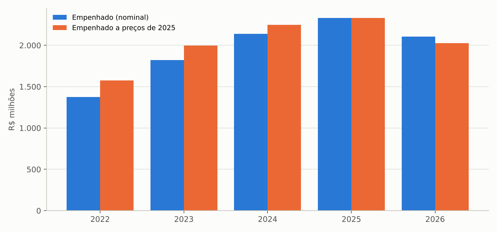

Fonte: SICONFI e IBGE (aba `DESPESA_SAUDE_FUNCAO10_AP`).

Figura: Participação da saúde na despesa total e na receita corrente líquida do Estado, 2022–2026 (2026 parcial)

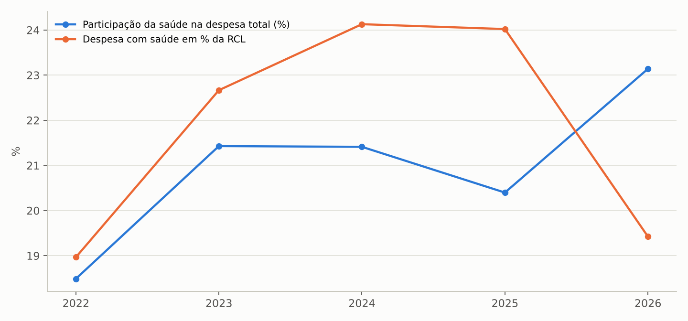

Fonte: SICONFI, RREO Anexos 02 e 03 (aba `DESPESA_SAUDE_FUNCAO10_AP`).

## 4.2 Em que a despesa é classificada

A leitura por subfunção revela o principal problema de transparência do gasto estadual em saúde: quase metade da despesa (R$ 1.130 milhões em 2025, 48,5%) é lançada na subfunção 122, Administração Geral, e não nas subfunções finalísticas. A assistência hospitalar e ambulatorial (subfunção 302) recebe 42,3% (R$ 986 milhões), o suporte profilático e terapêutico (medicamentos e insumos) 2,4% e as vigilâncias menos de 0,2%. A atenção básica estadual aparece com R$ 22 milhões em 2023, zero em 2024 e 2025 e R$ 14 milhões em 2026. Em 2024 surgiram R$ 245 milhões em "demais subfunções", provavelmente encargos e outras classificações atípicas.

Tabela: Despesa empenhada na função Saúde por subfunção, Estado do Amapá, 2022–2026 (R$ milhões)

| Subfunção | 2022 | 2023 | 2024 | 2025 | 2026* | Part. 2025 (%) |
|---|---:|---:|---:|---:|---:|---:|
| Administração Geral (122) | 756,8 | 1.061 | 1.143 | 1.130 | 1.057 | 48,5 |
| Assistência Hospitalar e Ambulatorial (302) | 602,3 | 734,6 | 691,4 | 985,9 | 806,4 | 42,3 |
| Demais subfunções | 0,2 | 0,6 | 245,0 | 155,8 | 153,8 | 6,7 |
| Suporte Profilático e Terapêutico (303) | 0,0 | 0,0 | 59,3 | 56,6 | 62,6 | 2,4 |
| Vigilância Epidemiológica (305) | 6,4 | 3,5 | 0,8 | 2,7 | 10,8 | 0,1 |
| Atenção Básica (301) | 7,8 | 22,2 | 0,0 | 0,0 | 14,1 | 0,0 |
| Vigilância Sanitária (304) | 0,4 | 0,5 | 0,9 | 0,7 | 1,4 | 0,0 |
| Total função Saúde | 1.374 | 1.823 | 2.141 | 2.331 | 2.106 | 100,0 |

\* até o 4º bimestre. Fonte: SICONFI, RREO Anexo 02 (aba `SAUDE_SUBFUNCAO_AP`).

Figura: Composição da despesa na função Saúde por subfunção, Estado do Amapá, 2022–2026 (2026 parcial)

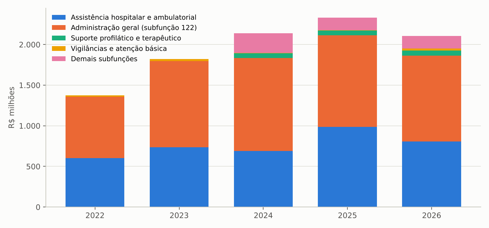

Fonte: SICONFI, RREO Anexo 02 (aba `SAUDE_SUBFUNCAO_AP`).

A prática de concentrar pessoal e manutenção dos hospitais na Administração Geral é comum entre estados, mas no Amapá ela atinge metade do orçamento e torna impossível saber, pelos demonstrativos fiscais, quanto custa cada hospital, a atenção especializada, a regulação ou a assistência farmacêutica. O Manual de Demonstrativos Fiscais da STN (BRASIL, 2023) e a Portaria de Consolidação GM/MS nº 6/2017 orientam a classificação pela finalidade da despesa; a reclassificação é uma medida de gestão sem custo fiscal e com alto retorno em transparência.

# 5. O mínimo constitucional em ações e serviços públicos de saúde

## 5.1 Base de cálculo

A base de cálculo do mínimo (receita de impostos mais transferências constitucionais e legais, deduzidas as parcelas repassadas aos municípios) cresceu de R$ 7,0 bilhões em 2022 para R$ 8,9 bilhões em 2025. O FPE (R$ 6,7 bilhões em 2025) representa 76% da base; o ICMS, R$ 1,7 bilhão; o IRRF retido dos servidores, R$ 778 milhões; o IPVA, R$ 149 milhões. Em 2026, até agosto, a base somava R$ 6,7 bilhões, com o FPE 5% abaixo do previsto em 2025, o que pressiona o mínimo e o financiamento da saúde no último quadrimestre.

Tabela: Base de cálculo do mínimo em saúde, Estado do Amapá, 2022–2026 (receita realizada, R$ milhões)

| Exercício | Receita de impostos (I) | ICMS | IRRF | IPVA | Transf. constitucionais (II) | Cota-parte FPE | (-) Deduções a municípios (III) | Base (IV) |
|---|---:|---:|---:|---:|---:|---:|---:|---:|
| 2022 | 1.817 | 1.353 | 346,6 | 114,1 | 5.588 | 5.577 | 397,9 | 7.007 |
| 2023 | 2.093 | 1.406 | 550,2 | 133,2 | 5.816 | 5.809 | 411,2 | 7.498 |
| 2024 | 2.356 | 1.517 | 711,1 | 124,0 | 6.563 | 6.558 | 442,6 | 8.476 |
| 2025 | 2.633 | 1.703 | 777,9 | 148,7 | 6.719 | 6.716 | 500,8 | 8.851 |
| 2026* | 1.834 | 1.187 | 515,6 | 128,5 | 5.244 | 5.242 | 361,4 | 6.716 |

\* até o 4º bimestre. Fonte: SIOPS, RREO Anexo 12 (BRASIL, 2026) (aba `SIOPS_RECEITA_BASE_AP`).

## 5.2 Apuração do mínimo e esforço próprio

A Constituição do Estado do Amapá fixa em 15% o mínimo da receita de impostos e transferências a ser aplicado em saúde, acima dos 12% da LC 141/2012. O Estado cumpriu o mínimo em todos os anos: 15,39% em 2022 (margem de apenas R$ 28 milhões), 19,38% em 2023, 17,58% em 2024 e 16,80% em 2025. Em 2026, até o 4º bimestre, o percentual pela despesa liquidada era de 15,3%, o menor da série.

O dado mais relevante para a transição é a estagnação da despesa própria: as ASPS empenhadas foram de R$ 1.454 milhões em 2023, R$ 1.490 milhões em 2024 e R$ 1.487 milhões em 2025, enquanto a base cresceu 18%. Em termos reais, a despesa própria caiu cerca de 7% entre 2023 e 2025. Todo o crescimento da despesa total com saúde no período veio de recursos transferidos pela União (seção 6). A margem acima do mínimo estadual recuou de R$ 329 milhões (2023) para R$ 160 milhões (2025); em relação ao piso federal de 12%, a margem é de R$ 425 milhões.

Tabela: Apuração do cumprimento do mínimo em ASPS, Estado do Amapá, 2022–2026 (R$ milhões)

| Exercício | Base (IV) | ASPS empenhadas | ASPS liquidadas | Mínimo 15% (CE) | Mínimo 12% (LC 141) | Acima do mínimo estadual | % aplicado (emp.) | % aplicado (liq.) |
|---|---:|---:|---:|---:|---:|---:|---:|---:|
| 2022 | 7.007 | 1.079 | 1.036 | 1.051 | 840,8 | 27,8 | 15,39 | 14,78 |
| 2023 | 7.498 | 1.454 | 1.438 | 1.125 | 899,7 | 329,1 | 19,38 | 19,17 |
| 2024 | 8.476 | 1.490 | 1.466 | 1.271 | 1.017 | 219,1 | 17,58 | 17,30 |
| 2025 | 8.851 | 1.487 | 1.477 | 1.328 | 1.062 | 159,6 | 16,80 | 16,69 |
| 2026* | 6.716 | 1.361 | 1.030 | 1.007 | 806,0 | 353,5 | 20,26 | 15,34 |

\* até o 4º bimestre; nos cinco primeiros bimestres o acompanhamento é feito pela despesa liquidada. CE = Constituição Estadual. Fonte: SIOPS, RREO Anexo 12 (aba `SIOPS_ASPS_APURACAO_AP`).

Figura: Percentual da receita de impostos e transferências aplicado em ASPS, Estado do Amapá, 2022–2026 (2026 pela despesa liquidada, 4º bimestre)

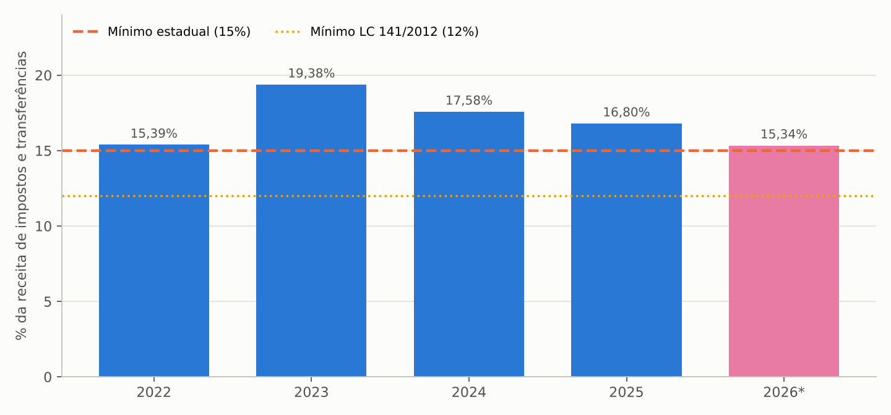

Fonte: SIOPS, RREO Anexo 12 (aba `SIOPS_ASPS_APURACAO_AP`).

Dentro das ASPS, o problema de classificação se repete: R$ 1.195 milhões (80%) estão em "outras subfunções" (Administração Geral) e R$ 291 milhões em assistência hospitalar e ambulatorial; a atenção básica, as vigilâncias e o suporte profilático com recursos próprios aparecem zerados em 2024 e 2025, embora o Estado mantenha vigilância epidemiológica, laboratório central e assistência farmacêutica especializada (aba `SIOPS_ASPS_SUBFUNCAO_AP`).

## 5.3 Restos a pagar de ASPS

A LC 141/2012 exige o controle dos restos a pagar de ASPS por exercício do empenho, pois cancelamentos reduzem o valor considerado para o mínimo. Na posição do RREO de 2026, os empenhos de 2022 inscritos em restos a pagar (R$ 172 milhões) tinham R$ 42 milhões pagos, R$ 110 milhões ainda a pagar e R$ 21 milhões cancelados; os de 2021 (R$ 208 milhões) tiveram R$ 97 milhões cancelados. A partir de 2023 a inscrição caiu (R$ 82, 24 e 15 milhões) e o pagamento foi quase integral, o que indica saneamento do passivo, mas o estoque de 2022 a pagar merece conferência contábil: parte pode corresponder a empenhos sem respaldo que deveriam ser cancelados e compensados.

Tabela: Controle dos restos a pagar de ASPS por exercício do empenho, Estado do Amapá (posição de 2026, 4º bimestre; R$ milhões)

| Exercício do empenho | Mínimo | Aplicado | Acima do mínimo | RP inscritos | RP pagos | RP a pagar | RP cancelados |
|---|---:|---:|---:|---:|---:|---:|---:|
| 2025 | 1.328 | 1.487 | 159,6 | 15,5 | 7,8 | 7,7 | 0,0 |
| 2024 | 1.271 | 1.490 | 219,1 | 24,4 | 16,5 | 0,5 | 7,4 |
| 2023 | 1.125 | 1.454 | 329,1 | 81,5 | 72,4 | 0,6 | 8,6 |
| 2022 | 1.051 | 1.079 | 27,8 | 172,4 | 41,9 | 110,0 | 20,5 |
| 2021 | 880,4 | 1.042 | 161,5 | 208,1 | 54,0 | 57,1 | 96,9 |

Fonte: SIOPS, RREO Anexo 12, quadro de controle dos restos a pagar (aba `RESTOS_A_PAGAR_ASPS_AP`).

# 6. Fontes de financiamento e transferências da União

## 6.1 Recursos próprios e recursos transferidos

A despesa total com saúde do Estado (recursos próprios mais transferidos) foi de R$ 2.330 milhões em 2025. Os recursos transferidos de outros entes financiaram R$ 786 milhões (33,7%), contra R$ 295 milhões (21,5%) em 2022. As transferências da União para a saúde efetivamente recebidas passaram de R$ 214 milhões para R$ 838 milhões, multiplicando-se por 3,9 em três anos, e em 2026 somavam R$ 653 milhões até agosto (R$ 806 por habitante). A diferença entre o previsto e o realizado foi grande em 2022 e 2023 (63% e 71% de realização) e desapareceu em 2025 (98%).

Tabela: Despesa total com saúde por fonte e transferências da União, Estado do Amapá, 2022–2026 (R$ milhões)

| Exercício | Despesa total (emp.) | Com recursos próprios | Com recursos transferidos | Part. transferidos (%) | Transf. da União recebidas | Transf. da União previstas | Transf. União per capita (R$) |
|---|---:|---:|---:|---:|---:|---:|---:|
| 2022 | 1.374 | 1.079 | 295,2 | 21,5 | 213,9 | 338,8 | 266 |
| 2023 | 1.785 | 1.471 | 314,3 | 17,6 | 408,3 | 572,4 | 509 |
| 2024 | 2.141 | 1.514 | 626,5 | 29,3 | 556,1 | 695,2 | 693 |
| 2025 | 2.330 | 1.544 | 785,8 | 33,7 | 837,7 | 854,2 | 1.039 |
| 2026* | 2.106 | 1.434 | 672,2 | 31,9 | 652,6 | 728,6 | 806 |

\* até o 4º bimestre. Fonte: SIOPS, RREO Anexo 12 (aba `SIOPS_DESPESA_TOTAL_FONTES_AP`).

Figura: Despesa total com saúde do Estado por fonte de recursos, 2022–2026 (2026 parcial)

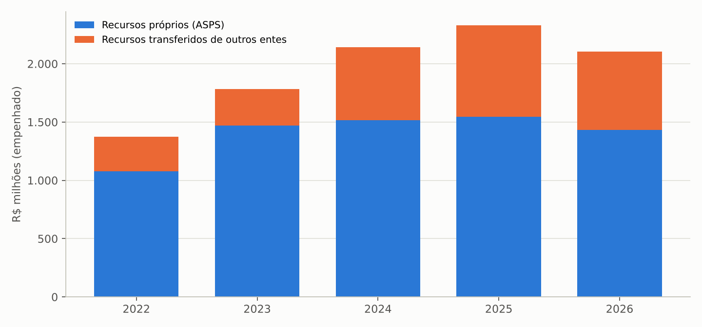

Fonte: SIOPS, RREO Anexo 12 (aba `SIOPS_DESPESA_TOTAL_FONTES_AP`).

As despesas com recursos transferidos concentram-se na assistência hospitalar e ambulatorial (R$ 694 milhões em 2025) e no suporte profilático (R$ 55 milhões, a assistência farmacêutica), com R$ 91 milhões em outras subfunções (aba `SIOPS_NAO_COMPUTADAS_SUBFUNCAO_AP`). O indicador SIOPS 1.3 mostra que as transferências do SUS passaram de 3,7% para 11,1% de tudo o que a União transfere ao Estado.

## 6.2 Composição da despesa segundo o SIOPS

Os indicadores do SIOPS revelam uma mudança estrutural no padrão de gasto. A participação de pessoal na despesa total com saúde caiu de 49,8% (2022) para 44,3% (2025 e 2026), e a de serviços de terceiros pessoa jurídica de 27,1% para 20,9%. Em contrapartida, as despesas com instituições privadas sem fins lucrativos saltaram de 4,9% em 2024 para 18,3% em 2025 (cerca de R$ 425 milhões), o que corresponde à entrada de organizações sociais ou filantrópicas na gestão de unidades. Os investimentos oscilaram entre 3% e 8,4% e caíram a 2,0% em 2026. A despesa com medicamentos é informada como zero desde 2023, o que é incompatível com os R$ 55 a 60 milhões anuais de suporte profilático e com a assistência farmacêutica especializada do Estado: trata-se de erro de preenchimento que distorce o indicador nacional e deve ser corrigido.

Tabela: Indicadores SIOPS do Estado do Amapá, 2022–2026

| Indicador | 2022 | 2023 | 2024 | 2025 | 2026 (4º bim.) |
|---|---:|---:|---:|---:|---:|
| 2.1 Despesa total com saúde por habitante (R$) | 1.566 | 2.034 | 2.666 | 2.889 | 1.940 |
| 2.2 Pessoal na despesa com saúde (%) | 49,8 | 55,3 | 47,8 | 44,3 | 44,3 |
| 2.3 Medicamentos (%) | 0,2 | 0,0 | 0,0 | 0,0 | 0,0 |
| 2.4 Serviços de terceiros – pessoa jurídica (%) | 27,1 | 24,4 | 25,1 | 20,9 | 22,6 |
| 2.5 Investimentos (%) | 4,1 | 3,0 | 8,4 | 4,8 | 2,0 |
| 2.6 Instituições privadas sem fins lucrativos (%) | 3,7 | 3,8 | 4,9 | 18,3 | 17,3 |
| 3.1 Transferências na despesa total com saúde (%) | 15,5 | 22,9 | 26,0 | 36,0 | 41,8 |
| 3.2 Receita própria aplicada em ASPS (%) | 15,4 | 19,4 | 17,6 | 16,8 | 15,3 |

Fonte: SIOPS, indicadores da situação de entrega (aba `SIOPS_INDICADORES_AP`).

Figura: Composição da despesa com saúde do Estado segundo o SIOPS, 2022–2026

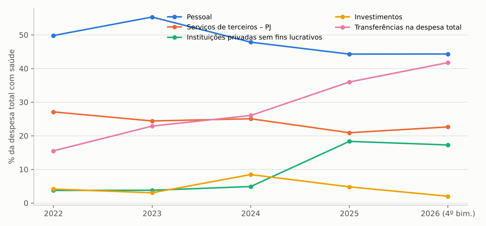

Fonte: SIOPS (aba `SIOPS_INDICADORES_AP`).

## 6.3 Produção faturada no SUS

O valor aprovado da produção registrada no SIH e no SIA, referência para o financiamento federal da média e alta complexidade, foi de R$ 203 milhões em 2025 (SIH R$ 54 milhões; SIA R$ 149 milhões), R$ 252 por habitante. O crescimento de 80% desde 2022 veio sobretudo do FAEC (R$ 19 milhões para R$ 57 milhões, com as trombectomias e procedimentos vasculares analisados no estudo geral) e da média complexidade ambulatorial. Ainda assim, em 2024 o Amapá faturou R$ 216 por habitante contra R$ 260 no Brasil (18ª posição), e o valor da produção equivale a cerca de um quarto das transferências federais recebidas pelo Estado e a menos de um décimo do gasto público estadual e municipal: o SUS amapaense é financiado por tetos e emendas, não pela produção que registra.

Tabela: Valor aprovado da produção SIH e SIA no Amapá por tipo de financiamento, 2022–2026 (R$ milhões)

| Ano | SIH – MAC | SIH – FAEC | SIH total | SIA – MAC | SIA – FAEC | SIA total | SIH+SIA | Per capita (R$) |
|---|---:|---:|---:|---:|---:|---:|---:|---:|
| 2022 | 35,0 | 0,9 | 35,9 | 57,8 | 18,2 | 77,0 | 112,9 | 141 |
| 2023 | 45,5 | 2,0 | 47,5 | 75,9 | 24,8 | 101,4 | 149,0 | 186 |
| 2024 | 46,5 | 3,3 | 49,7 | 85,3 | 36,6 | 123,8 | 173,6 | 216 |
| 2025 | 41,5 | 13,0 | 54,5 | 102,5 | 43,5 | 148,7 | 203,2 | 252 |
| 2026* | 32,7 | 21,7 | 54,4 | 70,1 | 43,6 | 115,5 | 169,9 | 210 |

\* parcial (até agosto/setembro). Fonte: SIH/SUS e SIA/SUS (BRASIL, 2026) (aba `SIH_SIA_VALORES_APROVADOS_AP`).

Figura: Valor aprovado SIH e SIA no Amapá, 2022–2026 (2026 parcial)

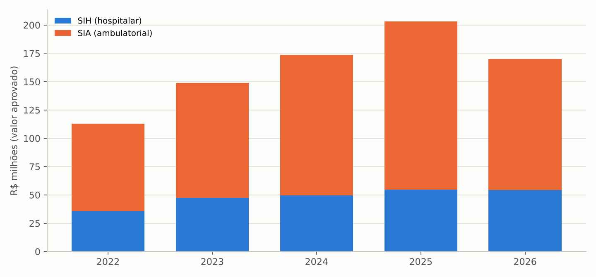

Fonte: SIH/SUS e SIA/SUS (aba `SIH_SIA_VALORES_APROVADOS_AP`).

# 7. Investimentos e execução das despesas de capital

As despesas de capital em saúde (obras, equipamentos e outras inversões, somadas as seções de recursos próprios e transferidos do Anexo 12) tiveram dotação atualizada de R$ 260 milhões em 2024 e R$ 233 milhões em 2025, mas liquidaram apenas R$ 57 milhões (22%) e R$ 74 milhões (32%). Em 2024, R$ 181 milhões foram empenhados e R$ 124 milhões inscritos em restos a pagar não processados; em 2026, até agosto, R$ 147 milhões empenhados contra R$ 31 milhões liquidados (18%). O componente mais afetado é o capital em assistência hospitalar com recursos transferidos: R$ 152 milhões empenhados e R$ 33 milhões liquidados em 2024; R$ 131 milhões empenhados e R$ 21 milhões liquidados em 2026. Trata-se do padrão clássico de obras hospitalares e aquisições de equipamentos financiadas por emendas e convênios que não avançam no ritmo do empenho.

Tabela: Despesas de capital em saúde do Estado do Amapá, 2022–2026 (R$ milhões)

| Exercício | Dotação atualizada | Empenhado | Liquidado | Pago | RPNP inscritos | Liquidado/dotação (%) | Capital em AHA transferido – emp. | Idem – liq. |
|---|---:|---:|---:|---:|---:|---:|---:|---:|
| 2022 | 90,0 | 56,8 | 36,5 | 30,2 | 20,3 | 40,6 | 0,2 | 0,1 |
| 2023 | 222,9 | 54,1 | 36,9 | 33,2 | 17,2 | 16,5 | 20,0 | 8,4 |
| 2024 | 259,5 | 181,0 | 57,0 | 57,0 | 124,0 | 22,0 | 151,7 | 32,5 |
| 2025 | 233,1 | 111,9 | 73,8 | 70,9 | 38,1 | 31,6 | 87,3 | 53,3 |
| 2026* | 172,8 | 147,4 | 31,3 | 30,8 | 116,1 | 18,1 | 130,5 | 20,5 |

\* até o 4º bimestre. Fonte: SIOPS, RREO Anexo 12 (aba `INVESTIMENTOS_CAPITAL_SAUDE_AP`).

Figura: Despesas de capital em saúde: dotação, empenho e liquidação, Estado do Amapá, 2022–2026 (2026 parcial)

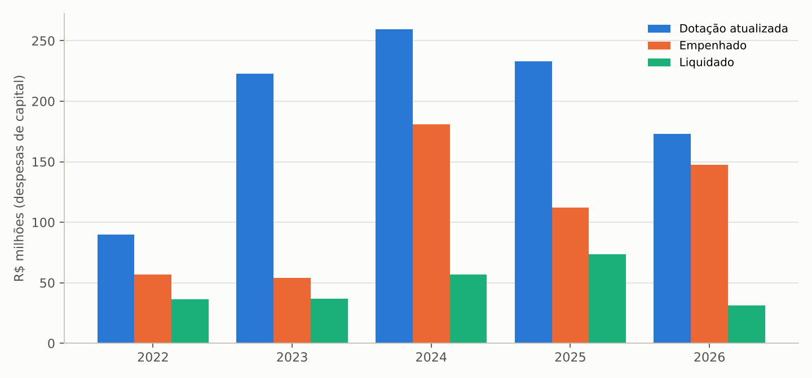

Fonte: SIOPS, RREO Anexo 12 (aba `INVESTIMENTOS_CAPITAL_SAUDE_AP`).

A transição deve receber a carteira de obras e aquisições com a situação física e financeira de cada item, inclusive os recursos de emendas e convênios depositados nas contas do Fundo Estadual de Saúde e ainda não executados, que estão sujeitos a prazos de aplicação e a devolução.

# 8. Emendas parlamentares federais

## 8.1 Volume e evolução

Entre 2022 e 2026 foram empenhados R$ 1.797 milhões em emendas parlamentares federais da função Saúde com aplicação no Amapá, com R$ 1.422 milhões já pagos. O valor anual mais que triplicou: R$ 170 milhões em 2022, R$ 267 milhões em 2023, R$ 316 milhões em 2024, R$ 606 milhões em 2025 e R$ 438 milhões em 2026 até a extração. As emendas individuais somaram R$ 951 milhões (53%) e as de bancada R$ 846 milhões (47%), estas concentradas em 2025 e 2026 (R$ 358 e R$ 242 milhões). Em 2025 as emendas equivaleram a R$ 751 por habitante e a 39% de todas as transferências da União para a saúde recebidas pelo Estado e pelos municípios, o que indica que o salto das transferências descrito na seção 6 é, em grande medida, efeito das emendas.

Tabela: Emendas parlamentares federais em saúde destinadas ao Amapá, por ano da emenda, 2022–2026 (R$ milhões)

| Ano da emenda | Empenhado | Liquidado | Pago | RP inscritos | RP pagos | Per capita (R$) |
|---|---:|---:|---:|---:|---:|---:|
| 2022 | 169,9 | 115,5 | 115,5 | 79,8 | 28,9 | 212 |
| 2023 | 267,3 | 203,7 | 203,7 | 40,3 | 22,3 | 333 |
| 2024 | 316,2 | 246,0 | 246,0 | 93,8 | 46,6 | 394 |
| 2025 | 605,6 | 469,8 | 469,8 | 46,1 | 89,7 | 751 |
| 2026* | 438,1 | 386,7 | 386,5 | 0,0 | 0,0 | 541 |
| Total | 1.797 | 1.422 | 1.422 | 259,9 | 187,6 | – |

\* até a extração (7 nov. 2026). Fonte: Portal da Transparência/CGU (BRASIL, 2026) (aba `EMENDAS_SAUDE_AP_ANO`).

Figura: Emendas parlamentares em saúde para o Amapá por tipo e ano (empenhado), 2022–2026

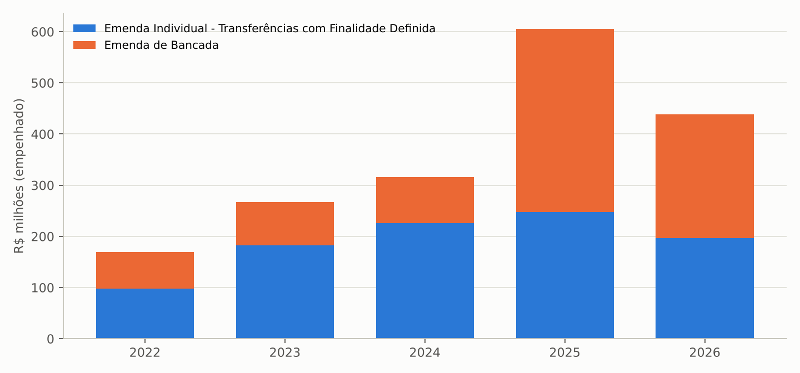

Fonte: CGU (aba `EMENDAS_TIPO_ANO`).

## 8.2 Destinação

Quase quatro quintos do valor (R$ 1.424 milhões; 79%) foram para "incremento temporário ao custeio" de serviços, R$ 897 milhões para a assistência hospitalar e ambulatorial e R$ 527 milhões para a atenção primária; apenas R$ 249 milhões (14%) foram para estruturação de unidades (atenção primária R$ 144 milhões; atenção especializada R$ 105 milhões). Por localidade, R$ 1.205 milhões (67%) foram classificados como "múltiplo" (vários municípios ou Estado e municípios), R$ 408 milhões de aplicação estadual e R$ 106 milhões para Macapá. A dependência de custeio por emenda é um risco fiscal relevante: o "incremento temporário" não integra o teto MAC nem o piso da atenção primária, não tem garantia de continuidade e, pela regra do Ministério da Saúde, não pode financiar pessoal permanente.

Tabela: Emendas parlamentares em saúde para o Amapá por ação orçamentária, 2022–2026 (empenhado, R$ milhões)

| Ação orçamentária | 2022 | 2023 | 2024 | 2025 | 2026 | Total |
|---|---:|---:|---:|---:|---:|---:|
| Incremento temporário ao custeio – assistência hospitalar e ambulatorial | 58,6 | 100,6 | 176,7 | 363,1 | 198,1 | 897,0 |
| Incremento temporário ao custeio – atenção primária | 48,1 | 35,8 | 78,2 | 167,2 | 197,3 | 526,6 |
| Estruturação da rede de atenção primária | 30,3 | 49,3 | 17,6 | 25,2 | 21,9 | 144,4 |
| Estruturação de unidades de atenção especializada | 29,1 | 16,9 | 25,0 | 27,5 | 6,6 | 105,1 |
| Múltiplo | 0,0 | 63,8 | 7,8 | 0,0 | 0,0 | 71,6 |
| Saúde indígena | 0,7 | 1,0 | 3,4 | 9,2 | 7,2 | 21,6 |
| Vigilância em saúde e ambiente | 0,5 | 0,0 | 7,5 | 5,8 | 6,0 | 19,8 |
| Saúde digital e telessaúde | 0,0 | 0,0 | 0,0 | 7,1 | 0,0 | 7,1 |

Fonte: CGU (aba `EMENDAS_ACAO`).

Os autores concentram-se na bancada do Amapá (R$ 846 milhões em emendas de bancada) e nos três senadores (Davi Alcolumbre R$ 146 milhões; Randolfe Rodrigues R$ 130 milhões; Lucas Barreto R$ 118 milhões), seguidos dos deputados federais (aba `EMENDAS_AUTOR`). Entre os favorecidos finais dos pagamentos, o Fundo Estadual de Saúde recebeu R$ 470 milhões (29%), o Fundo Municipal de Saúde de Macapá R$ 221 milhões (14%) e os demais fundos municipais entre R$ 7 e 58 milhões; R$ 566 milhões (35%) aparecem como pagos ao Banco do Brasil, agente financeiro das transferências fundo a fundo (aba `EMENDAS_FAVORECIDOS`). Os convênios vinculados a emendas incluem a construção de unidade de atenção especializada em Macapá (R$ 74,5 milhões, convênio 925155, de 2022, reforçado por emendas de 2025) e o Centro de Especialidades Odontológicas estadual (R$ 10 milhões) (aba `EMENDAS_CONVENIOS`).

## 8.3 Comparação com os demais estados

O Amapá é, com folga, o estado que mais recebe emendas federais de saúde por habitante: R$ 2.228 em 2022–2026, contra R$ 1.421 em Roraima, R$ 1.149 no Acre, R$ 1.012 no Tocantins e R$ 179 em São Paulo. Em 2025 foram R$ 751 por habitante, mais que o dobro do segundo colocado (Roraima, R$ 347). A pequena população e a representação parlamentar fixa explicam a vantagem; a contrapartida é a volatilidade: uma mudança na regra das emendas ou na composição da bancada afeta de imediato o custeio dos hospitais estaduais e das equipes municipais.

Figura: Emendas parlamentares federais em saúde empenhadas por habitante, por UF de aplicação, 2022–2026

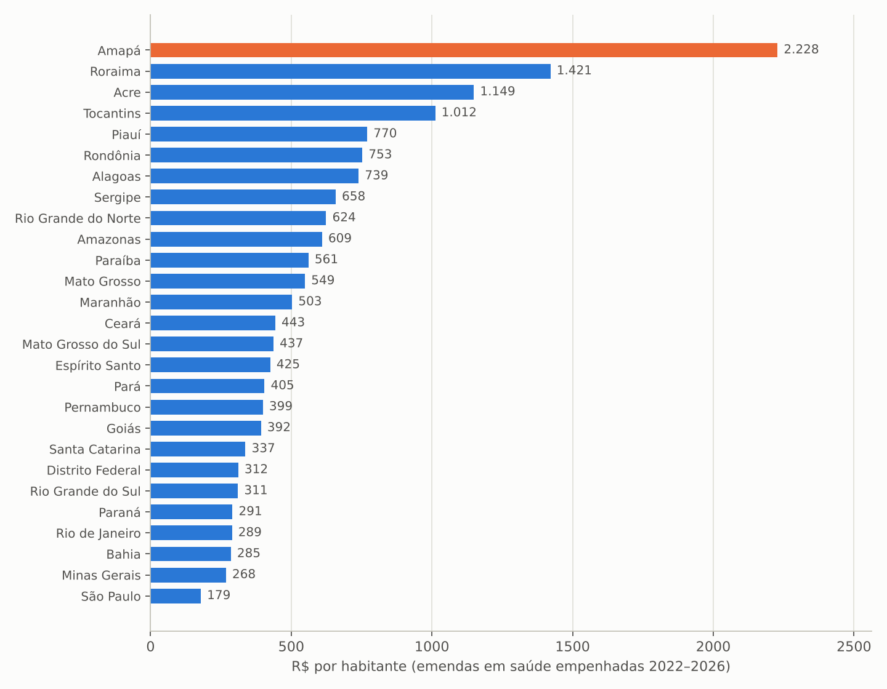

Fonte: CGU e IBGE (aba `BENCH_UF_EMENDAS_SAUDE`).

# 9. Municípios e gasto público consolidado

## 9.1 Despesa municipal

Os 16 municípios empenharam R$ 841 milhões na função Saúde em 2025 segundo a DCA (R$ 944 milhões no Anexo 12 do SIOPS, que inclui todas as fontes), 80% acima de 2022. Macapá responde por 57% (R$ 538 milhões; R$ 1.124 por habitante) e Santana por 12% (R$ 109 milhões; R$ 948 por habitante). Os municípios pequenos gastam muito mais por habitante (Tartarugalzinho R$ 2.324; Itaubal R$ 2.266; Pedra Branca do Amapari R$ 2.200), efeito da escala mínima dos serviços e das transferências federais per capita elevadas. Oiapoque tem o menor gasto por habitante (R$ 835). Laranjal do Jari não entregou a DCA de 2025 e o município de Amapá não entregou as de 2023 a 2025, lacunas que a transição deve registrar junto ao Tribunal de Contas.

Tabela: Financiamento da saúde nos municípios do Amapá, 2025 (RREO Anexo 12/SIOPS; R$ milhões)

| Município | Base de cálculo | ASPS próprias | % aplicado | Transf. da União | Despesa total | Per capita (R$) | União/despesa (%) | Atenção básica (%) |
|---|---:|---:|---:|---:|---:|---:|---:|---:|
| Macapá | 1.118 | 183,0 | 16,4 | 308,5 | 537,8 | 1.124 | 57,4 | 57,1 |
| Santana | 177,6 | 28,1 | 15,4 | 108,9 | 109,0 | 948 | 99,9 | 69,3 |
| Laranjal do Jari | 73,2 | 11,4 | 15,1 | 53,5 | 56,6 | 1.616 | 94,4 | 65,5 |
| Porto Grande | 36,3 | 9,1 | 25,0 | 25,3 | 34,7 | 1.935 | 72,8 | 41,7 |
| Mazagão | 36,4 | 5,7 | 15,5 | 56,6 | 29,1 | 1.316 | 194,4 | 76,9 |
| Pedra Branca do Amapari | 42,7 | 10,6 | 24,8 | 23,2 | 27,2 | 2.200 | 85,2 | 90,1 |
| Tartarugalzinho | 26,6 | 6,9 | 25,7 | 27,6 | 24,4 | 2.324 | 113,0 | 65,1 |
| Oiapoque | 48,3 | 7,4 | 15,3 | 15,9 | 23,2 | 835 | 68,4 | 76,7 |
| Calçoene | 23,5 | 5,6 | 23,6 | 12,9 | 19,4 | 1.831 | 66,4 | 91,5 |
| Vitória do Jari | 21,5 | 3,5 | 16,3 | 16,1 | 19,1 | 1.671 | 84,1 | 95,4 |
| Ferreira Gomes | 61,9 | 9,9 | 16,0 | 10,2 | 14,3 | 2.142 | 71,5 | 85,4 |
| Amapá (município) | 17,5 | 2,7 | 15,3 | 9,1 | 13,1 | 1.550 | 69,4 | 98,5 |
| Itaubal | 17,6 | 3,3 | 18,6 | 10,3 | 12,4 | 2.266 | 82,8 | 76,3 |
| Serra do Navio | 14,9 | 3,6 | 23,3 | 7,5 | 9,7 | 2.037 | 77,9 | 87,4 |
| Cutias | 14,5 | 3,4 | 23,3 | 11,6 | 7,6 | 1.728 | 152,4 | 86,6 |
| Pracuúba | 15,7 | 2,4 | 15,4 | 6,2 | 6,8 | 1.779 | 91,8 | 82,9 |

Fonte: SIOPS, RREO Anexo 12 dos municípios; população SICONFI/IBGE (aba `MUNICIPIOS_SIOPS_ANEXO12_2025`). Quando as transferências superam a despesa (Mazagão, Cutias, Tartarugalzinho), há recursos recebidos e não executados no exercício ou inconsistência de registro.

Figura: Despesa total com saúde por habitante nos municípios do Amapá, 2025

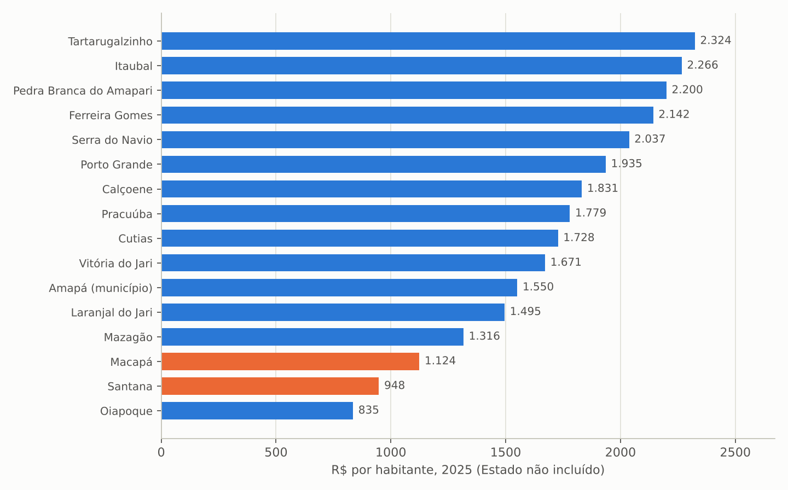

Fonte: SIOPS e SICONFI (aba `MUNICIPIOS_SIOPS_ANEXO12_2025`).

Todos os municípios cumpriram o mínimo de 15% em 2022–2025, vários com folga (Tartarugalzinho, Porto Grande, Pedra Branca, Calçoene e Serra do Navio acima de 23% em 2025). Em 2026, até o bimestre homologado, Santana (13,9%) e Pracuúba (11,4%) estavam abaixo do mínimo pela despesa liquidada e Laranjal do Jari não havia transmitido despesa própria, situações que costumam se regularizar no fechamento, mas que merecem acompanhamento (aba `MUNICIPIOS_PCT_APLICADO_SERIE`). A dependência de transferências é a marca do financiamento municipal: em nove municípios as transferências da União superam 80% da despesa com saúde, e em Santana equivalem a 100%.

## 9.2 Gasto público consolidado

Somando o Estado e os 16 municípios, e deduzindo as transferências estaduais aos municípios (R$ 21 milhões em 2025), o gasto público em saúde no Amapá passou de R$ 1,9 bilhão (2022) para R$ 3,25 bilhões (2025), ou de R$ 2.367 para R$ 4.034 por habitante. As transferências da União recebidas pelos dois níveis somaram R$ 1,54 bilhão em 2025, 47% do total. Em 2022, ano com PIB estadual disponível (R$ 23,6 bilhões), o gasto estadual e municipal equivalia a 8,0% do PIB, proporção muito superior à média nacional do gasto público em saúde (cerca de 4% do PIB), outro reflexo da economia pequena e dependente de transferências.

Tabela: Gasto público em saúde no Amapá, Estado e municípios, 2022–2025 (R$ milhões)

| Exercício | Estado | Municípios | (-) Transf. do Estado aos municípios | Gasto consolidado | Per capita (R$) | Transf. da União recebidas | Part. União (%) |
|---|---:|---:|---:|---:|---:|---:|---:|
| 2022 | 1.374 | 531,7 | 5,1 | 1.901 | 2.367 | 507,3 | 26,7 |
| 2023 | 1.785 | 692,7 | 8,2 | 2.469 | 3.076 | 1.004 | 40,7 |
| 2024 | 2.141 | 823,3 | 12,8 | 2.951 | 3.676 | 1.032 | 35,0 |
| 2025 | 2.330 | 944,4 | 21,1 | 3.253 | 4.034 | 1.541 | 47,4 |

Fonte: SIOPS, RREO Anexo 12 do Estado e dos municípios (aba `GASTO_PUBLICO_CONSOLIDADO_AP`). Exclui a despesa direta da União no estado.

# 10. Comparação com os demais estados

Em 2025 o Amapá apresentou a maior despesa estadual com saúde por habitante do país (R$ 2.889), seguido de Acre (R$ 2.760), Roraima (R$ 2.355) e Tocantins (R$ 2.165); a mediana dos estados é de cerca de R$ 1.000 e os grandes estados do Sudeste gastam entre R$ 750 e R$ 1.000. O Amapá também lidera as transferências federais per capita (R$ 1.039; Acre R$ 620) e tem a terceira maior dependência de transferências (36%, atrás de Sergipe e Pará). No esforço próprio, porém, o Estado é apenas o sexto (16,8%), atrás de Amazonas (19,9%), Sergipe (17,9%), Roraima (17,6%), Tocantins (17,2%) e Paraíba (16,8%), embora sua base de cálculo per capita (R$ 10.975) seja a terceira maior. A participação da saúde na despesa total (20,4%) é a segunda maior, atrás do Tocantins (21,3%).

Tabela: Despesa com saúde dos estados, 2025 (dez maiores por habitante e referências)

| UF | Função Saúde (R$ mi) | Part. na despesa (%) | Despesa total saúde per capita (R$) | ASPS próprias per capita (R$) | Transf. União per capita (R$) | Transf. União (%) | % aplicado |
|---|---:|---:|---:|---:|---:|---:|---:|
| Amapá | 2.331 | 20,4 | 2.889 | 1.844 | 1.039 | 36,0 | 16,8 |
| Acre | 2.250 | 16,8 | 2.760 | 1.838 | 620 | 22,5 | 15,6 |
| Roraima | 1.679 | 18,4 | 2.355 | 1.987 | 375 | 15,9 | 17,6 |
| Tocantins | 3.994 | 21,3 | 2.165 | 1.595 | 380 | 17,5 | 17,2 |
| Distrito Federal | 6.275 | 14,2 | 1.989 | 1.370 | 479 | 24,1 | 14,6 |
| Rondônia | 2.792 | 15,7 | 1.635 | 1.105 | 260 | 15,9 | 14,3 |
| Sergipe | 3.375 | 18,1 | 1.474 | 1.129 | 334 | 22,7 | 17,9 |
| Mato Grosso | 5.424 | 12,7 | 1.430 | 1.203 | 165 | 11,5 | 16,7 |
| Espírito Santo | 5.667 | 18,2 | 1.384 | 931 | 333 | 24,0 | 16,5 |
| Amazonas | 5.380 | 14,7 | 1.279 | 1.018 | 225 | 17,6 | 19,9 |
| Pará | 6.560 | 12,4 | 765 | 593 | 157 | 20,5 | 14,3 |
| São Paulo | 44.215 | 11,5 | 1.012 | 685 | 172 | 17,0 | 14,2 |
| Minas Gerais | 15.455 | 11,7 | 756 | 551 | 21 | 2,8 | 12,3 |

Fonte: SICONFI (RREO Anexo 02) e SIOPS (RREO Anexo 12); população IBGE 2025 (aba `BENCH_UF_DESPESA_SAUDE_2025`).

Figura: Despesa estadual total com saúde por habitante, por UF, 2025

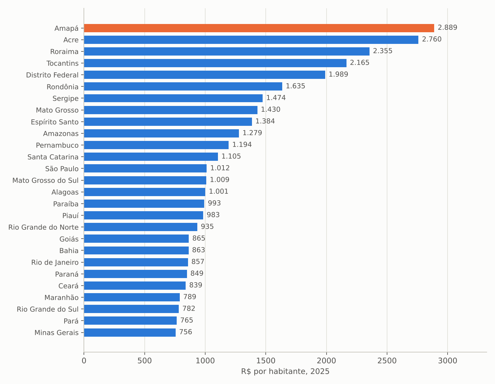

Fonte: SIOPS e IBGE (aba `BENCH_UF_DESPESA_SAUDE_2025`).

Figura: Percentual da receita de impostos e transferências aplicado em ASPS pelos estados, 2025

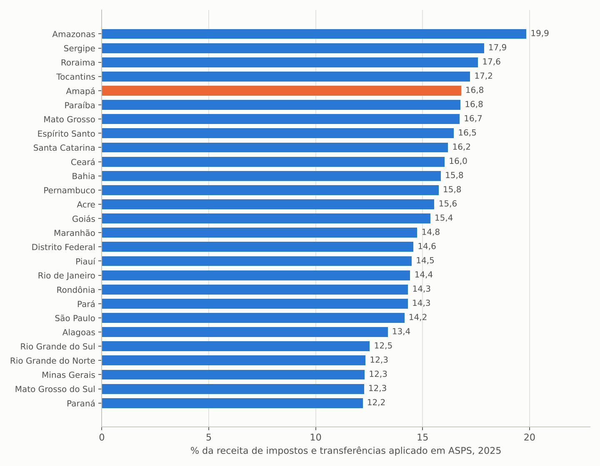

Fonte: SIOPS, RREO Anexo 12 (aba `BENCH_UF_DESPESA_SAUDE_2025`).

Na composição da despesa, o Amapá tem a quarta maior participação de pessoal (44,3%, atrás de Roraima, Tocantins e Rio Grande do Norte), participação média de serviços de terceiros (20,9%) e de instituições privadas sem fins lucrativos (18,3%, semelhante a Amazonas e Pernambuco, mas distante de Goiás, Espírito Santo, Pará e São Paulo, acima de 40%), e investimentos de 4,8% (Mato Grosso 16%; Minas Gerais 9,3%) (aba `BENCH_UF_SIOPS_INDICADORES_2025`). No valor aprovado SIH+SIA por habitante (2024), o Amapá ficou em 18º lugar (R$ 216; Brasil R$ 260; Santa Catarina R$ 356), com produção hospitalar per capita (R$ 62) entre as mais baixas do país e produção ambulatorial (R$ 154) próxima da média (aba `BENCH_UF_SIH_SIA_2024`).

# 11. Pontos de atenção para a transição

**Risco de descumprimento do mínimo em 2026.** O percentual aplicado pela despesa liquidada era de 15,3% em agosto, o menor da série, com o FPE 5% abaixo do previsto. A equipe de transição deve acompanhar o fechamento do 6º bimestre (RREO de janeiro de 2027), verificar se os empenhos de dezembro têm respaldo e lembrar que restos a pagar não processados sem disponibilidade financeira são deduzidos do mínimo.

**Dependência de emendas de custeio.** Cerca de R$ 600 milhões anuais de emendas, três quartos para custeio temporário, sustentam hospitais estaduais e equipes municipais. É preciso mapear que serviços dependem desse recurso, negociar com o Ministério da Saúde a incorporação ao teto MAC e ao piso da atenção primária e construir um plano de contingência para 2027.

**Contratos com entidades privadas sem fins lucrativos.** O salto de 4,9% para 18,3% da despesa em um ano (cerca de R$ 425 milhões) exige inventário dos contratos de gestão e convênios, metas pactuadas, mecanismos de monitoramento e situação de pagamento, como já apontado para o Hospital São Camilo no estudo geral.

**Obras e equipamentos parados.** Mais de R$ 120 milhões em despesas de capital inscritos em restos a pagar em 2024 e execução de 18% em 2026 indicam uma carteira de investimentos travada. Cada obra e cada aquisição devem ter situação física, saldo bancário vinculado e prazo de prestação de contas.

**Restos a pagar de 2022 e passivo com fornecedores.** R$ 110 milhões de ASPS de 2022 ainda a pagar na posição de 2026, além de R$ 541 milhões empenhados e não liquidados em 2026, requerem levantamento do passivo real com fornecedores e prestadores, especialmente do Fundo Estadual de Saúde.

**Qualidade da informação.** Metade da despesa em Administração Geral, medicamentos zerados, atenção básica zerada e divergências entre SICONFI e SIOPS impedem a gestão por custos. A reclassificação das despesas por subfunção e programa, com centros de custo por hospital, é condição para qualquer política de eficiência.

**Municípios.** Santana e Pracuúba abaixo do mínimo pela despesa liquidada em 2026, Laranjal do Jari sem transmissão de despesa própria e falta de DCA em dois municípios indicam a necessidade de apoio técnico da SESA e da Comissão Intergestores Bipartite à gestão financeira municipal.

# 12. Recomendações e agenda dos primeiros 100 dias

**Documentos e dados a requisitar à SESA e à Secretaria de Fazenda:**

1. Balancete do Fundo Estadual de Saúde por fonte de recursos, programa, ação e credor, com saldos bancários vinculados (emendas, convênios, blocos de custeio e investimento) em 31 de dezembro de 2026.
2. Relação de restos a pagar processados e não processados da saúde por exercício, credor e situação, e levantamento do passivo não empenhado com fornecedores e prestadores.
3. Inventário dos contratos de gestão, convênios e termos com organizações sociais e filantrópicas: objeto, valor mensal, metas, relatórios de monitoramento e pagamentos em atraso.
4. Carteira de obras e aquisições de equipamentos com situação física, valor empenhado, liquidado e pago, fonte e prazo de prestação de contas.
5. Lista das emendas parlamentares de 2024 a 2026 por beneficiário, objeto, valor recebido, saldo em conta e prazo de execução, com identificação dos serviços custeados por "incremento temporário".
6. Folha de pessoal da saúde por vínculo (efetivos, temporários, cedidos, terceirizados) e por unidade, para reconstruir o custo por hospital e por nível de atenção.
7. Tetos MAC, pisos da atenção primária e habilitações vigentes, com os pleitos pendentes no Ministério da Saúde.

**Prioridades de gestão sugeridas:**

1. Reclassificar a despesa da saúde por subfunção e programa a partir do orçamento de 2027, com centros de custo por unidade hospitalar, e corrigir os indicadores de medicamentos e atenção básica no SIOPS.
2. Recompor o esforço próprio em patamar estável (meta indicativa de 17% a 18% da base) e proteger o mínimo de 2026 com acompanhamento bimestral.
3. Negociar com o Ministério da Saúde a conversão de emendas de custeio em financiamento permanente (teto MAC, habilitações, piso da atenção primária) e pactuar com a bancada federal um plano plurianual de emendas voltado a investimentos estruturantes.
4. Instituir uma força-tarefa de execução de investimentos, com gestão de contratos de obras e aquisições e metas trimestrais de liquidação.
5. Publicar um painel de execução financeira do Fundo Estadual de Saúde (receita por fonte, despesa por unidade e programa, restos a pagar e prazos de emendas) atualizado mensalmente.
6. Oferecer apoio técnico da SESA aos municípios em gestão financeira, prestação de contas no SIOPS e no SICONFI e uso dos recursos de emendas.

# 13. Considerações finais

O Amapá gasta muito com saúde em termos relativos, mais do que qualquer outro estado por habitante e mais do que com educação, e cumpre o mínimo constitucional. Mas o crescimento recente foi financiado quase inteiramente por transferências federais, em especial emendas de custeio, enquanto o esforço com recursos próprios recuou em termos reais e a execução dos investimentos ficou travada. A combinação de alta dependência, baixa produção faturada, classificação opaca da despesa e expansão acelerada de contratos com entidades privadas define a agenda financeira da transição: conhecer o passivo, proteger o mínimo, converter o dinheiro temporário em financiamento estável e tornar o gasto legível para que as decisões assistenciais dos demais estudos possam ser custeadas com segurança.

# APÊNDICE A – Conteúdo da planilha de tabelas

A planilha `Tabelas_Financiamento_Saude_Amapa_2022_2026.xlsx` contém a aba `Indice` e 33 abas de dados: `CONTEXTO_FISCAL_AP`, `DESPESA_SAUDE_FUNCAO10_AP`, `SAUDE_SUBFUNCAO_AP` e `FUNCOES_2025_AP` (SICONFI, RREO); `SIOPS_RECEITA_BASE_AP`, `SIOPS_ASPS_APURACAO_AP`, `SIOPS_ASPS_SUBFUNCAO_AP`, `SIOPS_NAO_COMPUTADAS_SUBFUNCAO_AP`, `SIOPS_DESPESA_TOTAL_FONTES_AP`, `INVESTIMENTOS_CAPITAL_SAUDE_AP`, `RESTOS_A_PAGAR_ASPS_AP` e `SIOPS_INDICADORES_AP` (SIOPS, Estado); `BENCH_UF_SIOPS_INDICADORES_2024/2025` e `BENCH_UF_DESPESA_SAUDE_2024/2025` (comparação entre estados); `MUNICIPIOS_DESPESA_SAUDE_DCA`, `MUNICIPIOS_SIOPS_ANEXO12_2024/2025/2026_parcial`, `MUNICIPIOS_PCT_APLICADO_SERIE` e `GASTO_PUBLICO_CONSOLIDADO_AP` (municípios); `SIH_SIA_VALORES_APROVADOS_AP` e `BENCH_UF_SIH_SIA_2024` (produção faturada); `EMENDAS_SAUDE_AP_ANO`, `EMENDAS_TIPO_ANO`, `EMENDAS_SUBFUNCAO_ANO`, `EMENDAS_LOCALIDADE_ANO`, `EMENDAS_AUTOR`, `EMENDAS_ACAO`, `EMENDAS_FAVORECIDOS`, `EMENDAS_CONVENIOS` e `BENCH_UF_EMENDAS_SAUDE` (CGU); e `Fontes_Notas`, com endereços e notas metodológicas. Os dados brutos (JSON do SICONFI, HTML do SIOPS e CSV filtrados da CGU) e os scripts de extração e construção (`extract_siconfi.py`, `extract_siops_anexo12.py`, `build_e5.py`) acompanham o repositório do estudo.
